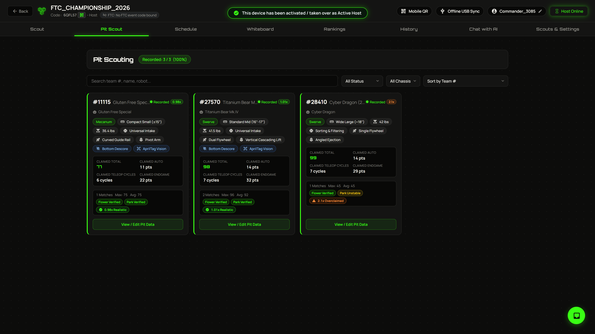
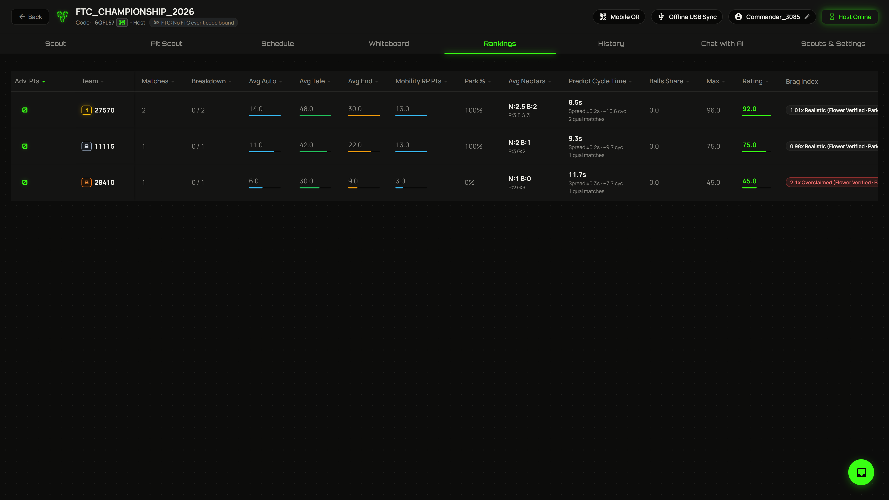
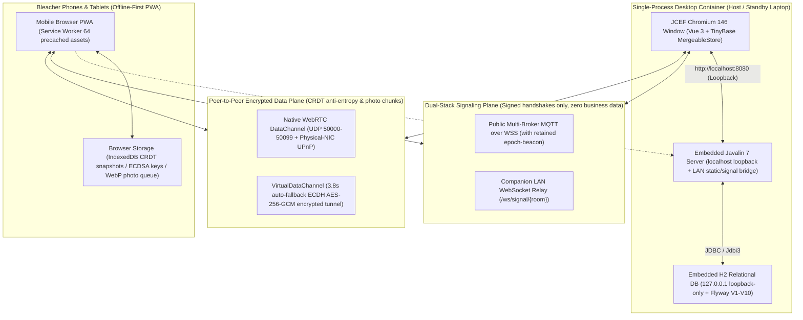

# ScoutingPro27 🚀

<p align="left">
  
  
  
  
  
  
  
  
  
  
</p>

<p align="left">
  <b>Language:</b>
  <a href="README.md"><b>English</b></a> |
  <a href="README_zh.md"><b>简体中文</b></a>
  &nbsp;|&nbsp;
  <b>Standalone User Guides (Illustrated Manuals):</b>
  <a href="docs/USER_GUIDE.md"><b>Bilingual Hub</b></a> ·
  <a href="docs/USER_GUIDE.en.md"><b>English Guide</b></a> ·
  <a href="docs/USER_GUIDE.zh.md"><b>中文教程</b></a> ·
  <a href="docs/README.md"><b>Docs Index</b></a> ·
  <a href="CONTRACT.md"><b>API & Architecture Contract</b></a>
</p>

> **Independently conceived, architected, and full-stack developed by students of FIRST Tech Challenge (FTC) Team 27570 B.E.A.R.**  
> A **Local-First + WebRTC P2P + TinyBase CRDT/HLC collaborative scouting & tactical intelligence platform** built for high-interference, offline/weak-network robotics competition arenas.

---

## 📸 Screenshots

<table>
  <tr>
    <td width="50%" align="center">
      
      <br />
      <sub><b>Pit Scouting &amp; Brag Index Verification</b> — Cell-level CRDT specs, claimed vs. actual consistency audit</sub>
    </td>
    <td width="50%" align="center">
      
      <br />
      <sub><b>Live Rankings Ladder &amp; Telemetry</b> — Predict Cycle Time, Swarm RP Mobility &amp; Rule A215 Advancement</sub>
    </td>
  </tr>
</table>

---

## 📖 Documentation Map

- **For Scouts & Team Leads**: Start with the illustrated guides 👉 **[Bilingual User Guide Hub](docs/USER_GUIDE.md)** · **[English Step-by-Step Guide](docs/USER_GUIDE.en.md)** · **[中文保姆级教程](docs/USER_GUIDE.zh.md)** (includes Windows `.msi` / macOS `.dmg` installation & Gatekeeper bypass in [Chapter 0](docs/USER_GUIDE.en.md#chapter-0-download--install-macos-users-read-this-first); run `npm run export:userguide-pdf` in `frontend/` to generate offline PDFs).
- **For Developers & Contributors**: Full HTTP REST routes, WebSocket signaling, TinyBase 8-table CRDT schema, ECDSA verification, and JCEF desktop bridge specifications live in **[CONTRACT.md](CONTRACT.md)**; QA & release docs live in **[docs/README.md](docs/README.md)**.

---

## 1. Arena Pain Points & Design Positioning

Under 3,000-person congested venue Wi-Fi, strict RF spectrum rules, and cross-carrier NAT isolation, traditional scouting setups routinely fail right before Alliance Selection:

1. **Cloud Spreadsheets (Google Sheets / Feishu / Tencent Docs)**: Depend on centralized internet access — spinning endlessly when offline and prone to accidental whole-row overwrites when multiple scouts edit simultaneously.
2. **Classic Master-Slave LAN Servers / Cloud SaaS**: Suffer from a Single Point of Failure (SPOF) — if the venue internet drops or the lead laptop crashes, every scout's phone immediately halts.
3. **Static Offline QR Workflows (e.g., ScoutingPASS)**: Survive blackouts, but have low manual scanning throughput and cannot share live schedules, Pit photos, team tags, or custom derived metrics in real time.

**ScoutingPro27's Core Design Principle**: **"Every device reads & writes locally at zero latency, merges peer-to-peer over any available path, and survives host failures with split-brain-proof takeover."**

| Dimension | ScoutingPro27 (This Project) | Cloud Spreadsheets | Local Master-Slave LAN | Static Offline QR | Cloud SaaS Sites |
| :--- | :---: | :---: | :---: | :---: | :---: |
| **Core Sync Architecture** | **WebRTC P2P + TinyBase CRDT/HLC** | Centralized cloud doc | Local Server + Hotspot | Manual QR scanning | Centralized cloud CRUD |
| **Cloud Hosting Cost** | **\$0 / yr (No cloud backend needed)** | Requires internet | Dedicated LAN setup | \$0 / yr | Recurring server fees |
| **Blackout Resilience** | **100% Offline + Auto Anti-Entropy Merge** | Spins & fails to save | Fails outside local Wi-Fi | Works, slow manual queue | Total outage offline |
| **Concurrent Team Edits** | **Cell-Level LWW-HLC + Derived Conflict** | Accidental row overwrites | Whole-record overwrite | Manual merge gaps | Last POST wins |
| **Host Crash Recovery** | **`hostEpoch` Fencing + Signed Peer Relay** | Account/net lock halts | Host crash halts team | Master failure = rescan | DB outage halts team |
| **Clock & Zero-Trust** | **3-RTT Crystal Clock + ECDH/SAS + ECDSA** | Leaked link vandalism | Plaintext / basic auth | QR easily photographed | Standard HTTPS + login |
| **Built-In Analytics** | **SP-NP OPR + A215 Adv. + Formula AST + AI** | Raw number grid | External scripts needed | External Tableau needed | Basic averages / OPR |

---

## 2. End-to-End Operating Principles (How It Works)

### 2.1 Process & Network Topology

ScoutingPro27 runs a unified Vue 3 codebase across two node roles: **Desktop Host / Standby Laptops (native installers)** and **Bleacher Mobile Devices (zero-install offline PWA)**.



### 2.2 Desktop `localhost` Boundary vs. LAN Onboarding Listener

1. **Internal Desktop Traffic Uses `localhost` Loopback with Zero WAN Exposure**:
   - Inside the desktop app, JCEF loads `http://localhost:8080/index.html` over local loopback, while the embedded H2 database binds strictly to `127.0.0.1`.
   - `PortForwardingService` **only maps 10 WebRTC UDP ports (`50000-50009/UDP`) on the router and never maps TCP `8080`**. External machines on the Internet cannot reach or interfere with JCEF ↔ Javalin communication.
2. **Why Javalin Also Listens on `::` / `0.0.0.0:8080` on the Local Network**:
   - In a **zero-Internet arena** where a new scout's phone has not yet cached the cloud PWA, the lead can turn on a Windows Mobile Hotspot (`192.168.137.1`) or join a local router: scanning the Host QR code serves the offline PWA bundle directly from `:8080` and connects WebRTC over the companion LAN relay `/ws/signal/{room}`.
   - To keep shared venue Wi-Fi secure, all `/api/*` data routes enforce HMAC-SHA256 JWT + event membership (`isMember`), and host-level system endpoints (such as triggering firewall setup) strictly verify that the underlying socket `remoteAddr` is local loopback (`127.0.0.1` / `::1`).
3. **Zero-Backend Static Cloud PWA Mode (GitHub Pages / Cloudflare Pages)**:
   - When opened from a static cloud host, `services/api.ts` automatically synthesizes lightweight read/session fallbacks while routing all scouting records and Pit photos through local IndexedDB + WebRTC DataChannels.

### 2.3 NAT & TUN Proxy Traversal: Why Windows UAC Runs & How TUN Conflicts Are Avoided

Real-world WebRTC hole-punching on Windows laptops faces two classic obstacles: **Windows Firewall blocking inbound UDP on Public Wi-Fi profiles**, and **TUN proxy virtual adapters (Clash / Mihomo / Sing-box) hijacking default routes**. ScoutingPro27 addresses them cleanly without side effects:

1. **What Windows UAC Elevation Actually Does (Scoped Firewall Rules Only)**:
   - Venue Wi-Fi and mobile hotspots default to the Windows *Public* firewall profile, which drops unsolicited inbound WebRTC STUN/ICE packets and NAT edge-traversed UDP traffic.
   - On startup, `NetworkUtil.ensureWindowsFirewallPort` requests UAC once (if rules are missing) to add **application-scoped inbound Allow rules bound exclusively to the current `java.exe` and bundled `jcef_helper.exe`** — permitting `TCP 8080` for LAN QR onboarding and WebRTC UDP with **`edge=yes` (NAT Edge Traversal)**.
   - **Strict Non-Interference**: The UAC script **never modifies OS routing tables, `InterfaceMetric`, or `WeakHost` settings**, ensuring active proxy/VPN clients on the host laptop are never disrupted.
2. **Three-Layer Non-Invasive TUN Bypass & Connectivity Fallback**:
   - **Layer 1 (Per-Socket Physical NIC Binding in Chromium)**: JCEF launches with `--force-fieldtrials=WebRTC-IPv6Default/Enabled/WebRTC-BindUsingInterfaceIndex/Enabled/...`, instructing `libwebrtc` (`50000-50099/UDP`) to bind ICE sockets directly by physical interface index rather than routing through virtual TUN adapters.
   - **Layer 2 (Virtual Adapter Filtering & Physical-NIC UPnP / Global IPv6)**: `NetworkUtil` and `PortForwardingService` filter out `wintun`, `sing-tun`, `clash`, `mihomo`, `198.18.*` Fake-IP ranges, `wsl`, `vmware`, and `tailscale` (while preserving Windows `Wi-Fi Direct` hotspot adapters), extract real LAN IPv4 + Global Unicast IPv6 (`2000::/3`), and request short-lease `50000-50009/UDP` mappings via UPnP IGDv1/v2 (including `WANIPv6FirewallControl:1`), NAT-PMP, and PCP.
   - **Layer 3 (`VirtualDataChannel` 3.8s Encrypted WSS Tunnel)**: If a mobile VPN or symmetric carrier NAT completely blocks UDP, WebRTC automatically activates `VirtualDataChannel` after `3.8s` — encrypting frames end-to-end with ECDH AES-256-GCM over WSS/MQTT signaling — while running non-destructive background probes to hot-upgrade back to native UDP via `startDrain` with zero packet loss.

### 2.4 Dual-Code Separation: Immutable `inviteCode` vs. Configurable `ftcEventCode`

- **Room Invite Code `inviteCode` (Auto-Generated · Globally Immutable)**:
  - Generated once on `POST /api/events` as a 6-character uppercase code from an unambiguous 32-character alphabet excluding `I/O/0/1` ($32^6 = 1,073,741,824$ combinations, verified unique in DB).
  - **Immutable for Everyone**: Once created, **nobody (including the Event Host) can ever modify an event's `inviteCode` or reassign it to another authoritative event ID**.
  - **Three Architectural Roles**: (1) QR / manual room entry key; (2) cryptographic salt anchor for deriving the `SHA-256` signaling topic and 100,000-iteration PBKDF2-HMAC signaling signature key; (3) temporary offline stub key (`ext_<CODE>` / `evt-<CODE>`) that atomically reparents all 12 tables and local Pit photos into the authoritative UUID once connected to the Host.
- **Official FTC Event Code `ftcEventCode` (Freely Bound / Updated / Cleared by Host)**:
  - Configured via `PUT /api/events/{id}/ftc-config` (e.g., `2026` + `CNCMP`) solely to pull official schedules, net scores, and Rule A215 advancement points from the FTC Events API v2.0 proxy without affecting P2P room identity.

### 2.5 Five-Step Collaborative Data Pipeline

1. **Dual-Stack Signaling & 4-Digit SAS Zero-Trust Gate**: Peers exchange PBKDF2-HMAC-signed signaling frames (`NonceLruCache` replay defense) over multi-broker MQTT over WSS + LAN `/ws/signal/{room}`, run ECDH P-256 key exchange, and gate all business traffic behind a **4-digit SAS verification prompt** persisted in an IndexedDB TOFU trust store.
2. **Crystal-Oscillator Monotonic Clock (`CalibratedMonotonicClock`)**: Post-SAS, 3 rounds of `CLOCK_SYNC_REQ/RES` anchor zero-point time using minimum RTT; runtime HLC generation **never calls `Date.now()`**, advancing strictly via `performance.now()` and rejecting inbound packets with `>300s` future HLC skew.
3. **TinyBase 8-Table Cell-Level CRDT Merge & Write-Time ECDSA Signatures**:
   - State lives in 8 normalized `MergeableStore` tables (`scouting_records`, `pit_records`, `pit_photo_keys`, `team_tags`, `custom_fields`, `schedules`, `assignments`, `member_identities`).
   - Concurrent Pit edits merge at the **individual cell level** with automatic BIOBUZZ endgame/total score normalization across REST, CRDT read, and H2 projection.
   - Match records are signed at write time with the scout device's ECDSA P-256 key (`authorSig`, backed by Host-countersigned `member_identities` `hostSig`); duplicate same-match team entries are preserved side-by-side with derived conflict badges.
4. **Control-Plane `hostEpoch` Fencing & Signed Teammate Relay**: Detailed in `§3.1` below.
5. **Debounced Snapshot & Dirty-Row H2 Projection (`CrdtProjectionService`)**: The Host flushes `PUT /api/events/{id}/crdt-state` (`1500ms` debounce / `5000ms` maxWait, immediate flush on `beforeunload`/`logout`), sanitizing non-Host snapshots and incrementally projecting `dirtyRows` into 6 relational H2 tables.

---

## 3. Core Subsystems Deep Dive

### 3.1 Control-Plane Epoch Fencing (`hostEpoch`) & Dual-Entry Disaster Recovery

Control-plane authority (`hostEpoch`, desktop-only) is strictly decoupled from data-plane timestamps (`HLC`), ensuring a newly promoted empty laptop never overwrites older offline scouting cells.

```mermaid
sequenceDiagram
    autonumber
    participant HostA as "Primary Host A (H2 #1)"
    participant HostB as "Backup Laptop B (H2 #2)"
    participant MQTT as "MQTT Signaling & epoch-beacon"
    participant Phones as "Scout Phones S1/S2 (Witness + CRDT)"
    participant HostC as "Empty Laptop C (H2 #3)"

    Note over HostA,Phones: "Stage 1: HostA creates event (Epoch=1), publishes retained beacon, completes SAS & 3-RTT calibration"
    HostA->>MQTT: "publish retained epoch-beacon (epoch=1, eventId=UUID, inviteCode)"
    Note over HostA: "Stage 2: HostA logs 1 exclusive local record, then suffers sudden power loss"
    Note over Phones,HostB: "Stage 3: Hostless Window — phones edit different Pit cells & log ECDSA-signed match records"
    Phones->>Phones: "S1 edits weight + offline reload; S2 edits launcher, tags & signed match record"
    HostB->>HostB: "Assistant logs offline schedule & scores; logout() flushes CRDT snapshot to H2 #2"

    Note over HostB,Phones: "Stage 4 (Primary Path): Lead logs into Laptop B — 1-click Dashboard takeover (Epoch=2)"
    HostB->>MQTT: "1.5s HOST_DISCOVERY collects mobile EPOCH_WITNESS -> promotes to Epoch=2"
    Phones<-->HostB: "CRDT anti-entropy merges weight + launcher + photos + tags + schedule losslessly"

    Note over HostA,HostB: "Stage 5 (Split-Brain Fencing): Revived HostA broadcasts stale Epoch=1 heartbeat"
    HostA->>MQTT: "host_heartbeat (epoch=1)"
    HostB-->>HostA: "epoch_superseded (epoch=2)"
    HostA->>HostA: "Auto-demotes to Standby Client & merges pre-crash exclusive record into HostB"

    Note over HostC,Phones: "Stage 6 (Fallback Path): Brand-new Laptop C enters immutable 6-char inviteCode (Epoch=3)"
    HostC->>MQTT: "Recovers authoritative UUID from S1 EPOCH_WITNESS into H2 #3"
    Phones<-->HostC: "S1 safely relays offline teammate S2's ECDSA-signed records into Laptop C"
```

### 3.2 BIOBUZZ 2026–2027 Analytics & Isomorphic Formula Engine

1. **SP-NP OPR (`npOpr.ts`) & Cycle Consistency Telemetry**:
   - Solves ridge-regularized non-penalty OPR using scout-recorded phase scores as priors against official penalty-free alliance totals, paired with outlier-trimmed **Predict Cycle Time** (`≥ 6` cycles), **Min Cycles**, **Cycle Variance**, and **Swarm RP Mobility** (`Leave +3` / `Auto Park +5` / `Endgame Park +5`).
2. **FTC Official Rule A215 Advancement Engine (`AdvancementCalculator.java` & `advancement.ts`)**:
   - Synchronized Java + TypeScript implementation of A215 `invErf` qualification points (`2..16`), alliance selection, playoff, and judged award points with live roll-down status badges.
3. **Custom Fields & Isomorphic AST Formula Engine (`V10`, `FormulaValidator.java` & `utils/formula/*`)**:
   - Supports dynamic `boolean`, `number`, `timer`, `level`, weighted `select`/`multi_select`, and **derived `formula` columns (`MATCH` / `PIT` / `TEAM` scopes)**.
   - Hand-written lexer/recursive-descent AST parser (zero `eval`/`Function`), cross-layer reference guards, 3-color DFS cycle detection, 500-step runtime budget, and 25 statistical/math functions verified identically across Java and TypeScript via [`shared/formula-conformance-cases.json`](shared/formula-conformance-cases.json).
4. **Brag Index Reality Auditor**:
   - Evaluates $\text{OverallRatio} = \frac{\text{ClaimedTotalScore}}{\max(\text{MaxActualScore}, \text{AvgActualScore} \times 1.05, 1)}$ (excluding `isBroken` matches) into **🎯 Realistic (`≤1.25x`)**, **🟡 Optimistic (`1.25x~1.65x`)**, **⚠️ Overclaimed (`1.65x~2.20x`)**, and **🔥 Mythical (`>2.20x`)**, with verified **`Flower 🌸`** and **`Park ✅`** badges.

### 3.3 Multi-Protocol AI Copilot & Full-Duplex Live Voice (`V9`)

- **Native Multi-Protocol Profiles**: Supports **OpenAI-compatible** (GPT / DeepSeek / Kimi / SiliconFlow / local Ollama), **Google Gemini (`v1beta`)**, and **Anthropic Claude**, with `AES-256-GCM` encrypted keys at rest and `AiUrlGuard` SSRF protection.
- **Budgeted Tactical Context (`contextBuilder.ts`)**: Packs focus teams, banned teams, SP-NP OPR & advancement rankings, schedules, tags, Pit specs, custom formula metrics, and match logs within a `28,000`-char budget across 5 personas and 5 `/` commands.
- **Two-Tier Direct Voice**: Full-duplex native **`Gemini Live` / `OpenAI Realtime`** via `/ws/ai/voice` (VAD, barge-in, PTT, live captions, and automatic `usage` token persistence) plus universal `/api/ai/audio/transcribe` turn-based voice for all other models.

---

## 4. Tech Stack & Repository Overview

| Layer | Core Technologies & Responsibilities |
| :--- | :--- |
| **Frontend & Offline PWA (`frontend/`)** | **Vue 3.5** + **TypeScript 6** + **Vite 8** + **Pinia 4** + **Vue I18n 9** (bilingual parity) + **Workbox PWA** |
| **CRDT & Cryptography (`frontend/src/services/`)** | **TinyBase 10.1** `MergeableStore`, `CalibratedMonotonicClock`, chunked WebRTC sync, Web Crypto `ECDH`/`ECDSA P-256`/`PBKDF2-HMAC` |
| **Desktop Host & Container (`Backend/`)** | **Java 21 LTS** + **Javalin 7.2** (Jetty 12) + **JCEF Chromium 146** (custom frameless rounded title bar on Windows; native frame on macOS/Linux) |
| **Storage & NAT Traversal (`Backend/src/main/`)** | **H2 2.2** + **HikariCP** + **Jdbi3** + **Flyway 13 (`V1`–`V10`)** + **Auth0 JWT / jBCrypt / AES-256-GCM** + **Offbynull PortMapper** |
| **Shared Conformance & QA (`shared/`, `e2e/`)** | `shared/formula-conformance-cases.json`, **Vitest** (98 files / 887 tests), **JUnit 5** (42 classes / 214 tests), **Puppeteer** (4 multi-node E2E suites) |

---

## 5. Download, Installation & Quick Start

### 5.1 Prebuilt Desktop Installers (Windows & macOS Apple Silicon)

Download the latest release packages from **[GitHub Releases](https://github.com/Lucalmz/ScoutingPro27/releases)** (bleacher scouts on phones/tablets can use the zero-install Web/PWA directly by scanning the Host QR code):

- **Windows (`ScoutingPro27-windows-<version>.msi`)**:
  1. Double-click the `.msi` installer and follow the setup wizard.
  2. If **Microsoft Defender SmartScreen** displays *"Windows protected your PC"*, click **More info** → **Run anyway** (expected because open-source builds are not EV/OV Authenticode-signed).
  3. On first launch, approve the Windows UAC firewall prompt so ScoutingPro27 can add scoped inbound rules for LAN QR onboarding and WebRTC P2P.

- **macOS Apple Silicon (`ScoutingPro27-mac-arm64-<version>.dmg`) — How to Bypass macOS Gatekeeper**:
  1. Double-click the `.dmg` and drag **ScoutingPro27** into your **Applications** folder.
  2. Because this open-source build uses an ad-hoc Apple Silicon signature rather than a paid Apple Developer notarization certificate, macOS Gatekeeper blocks the first launch (*"Apple could not verify 'ScoutingPro27' is free of malware"* on macOS 15 Sequoia / 26 Tahoe+, or *"cannot be opened because the developer cannot be verified"* on older macOS). Use **either** method once:
     - **Option A — System Settings (Recommended; works on macOS 15 Sequoia, 26 Tahoe & macOS 13–14)**:
       1. Double-click **ScoutingPro27** in **Finder → Applications** once and click **Done** when blocked.
       2. Open **System Settings** → **Privacy & Security** → scroll down to **Security**.
       3. Click **Open Anyway** next to the ScoutingPro27 blocked notice, authenticate with Touch ID or password, then click **Open**.
     - **Option B — One-Line Terminal Fix (Fastest)**:
       ```bash
       xattr -cr /Applications/ScoutingPro27.app
       ```
       *(Or `xattr -dr com.apple.quarantine /Applications/ScoutingPro27.app`.)* Then double-click the app normally.
     - *(Note: On **macOS 14 Sonoma & earlier**, Control-click / Right-click → Open also works; Apple removed that shortcut starting in macOS 15 Sequoia, so use Option A or B on macOS 15+.)*

  See [User Guide Chapter 0](docs/USER_GUIDE.en.md#chapter-0-download--install-macos-users-read-this-first) for detailed walkthroughs.

### 5.2 Build From Source & Local Run
- **Requirements**: JDK 21+, Maven 3.8+, Node.js `>=22.18.0` or `>=24.12.0`
- **Build & Launch**:
  ```powershell
  # 1. Build frontend production assets & PWA Service Worker into Backend static resources
  cd frontend
  npm install
  npm run build

  # 2. Launch backend host (--headless skips JCEF desktop window and serves on port 8080)
  cd ../Backend
  mvn compile exec:java -Dexec.mainClass="com.bear27570.app.Main" -Dexec.args="--headless --port=8080"

  # 3. Package standalone executable Fat JAR (target/ScoutingPro27.jar)
  mvn package -DskipTests
  ```

### 5.3 Automated Verification Suites
```powershell
# 1. Frontend TypeScript 6 strict type check
cd frontend
npm run type-check

# 2. Frontend Vitest unit & component suite (98 test files / 887 tests)
npx vitest run

# 3. Backend Maven JUnit 5 suite (42 test classes / 214 tests, incl. Flyway V1-V10, ECDSA & CRDT projection)
cd ../Backend
mvn test

# 4. Full-stack multi-node disaster-recovery & interactive E2E suites
cd ../frontend
npm run test:e2e
```

---

## 📄 License & Acknowledgements

- **License**: Released under the open-source **MIT License**.
- **Acknowledgements**: Special thanks to **FIRST**, the open-source communities behind Vue.js, TinyBase, Javalin, WebRTC, and EMQX, and every member and mentor of **FTC Team 27570 B.E.A.R.**!

<p align="center">
  <b>Designed & Built with ❤️ by FTC Team 27570 B.E.A.R.</b><br/>
  <i>Empowering Every Robot Alliance with Next-Gen Distributed Intelligence.</i>
</p>
