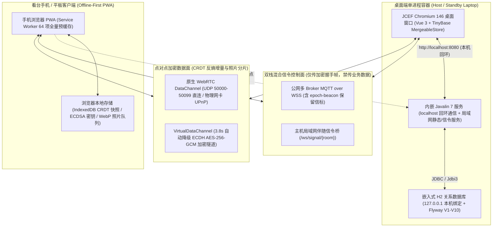

# ScoutingPro27 🚀

<p align="left">
  
  
  
  
  
  
  
  
  
  
</p>

<p align="left">
  <b>Language:</b>
  <a href="README.md"><b>简体中文</b></a> |
  <a href="README_en.md"><b>English</b></a>
  &nbsp;|&nbsp;
  <b>新手手册 / User Guide (独立图文教程):</b>
  <a href="docs/USER_GUIDE.md"><b>双语总入口</b></a> ·
  <a href="docs/USER_GUIDE.zh.md"><b>中文保姆级手册</b></a> ·
  <a href="docs/USER_GUIDE.en.md"><b>English Guide</b></a> ·
  <a href="docs/README.md"><b>完整文档索引</b></a> ·
  <a href="CONTRACT.md"><b>API 与架构契约</b></a>
</p>

> **由 FIRST Tech Challenge (FTC) Team 27570 B.E.A.R. 独立构思、架构并全栈开发。**  
> 专为高干扰、弱网/断网机器人赛场打造的 **本地优先（Local-First）+ WebRTC P2P + TinyBase CRDT/HLC 协同侦察与战术决策平台**。

---

## 📖 文档导航

- **队员与领队快速上手**：请直接阅读独立图文手册 👉 **[双语总入口](docs/USER_GUIDE.md)** · **[中文保姆级教程](docs/USER_GUIDE.zh.md)** · **[English Step-by-Step Guide](docs/USER_GUIDE.en.md)**（含 Windows `.msi` / macOS `.dmg` 安装指引；可在 `frontend/` 执行 `npm run export:userguide-pdf` 导出离线 PDF）。
- **开发者与架构契约**：完整 HTTP REST 路由、WebSocket 信令、TinyBase 8 表 Schema、ECDSA 验签与 JCEF 桌面桥接规范见 **[CONTRACT.md](CONTRACT.md)**；测试与发版记录见 **[docs/README.md](docs/README.md)**。

---

## 一、 赛场痛点与项目定位

在数千人密集连接 Wi-Fi、存在无线电管制与跨运营商 NAT 隔离的机器人赛场中，传统方案往往在淘汰赛选队前夕崩溃：

1. **云端在线表格（飞书 / 腾讯文档 / Google Sheets）**：依赖中心化公网连接，场馆弱网下持续转圈无法保存；多人同改一行极易发生整格误覆盖。
2. **传统局域网主从系统 / 云端 SaaS**：存在单点故障（SPOF）——一旦场馆断网或领队主笔记本蓝屏断电，全场侦察员手机立即报错停摆。
3. **纯离线扫二维码方案（如 ScoutingPASS）**：抗断网但吞吐极低，无法实时共享排班、Pit 照片、战队标签与动态战术指标。

**ScoutingPro27 的核心设计哲学**：**“单机永远可读写、有路即可点对点合并、主机随时可无损接管”**。

| 对比维度 | ScoutingPro27 (本项目) | 在线协同表格 | 局域网主从系统 | 纯离线二维码方案 | 云端 SaaS 侦察站 |
| :--- | :---: | :---: | :---: | :---: | :---: |
| **核心同步架构** | **WebRTC P2P + TinyBase CRDT/HLC** | 中心化云文档 | 本地 Server + 热点 | 赛后人工逐张扫码 | 中心化云端 CRUD |
| **云服务器运维成本** | **0 元（无需自建公网后端）** | 依赖公网可用性 | 需维护局域网服务 | 0 元 | 需持续续费服务器与域名 |
| **断网 / 弱网可用性** | **100% 离线秒存，恢复信号自动反熵合并** | 断网即卡死无法写入 | 脱离同局域网即断联 | 可用，但人工排队扫码慢 | 断网彻底不可用 |
| **多人并发改同一战队** | **单元格级 LWW-HLC 无损合并 + 双录冲突派生** | 极易滑错行覆盖他人数据 | 粗粒度整行覆盖 | 人工合并易漏单 | 后提交直接覆盖先提交 |
| **主电脑死机容灾** | **`hostEpoch` 防脑裂接管 + 队友手机签名代传** | 账号或网络异常即停摆 | 主机死机全员停摆 | 汇总机故障需重扫全部码 | 数据库掉线全员停摆 |
| **时钟防篡改与零信任** | **3-RTT 晶振单调钟 + ECDH/SAS + ECDSA 签名** | 链接泄露即可被涂改 | 明文或基础口令 | 二维码易被截拍伪造 | 普通 HTTPS + 账密 |
| **内置赛场决策引擎** | **SP-NP OPR + A215 晋级分 + 公式引擎 + AI 军师** | 原始数字堆砌不直观 | 需导出外部工具分析 | 需导出 Tableau 二次计算 | 仅基础均分/OPR |

---

## 二、 系统运行原理全景解析（How It Works）

### 2.1 整体进程与网络拓扑

ScoutingPro27 由两类节点组成：**桌面端主机/备机（Windows / macOS / Linux 原生安装包）** 与 **看台移动端（零安装离线 PWA 网页）**。两者运行同一套前端 Vue 3 代码，但按运行环境承担不同职责：



### 2.2 桌面端 `localhost` 通信边界与网络监听机制

1. **本机前后端走 `localhost` 回环，公网零暴露**：
   - 桌面端启动时，内嵌的 JCEF Chromium 浏览器直接加载 `http://localhost:8080/index.html` 与同进程的 Javalin 后端通信；嵌入式 H2 数据库强制锁定 `h2.bindAddress=127.0.0.1`。
   - 后台路由器端口映射服务（`PortForwardingService`）**只映射 WebRTC 所需的 10 个 UDP 端口（`50000-50009/UDP`），绝不向公网映射 TCP `8080` 端口**。因此公网上的外部设备根本无法触达或干涉主机内部的 JCEF ↔ Javalin 通信。
2. **为什么 Javalin 同时监听局域网网卡（`::` / `0.0.0.0:8080`）？**
   - 设想场馆**完全没有外网**且新队员手机此前从未缓存过云端 PWA：此时领队只需开启电脑移动热点（如 `192.168.137.1`）或连入同一局域网，手机扫主机二维码即可直接从主机 `:8080` 拉取完整的离线 PWA 前端包，并通过主机自带的 `/ws/signal/{room}` 完成纯局域网无外网 WebRTC 组网。
   - 为确保同一公共赛场 Wi-Fi 下的安全性：所有 `/api/*` 业务路由默认强制校验 HMAC-SHA256 JWT 与赛事成员身份（`isMember`），而涉及宿主机的系统接口（如触发防火墙配置）额外严格校验底层 Socket 来源必须为本机回环地址（`127.0.0.1` / `::1`）。
3. **云端静态 PWA 零后端模式（GitHub Pages / Cloudflare Pages）**：
   - 当手机从公网静态托管域名打开前端时，`services/api.ts` 自动识别静态宿主环境并接管本地 API 调用（所有侦察记录与照片写入请求强制导向本地 IndexedDB + WebRTC P2P 通道），无需额外部署任何中心化云后端。

### 2.3 网络穿透原理：Windows UAC 防火墙放行与无损绕行 TUN 代理

在复杂的国内网络与赛场环境中，WebRTC P2P 打洞通常面临两大阻碍：**Windows 公用网络防火墙拦截入站 UDP 包**，以及 **电脑开启 Clash / Mihomo / Sing-box 等 TUN 虚拟网卡劫持默认路由**。项目通过职责清晰的分层机制解决：

1. **Windows UAC 提权的真实作用——仅为当前进程配置防火墙入站与 NAT 边缘穿透规则**：
   - 赛场 Wi-Fi 与手机热点几乎都会被 Windows 归类为“公用网络（Public Profile）”，默认丢弃非本机主动发起五元组的 WebRTC STUN/ICE 入站打洞包。
   - 因此 Windows 端首次启动时唤起一次 UAC 提权（`NetworkUtil.ensureWindowsFirewallPort`），**仅针对当前 `java.exe` 与内置 `jcef_helper.exe` 写入作用域限定的入站允许规则**——包含局域网扫码所需的 `TCP 8080`，以及带 **`edge=yes`（允许 NAT 边缘穿透）** 的 WebRTC UDP 入站规则。
   - **严守边界**：UAC 脚本**只改防火墙规则，绝不修改 Windows 系统路由表、网卡跃点数（`InterfaceMetric`）或 `WeakHost` 模型**，从而保证电脑上正在运行的代理软件不会因路由表被篡改而断网。
2. **TUN 虚拟网卡环境下的三层无损穿透机制**：
   - **第一层（Chromium Socket 级物理网卡绑定）**：JCEF 启动参数注入 `--force-fieldtrials=WebRTC-IPv6Default/Enabled/WebRTC-BindUsingInterfaceIndex/Enabled/...` 并关闭 mDNS 主机名隐藏，使 `libwebrtc` 直接按物理网卡索引绑定 `50000-50099/UDP` Socket，从源头绕开虚拟 TUN 网卡的流量劫持。
   - **第二层（虚拟网卡精准识别与物理网卡 UPnP/IPv6 直连）**：`NetworkUtil` 与 `PortForwardingService` 自动过滤 `wintun`、`sing-tun`、`clash`、`mihomo`、`198.18.*`（Fake-IP 段）、`wsl`、`vmware`、`tailscale` 等虚拟接口（同时显式保留 Windows 移动热点使用的 `Wi-Fi Direct` 适配器），提取真实物理局域网 IPv4 与全球单播公网 IPv6（`2000::/3`，优先国内三大运营商 `240e:`/`2408:`/`2409:`），并在物理网卡上以 12 秒预算向路由器申请 `50000-50009/UDP` 短租约映射（退出自动清理）。
   - **第三层（`VirtualDataChannel` 3.8 秒加密隧道热切换兜底）**：若手机端挂了全局 VPN 或处于严格对称型 NAT 导致原生 UDP 在 `3.8s` 内未能连通，前端自动无缝启用 `VirtualDataChannel`，将业务分片用 ECDH 协商出的 AES-256-GCM 密钥端到端加密后经 WSS/MQTT 信令通道透传；同时后台持续非破坏性探测原生 UDP，一旦打通即通过 `startDrain` 排空缓冲平滑热切回原生低延迟通道。

### 2.4 双码隔离体系：终身不可变的 `inviteCode` vs 自由绑定的 `ftcEventCode`

系统在模型设计上将 **“P2P 协同房间身份”** 与 **“FTC 官方赛事数据源”** 彻底解耦：

- **房间邀请码 `inviteCode`（自动生成 · 全局任何人不可更改）**：
  - Host 创建赛事时，后端从剔除易混淆字符（`I/O/0/1`）的 32 字符集中随机生成 6 位大写码（理论空间 $32^6 = 1,073,741,824 \approx 10.7$ 亿，并在本地库判重）。
  - **终身不可变铁律**：`inviteCode` 一旦随赛事生成，**包括赛事 Host 本人在内的任何人均不可修改，也不可将其解绑转移至其他赛事 ID**（`EventRoutes` 在服务端强校验拦截）。
  - **三重核心用途**：① 队员扫码/输码入房凭证；② 派生 MQTT 信令房间 Topic（`SHA-256`）与 100,000 次迭代 PBKDF2-HMAC 信令签名密钥的密码学盐值锚点；③ 队员在离线状态下先行输入邀请码创建临时存根赛事（`ext_<CODE>` / `evt-<CODE>`）正常打分，待连上 Host 获取权威赛事 UUID 后，系统自动把 12 张关联表与本地照片目录原子过户（Reparent）至权威 UUID。
- **官方赛事代码 `ftcEventCode`（Host 按需绑定 / 更换 / 清空）**：
  - 如绑定 `2026` 赛季 `CNCMP`，仅用于通过内置 FTC Events API v2.0 代理拉取官方对阵表、参赛名录、扣除对手罚分后的净得分以及 Rule A215 官方晋级积分，随时解绑或更换均不影响团队已录侦察数据与 P2P 同步。

### 2.5 从看台指尖录入到全队落盘分析的五步数据流

1. **双栈信令握手与 4 位 SAS 零信任门禁**：节点通过公网多 Broker MQTT over WSS（自动主备切换）与局域网 `/ws/signal/{room}` 双栈交换 HMAC 签名信令（含 `NonceLruCache` 防重放），完成 ECDH P-256 密钥交换；首次见面的设备强制挂起业务收发并弹出 **4 位 SAS 短认证码**，人工核对一致后写入 IndexedDB TOFU 信任库，杜绝赛场伪造基站或中间人窃听。
2. **抗毒化晶振单调时钟（`CalibratedMonotonicClock`）**：SAS 通过后执行 3 轮 `CLOCK_SYNC_REQ/RES` 取最小 RTT 标定时间零点；此后运行期**完全停用系统 `Date.now()`**，仅靠硬件 `performance.now()` 晶振单调推进生成 TinyBase 16 字符紧凑 **HLC（混合逻辑时钟）**。即便某台手机系统时间被误改到 2036 年，入站 `decodeHlc` 预检器也会拦截 `>300s` 未来偏移毒包并下发 `FORCE_CLOCK_RESYNC`。
3. **TinyBase 8 表单元格级 CRDT 合并与写时 ECDSA 签名**：
   - 全部协同状态建模为 `MergeableStore` 内的 8 张规范化表：`scouting_records`、`pit_records`、`pit_photo_keys`、`team_tags`、`custom_fields`、`schedules`、`assignments`、`member_identities`。
   - **Pit 展位与标签协同**：A 侦察员离线改车重与自动分、B 侦察员离线改花朵终局结构与标签，重连后按**单元格级 LWW-HLC** 自动无损合并，并在前后端三端统一自动重算 BIOBUZZ 结构化终局分与总分。
   - **正赛记录防篡改与冲突派生**：每条正赛记录在落盘瞬间由作者设备 ECDSA P-256 私钥签发 `authorSig`（设备公钥由 Host 在 `member_identities` 表签发 `hostSig` 背书）；两人同场误录同一战队时，两条记录因各自 ID 独立而**同时完整保留**，前端通过纯计算属性派生冲突徽章供队长复核。
4. **控制面纪元防脑裂（`hostEpoch` Fencing）与队友代传恢复**：见下文 `§3.1`。
5. **Host 防抖快照与脏行增量关系投影（`CrdtProjectionService`）**：Host 前端以 `1500ms` 防抖（`5000ms` 最大等待，`beforeunload`/`logout` 立即冲刷）调用 `PUT /api/events/{id}/crdt-state`；后端在单事务内净化非 Host 快照、保存全量 CRDT JSON，并仅对发生变化的 `dirtyRows` 增量 `MERGE` 投影至 6 张 H2 关系表，无缝驱动后续 SQL 查询、CSV 导出与 AI 上下文组装。

---

## 三、 核心子系统深潜

### 3.1 控制面纪元防脑裂（`hostEpoch` Fencing）与双入口灾难恢复

系统严格执行**控制面纪元（`hostEpoch`）与数据面时间戳（`HLC`）解耦**：仅桌面端允许担任 Host；`hostEpoch` 只裁决谁是当前唯一合法主机，绝不覆盖单元格级 HLC 时间戳（避免新晋升的空电脑用高纪元空状态抹掉队员旧纪元离线数据）。

```mermaid
sequenceDiagram
    autonumber
    participant HostA as "原主机电脑 A (H2 #1)"
    participant HostB as "队友备机电脑 B (H2 #2)"
    participant MQTT as "MQTT 信令与 epoch-beacon"
    participant Phones as "看台手机群 S1/S2 (Witness + CRDT)"
    participant HostC as "全新空库电脑 C (H2 #3)"

    Note over HostA,Phones: "阶段 1: HostA 建赛 (Epoch=1)，发布保留信标，全员完成 SAS 与 3-RTT 晶振标定"
    HostA->>MQTT: "发布 retained epoch-beacon (epoch=1, eventId=UUID, inviteCode)"
    Note over HostA: "阶段 2: HostA 录完 1 条本地独占记录后突然断电死机"
    Note over Phones,HostB: "阶段 3: 无主机离线窗口期 — 手机并发改 Pit 不同字段、录带 ECDSA 签名的正赛记录"
    Phones->>Phones: "S1 改车重并离线刷新；S2 改发射机构、贴标签、录签名比赛记录"
    HostB->>HostB: "队友在电脑 B 离线排班打分，退出账号前自动 flush 快照至本地 H2 #2"

    Note over HostB,Phones: "阶段 4 (主路径): 领队在备机 B 登录原账号 — 面板直接点击原赛事免输码接管 (Epoch=2)"
    HostB->>MQTT: "1.5s HOST_DISCOVERY 收集手机 EPOCH_WITNESS -> 递增晋升 Epoch=2"
    Phones<-->HostB: "CRDT 反熵双向合流：车重 + 发射机构 + 照片键 + 标签 + 排班全部无损合并"

    Note over HostA,HostB: "阶段 5 (防脑裂压制): 旧主机 A 恢复供电广播旧 Epoch=1 心跳"
    HostA->>MQTT: "host_heartbeat (epoch=1)"
    HostB-->>HostA: "epoch_superseded (epoch=2)"
    HostA->>HostA: "自动降级为 Standby 从机连入 HostB，并将断电前独占记录反熵补齐至全场"

    Note over HostC,Phones: "阶段 6 (极限兜底): 若仅剩全新空电脑 C，输入 6 位不可变 inviteCode 接管 (Epoch=3)"
    HostC->>MQTT: "从在场手机 S1 的 EPOCH_WITNESS 还原权威赛事 UUID 落盘 H2 #3"
    Phones<-->HostC: "S1 将已离场队友 S2 带 ECDSA 签名的历史记录安全代传恢复至空电脑 C"
```

### 3.2 BIOBUZZ 2026–2027 战术量化引擎与双端同构公式系统

1. **SP-NP OPR（侦察先验去罚分贡献值，`npOpr.ts`）与节奏稳定性测速**：
   - 结合 FTC 官方联盟净得分（自动剥离对手犯规送分）与本队侦察员实录分项先验求解岭回归线性方程组，分解出单车自动、手动、终局真实净贡献值及置信度等级。
   - **Predict Cycle Time**：单场手动阶段有效循环间隔 `≥ 5` 个（即 `≥ 6` 轮、`≤ 120s`）时，自动剔除最快 1 次异常值后取次快 4 次均值，并配套输出非故障场次的 **最低 Cycle 数（Min Cycles）** 与 **Cycle 方差（Cycle Variance）**。
   - **Swarm RP 机动分**：自动核算单车机动得分（离墙 `3` + 自动停泊 `5` + 终局停泊 `5` = 满分 `13`），辅助筛选双车合计 `≥ 16` 分的稳定拿点搭档。
2. **FTC 官方 Rule A215 晋级积分与顺延引擎（`AdvancementCalculator.java` & `advancement.ts`）**：
   - Java 后端与 TS 前端双端同步实现 A215 逆误差函数 `invErf` 资格赛赋分（`2..16` 分）、蛇形选队顺位分、双败淘汰赛分与评委奖项分，实时解析官方保送/放弃顺延（Roll-down）状态并在排行榜首列高亮展示。
3. **自定义字段与前后端同构安全公式引擎（`V10`，`FormulaValidator.java` & `utils/formula/*`）**：
   - 支持按赛事动态创建布尔、步进数值、毫秒计时器、星级/档位、单选/多选（带数值权重）及 **派生公式列（`MATCH` / `PIT` / `TEAM` 三层作用域）**。
   - 手写词法/递归下降 AST 解析器与求值器（严禁 `eval` / `Function` / 原型链访问），强制单向跨层引用与 3 色 DFS 环路检测，内置 `SAFE_DIV`、`COALESCE`、`TRIMMED_AVG`、`RECENT_AVG`、`PERCENTILE`、`WEIGHTED_AVG`、`NORM` 等 25 个统计与数学函数，由 [`shared/formula-conformance-cases.json`](shared/formula-conformance-cases.json) 锁定前后端 100% 行为一致。
4. **“吹牛指数（Brag Index）”展位自述审计**：
   - 按 $\text{OverallRatio} = \frac{\text{ClaimedTotalScore}}{\max(\text{MaxActualScore}, \text{AvgActualScore} \times 1.05, 1)}$（自动排除 `isBroken` 故障场次）将展位自述划分为 **🎯 真实守信（`≤1.25x`）**、**🟡 略偏乐观（`1.25x~1.65x`）**、**⚠️ 夸大其词（`1.65x~2.20x`）** 与 **🔥 吹破牛皮（`>2.20x`）**，并自动交叉核验正赛实绩点亮 **`花朵已证实 🌸`** 与 **`停泊已证实 ✅`** 徽章。

### 3.3 多协议 AI Copilot 战术工作台与实时语音通话（`V9`）

- **三协议原生适配与安全密钥仓**：支持 **OpenAI 兼容流派**（GPT / DeepSeek / Kimi / SiliconFlow / 本地 Ollama）、**Google Gemini（`v1beta`）** 与 **Anthropic Claude**；API Key 经主机 `AES-256-GCM` 加密落盘，配合 `AiUrlGuard` 阻断私网 SSRF 探测。
- **赛事上下文预算组装（`contextBuilder.ts`）**：在 `28,000` 字符预算内按优先级自动组装我方队号、禁选名单、天梯 SP-NP OPR 与晋级分、相关排班、标签、Pit 硬件、自定义公式指标及近期场次明细，支持 5 种战术人设与 `/pick` `/match` `/compare` `/audit` `/brief` 快捷指令。
- **双档语音直接对话**：
  - **全双工原生实时语音（`Gemini Live` / `OpenAI Realtime`）**：经后端 `/ws/ai/voice` 中继，前端基于音频流捕获与无缝 PCM 队列实现免提 VAD 自动收音、随时打断（Barge-in）、按住说话（PTT）、实时双语字幕与 Token 用量（`usage`）自动归档入当前会话线程。
  - **全模型通用轮次语音**：针对无原生实时语音接口的模型，支持按住录音经 `/api/ai/audio/transcribe` 转写提问并分句流式朗读回复。

---

## 四、 技术栈与仓库结构速览

| 层级 | 核心技术与模块职责 |
| :--- | :--- |
| **前端与离线 PWA (`frontend/`)** | **Vue 3.5** + **TypeScript 6** + **Vite 8** + **Pinia 4** + **Vue I18n 9**（中英双语全量对齐）+ **Workbox PWA** |
| **CRDT 与密码学层 (`frontend/src/services/`)** | **TinyBase 10.1** `MergeableStore`、自研 `CalibratedMonotonicClock`、WebRTC 分片同步器、Web Crypto `ECDH`/`ECDSA P-256`/`PBKDF2-HMAC` |
| **主机后端与桌面壳 (`Backend/`)** | **Java 21 LTS** + **Javalin 7.2** (Jetty 12) + **JCEF Chromium 146**（Windows 自定义圆角无边框标题栏 / macOS & Linux 原生窗口） |
| **存储与网络穿透 (`Backend/src/main/`)** | **H2 2.2** + **HikariCP** + **Jdbi3** + **Flyway 13 (`V1`–`V10`)** + **Auth0 JWT / jBCrypt / AES-256-GCM** + **Offbynull PortMapper** |
| **共享契约与测试 (`shared/`, `e2e/`)** | 双端公式契约集 `shared/formula-conformance-cases.json`、**Vitest**（98 文件 / 887 单测）、**JUnit 5**（42 类 / 214 单测）、**Puppeteer**（4 套多节点容灾 E2E） |

---

## 五、 快速启动与自动化验证

### 5.1 环境要求与本地运行
- **环境要求**：JDK 21+、Maven 3.8+、Node.js `>=22.18.0` 或 `>=24.12.0`
- **构建与启动**：
  ```powershell
  # 1. 构建前端生产静态资源与 PWA Service Worker（自动输出至 Backend 静态资源目录）
  cd frontend
  npm install
  npm run build

  # 2. 启动桌面主机（加 --headless 可跳过 JCEF 桌面窗口以纯服务模式运行）
  cd ../Backend
  mvn compile exec:java -Dexec.mainClass="com.bear27570.app.Main" -Dexec.args="--headless --port=8080"

  # 3. 打包单文件可执行 Fat JAR (target/ScoutingPro27.jar)
  mvn package -DskipTests
  ```

### 5.2 全量测试套件执行
```powershell
# 1. 前端 TypeScript 6 严格类型检查
cd frontend
npm run type-check

# 2. 前端 Vitest 单元测试套件（98 个测试文件 / 887 项单测）
npx vitest run

# 3. 后端 Maven JUnit 5 测试套件（42 个测试类 / 214 项单测，覆盖 Flyway V1-V10、零信任验签与 CRDT 脏行投影）
cd ../Backend
mvn test

# 4. 全栈多实例容灾与交互 E2E 套件（4 套核心 E2E；单独运行 12 步跨机灾难恢复可执行 npm run test:e2e:multi）
cd ../frontend
npm run test:e2e
```

---

## 📄 开源许可与致谢

- **开源协议**：本项目基于 **MIT License** 开放源代码。
- **特别致谢**：感谢 **FIRST** 官方赛事舞台，感谢 Vue.js、TinyBase、Javalin、WebRTC、EMQX 与开源社区，感谢 **FTC Team 27570 B.E.A.R.** 每一位参与实战检验与持续演进的队员与导师！

<p align="center">
  <b>Designed & Built with ❤️ by FTC Team 27570 B.E.A.R.</b><br/>
  <i>Empowering Every Robot Alliance with Next-Gen Distributed Intelligence.</i>
</p>
