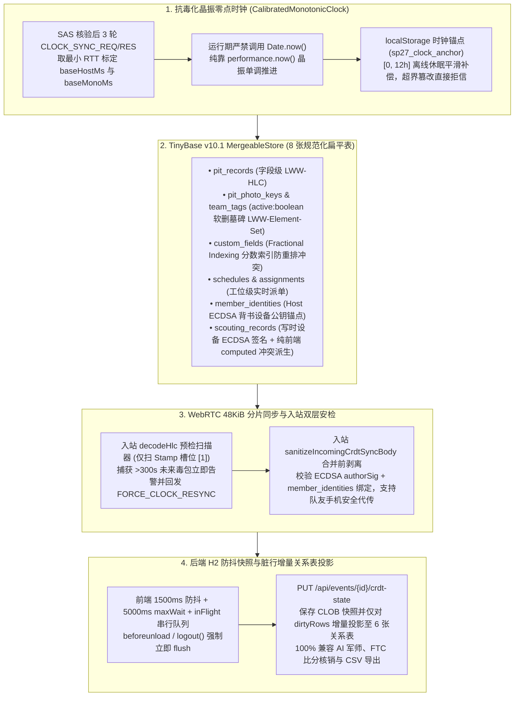

# ScoutingPro27 🚀

<p align="left">
  
  
  
  
  
  
  
  
  
  
</p>

<p align="left">
  <b>Language:</b>
  <a href="README.md"><b>简体中文</b></a> |
  <a href="README_en.md"><b>English</b></a>
  &nbsp;|&nbsp;
  <b>新手手册 / User Guide (独立图文教程):</b>
  <a href="USER_GUIDE.md"><b>双语总入口</b></a> ·
  <a href="docs/USER_GUIDE.zh.md"><b>中文保姆级手册</b></a> ·
  <a href="docs/USER_GUIDE.en.md"><b>English Guide</b></a> ·
  <a href="docs/ScoutingPro27_UserGuide_ZH.pdf"><b>离线 PDF (ZH)</b></a> ·
  <a href="docs/ScoutingPro27_UserGuide_EN.pdf"><b>Offline PDF (EN)</b></a>
</p>

> 💡 **由 FIRST Tech Challenge (FTC) Team 27570 B.E.A.R. 中学生团队独立构思、架构并全栈开发。**  
> 专为高对抗机器人赛场打造的**去中心化 WebRTC P2P + TinyBase CRDT/HLC 协同侦察与战术分析平台**。

---

## ⚡ 设想一个赛场上最崩溃的极端噩梦

距离淘汰赛联盟选队（Alliance Selection）只剩 **15 分钟**，你的队伍正在经历一场灾难：

1. **在线表格彻底卡死写不进去**：场馆内 3,000 人同时连 Wi-Fi、外加无线电管制，手机 4G/5G 信号满格却一滴流量都挤不进去。你们用的飞书/腾讯文档/Google Sheets 一直在转圈显示“正在重连”，看台上 6 名侦察员刚记完的半决赛关键场次，**一行都保存不上去**。
2. **手抖点错行，把别人熬夜记的数据全覆盖了**：好不容易有两个人刷出了表格，慌乱中一人滑错了单元格、另一人在同一行改备注，**直接把队友辛苦录了一上午的核心强队数据整行覆盖清空**，连谁改的、原本是多少分都找不回来。
3. **单核数据库/主机一掉线，全员干瞪眼**：有的队伍自己搭了云服务器或局域网单机后台，结果场馆外网一断，或者领队的主笔记本突然蓝屏死机、电源被踢掉，整个单核数据库瞬间失联——**全场所有人的手机立刻报错停摆，只能站在看台上干瞪眼**。
4. **密密麻麻全是数字，计分结果极其不直观**：选队队长站在台前手心冒汗，面对几百行杂乱的表格原始数字，根本算不清谁的 Cycle 到底稳不稳、谁在维修区吹了牛、谁的真实净得分被对手罚分注了水。

### 🛡️ 在这个绝境之下，ScoutingPro27 可以完美终结以上所有问题：

- **断网？照样秒存 + 毫秒级 P2P 直连**：全端 PWA + IndexedDB 离线优先，没网也能零延迟盲操打分与拍高清 WebP 照片；一旦有信号，无需云服务器，手机 4G/5G 与电脑 Wi-Fi 通过 **WebRTC DataChannel** 点对点直连（含物理网卡 UPnP 开孔 + ECDH 加密 WSS 隧道兜底），50ms 内自动同步上屏。
- **撞车改同一队？字段级 CRDT 无冲突合并**：底层搭载 **TinyBase `MergeableStore` CRDT + 晶振校准混合逻辑时钟（HLC）**。一人离线改底盘重量、一人离线改发射机构、一人贴标签，重连后**按单元格自动无损合并**；两人同场录了同一支队伍，系统**自动同时保留两条并高亮派生冲突卡片**供人工复核，还有设备级 **ECDSA P-256 写时数字签名**防篡改防误盖。
- **主机突然暴毙？零脑裂接管 + 队友手机代传复活**：哪怕主电脑主板烧毁、断网 2 小时，队员在各自手机上照常离线录数据。领队随便借来队友的备机（直接点击列表零邀请码接管）甚至找一台**全新空电脑**输入 6 位邀请码，系统通过 **`hostEpoch` 纪元防脑裂协议（Epoch Fencing）+ 手机 Witness 仲裁** 自动晋升新主机，连已关机队友手机里的历史打分都能由在场队友手机**带签名无损代传恢复**；旧电脑就算突然复活也会被自动压制降级为从机，并把暴毙前未发出的独占数据自动合流。
- **数据怎么看？一键化为战场决策**：**FTC 官方晋级分（Rule A215 `invErf`）+ 顺延徽章**、**Predict Cycle Time（≥6 轮去极值测速）**、**Swarm RP 机动分**、专治展位虚报的 **“吹牛指数（Brag Index）”**、**Viper 风格 60fps 激光轨迹推演战术白板** 与 **内置流式 AI 战术军师** 一屏拉满。

**用上 ScoutingPro27，让你的队伍从此彻底告别赛场手忙脚乱，再也不为 Scout 工作发愁！**

---

## 📖 新手操作指南（独立文档）

> 为保持本 README 聚焦于工程架构与技术实现，**零基础图文操作手册已完全独立拆分**。队员与领队请直接阅读：
> - 📘 **[双语手册总入口 (USER_GUIDE.md)](USER_GUIDE.md)**
> - 🇨🇳 **[中文保姆级图文教程 (docs/USER_GUIDE.zh.md)](docs/USER_GUIDE.zh.md)** / **[中文离线 PDF](docs/ScoutingPro27_UserGuide_ZH.pdf)**
> - 🇺🇸 **[English Step-by-Step Guide (docs/USER_GUIDE.en.md)](docs/USER_GUIDE.en.md)** / **[English Offline PDF](docs/ScoutingPro27_UserGuide_EN.pdf)**

---

## 一、 核心能力与全社区方案对比

| 对比维度 | ScoutingPro27 (本项目 🚀) | 传统在线表格<br/>(飞书 / 腾讯 / Google) | FRC 1678 等局域网主从系统 | ScoutingPASS 等<br/>传统离线二维码方案 | 云端 SaaS 侦察网站 |
| :--- | :---: | :---: | :---: | :---: | :---: |
| **核心同步引擎** | **WebRTC P2P + TinyBase CRDT/HLC** | 中心化云文档协同 | 本地 Server + 蓝牙/热点 | 纯离线逐张扫二维码 | 中心化云端 CRUD |
| **云服务器与运维成本** | **0 元（彻底去中心化）** | 依赖公网云服务 | 需专人维护本地服务器 | 0 元 | 需按年续费云主机与域名 |
| **赛场断网 / 弱网可用性** | **100% 离线可用，重连自动反熵合并** | **断网即转圈卡死，无法写入** | 脱离同局域网即断联 | 可用，但需排队人工扫码 | **断网彻底瘫痪** |
| **多人并发改同一行/同队** | **字段级 LWW-HLC 合并 + 双录冲突派生** | **极易串行点错、整格覆盖他人数据** | 粗粒度整条覆盖 | 赛后人工合并易漏单 | 后提交直接覆盖先提交 |
| **主机死机 / 单点故障容灾** | **Epoch Fencing 防脑裂接管 + 队友代传恢复** | 依赖云厂商，账号锁死即停摆 | **单核主机一挂全场干瞪眼** | 汇总电脑坏掉需重扫全部码 | **单库掉线全员干瞪眼** |
| **系统时钟被乱改防护** | **3-RTT 晶振零点标定 + 300s 漂移护栏** | 依赖服务器时间 | 易受手机错乱时钟污染 | 无时钟校验 | 依赖服务器时间 |
| **零信任加密与防伪造** | **ECDH + 4位 SAS 码 + TOFU + ECDSA 签名** | 链接泄露即可被恶意涂改 | 无加密或基础口令 | 二维码极易被对手截拍 | 普通 HTTPS + 账密 |
| **赛场战力与防忽悠分析** | **Rule A215 晋级分 + 吹牛指数 + Cycle 测速** | **纯数字表格，毫无直观决策视图** | 需外部工具二次分析 | 需导出 Tableau 离线算 | 仅基础均分/OPR |
| **战术沙盘与 AI 军师** | **60fps 激光推演白板 + 流式 AI 军师** | 无 | 独立静态画板 | 无 | 极少集成 |

---

## 二、 完整技术栈清单 (Full Tech Stack)

本项目采用 **前端 Vue 3 + TypeScript 6 单页离线 PWA** 与 **后端 Java 21 + Javalin 7 + H2 + JCEF 桌面容器** 的全栈架构，前后端真实依赖版本如下：

### 2.1 前端与移动端 (`frontend/`)
- **核心框架与构建工具**：
  - **Vue `^3.5.40`** (Composition API / `<script setup>`)
  - **TypeScript `~6.0.0`** + **`vue-tsc ^3.3.7`** (全量严格类型检查)
  - **Vite `^8.1.5`** (基于 Rolldown 高速打包引擎)
  - **Pinia `^4.0.2`** (响应式状态管理，与 CRDT 双向桥接)
  - **Vue Router `^4.6.4`** (SPA 路由与登录守卫)
  - **Vue I18n `^9.14.5`** (中英双语 **1,313 组键值 1:1 对齐**，毫秒级热切换)
- **分布式 CRDT 协同与抗毒化时钟层**：
  - **TinyBase `^10.1.0`** (`MergeableStore` 单元格级 LWW-CRDT + `createCustomSynchronizer` + `persister-indexed-db` + `getHlcFunctions` 16 字符紧凑 HLC 编解码 + `maxClockSkewSeconds=300` 护栏)
  - **自研 `CalibratedMonotonicClock`**：3 样本最小 RTT 握手标定 + `performance.now()` 晶振单调走时 + `[0, 12h]` 离线休眠补偿与冷重启锚点 (`sp27_clock_anchor_${eventId}`) + 抗拜占庭 5 分钟聚类中位数对齐
- **WebRTC P2P 穿透与零信任密码学层**：
  - **WebRTC `RTCDataChannel`**：星型/网格反熵同步、48 KiB 自动分片重组 (`CRDT_SYNC_CHUNK`)、背压流控 (`DataChannelSender`)
  - **MQTT over WSS (`mqtt ^5.15.2`)**：多公网 Broker 自动灾备切换 + 本地 Javalin `/ws/signal/{room}` 局域网伴随 WebSocket 双发 + 独立 Retained 纪元信标子主题 (`epoch-beacon`) + **`VirtualDataChannel`** (UDP 受阻时 3.8s 自动切换 ECDH 加密 WSS 隧道，后台非破坏性探针无感热升级回原生 UDP)
  - **Web Crypto API + 纯 JS 降级引擎 (`crypto.ts` / `identityStore.ts`)**：
    - **ECDH (P-256) + HKDF-SHA256 + AES-256-GCM**：信令与虚拟数据通道端到端加密
    - **ECDSA (P-256 / SHA-256)**：作者设备持久化签名密钥对、正赛记录写时签名 (`authorSig`) 与 Host 背书成员公钥绑定表 (`member_identities` `hostSig`) 双重验权
    - **PBKDF2-HMAC-SHA256 (100,000 次迭代)**：房间信令全载荷签名（含非 HTTPS 局域网纯 JS Midstate 加速回退）+ 5,000 容量 `NonceLruCache` 防重放 + 4 位 **SAS 短认证码** + **TOFU** 设备信任库
- **离线存储、扫码、渲染与 UI 系统**：
  - **PWA & Service Worker (`vite-plugin-pwa ^1.3.0` / Workbox)**：57 项静态资源全量预缓存，断网刷新秒开
  - **IndexedDB**：CRDT 状态快照持久化 (`sp27_crdt_${eventId}`)、设备公私钥保险箱 (`scoutingpro_security_v1`)、移动端高清 WebP 照片离线队列 (`mobilePhotoCache.ts`)
  - **二维码与富文本**：`qrcode ^1.5.4` (动态入房码生成)、`jsqr ^1.4.0` (纯前端相机扫码)、`markdown-it ^15.0.0` + `highlight.js ^11.12.0` + `dompurify ^3.4.14` (AI 军师流式 Markdown 安全渲染)
  - **视觉与动效**：Cold Graphite Pit Wall 工业风 CSS Token 系统 (`#0B0E10` + `#39FF14`)、本地内嵌 `Noto Sans SC` 可变字体、CSS `linear()` 物理弹簧动效与 Canvas 2D 60fps 激光轨迹白板引擎

### 2.2 电脑主机后端与原生桌面容器 (`Backend/`)
- **语言与Web 服务底座**：
  - **Java 21 (LTS)**
  - **Javalin `7.2.3`** (内置 Jetty 12 高性能异步 HTTP / RESTful API / WebSocket 局域网信令桥 / SSE AI 流式代理)
  - **Gson `2.11.0`** (JSON 序列化与 TinyBase `MergeableContent` 树解析)
  - **SLF4J Simple `2.0.17`** (毫秒级双流控制台 + 独立实例文件日志系统)
- **数据库、连接池与 Schema 迁移**：
  - **H2 Database `2.2.224`** (嵌入式本地关系型数据库，支持 `AUTO_SERVER` 回环 `127.0.0.1` 绑定与 `--data-dir` / `--no-auto-server` 多实例物理隔离)
  - **HikariCP `5.1.0`** (高性能 JDBC 连接池)
  - **Jdbi3 `3.45.1`** (`jdbi3-core` + `jdbi3-sqlobject` 声明式 DAO 与事务死锁自动重试)
  - **Flyway `13.10.3`** (`V1`–`V8` 自动化版本迁移 + `CrdtProjectionService` 启动期幂等 Schema 自愈与脏行增量关系表投影)
- **安全鉴权与物理网卡自动穿透**：
  - **Auth0 `java-jwt 4.6.2`** (HMAC256 JWT 签发与确定性用户 UUID 自愈) + **jBCrypt `0.4`** (密码哈希) + **Java JCE AES-256-GCM** (本地 AI Key 与自定义 TURN 凭据落盘加密)
  - **Offbynull PortMapper `2.0.6`** (`PortForwardingService.java`：自动过滤 Clash TUN / WSL / VMware 等虚拟网卡，在真实物理网卡上以 12s 有界预算探测 **UPnP IGDv1/v2 含 `WANIPv6FirewallControl:1`、NAT-PMP、PCP**，为 `50000-50009/UDP` 申请短租约端口映射并自动续租/退出清理)
- **桌面原生容器与打包**：
  - **JCEF (`jcefmaven 146.0.10`)**：内嵌 Chromium 桌面原生容器，锁定 `webrtc.udp_port_range=50000-50099`，定制 Windows 无边框圆角 `CustomTitleBar`、`WindowResizer` 与 `SplashScreen` 启动动画
  - **Maven Shade Plugin `3.6.0`** (构建单文件可执行 Fat JAR `ScoutingPro27.jar`) + GitHub Actions 自动打包 Windows `.msi` / macOS Apple Silicon `.dmg`

### 2.3 自动化测试与质量工程栈
- **前端单测**：**Vitest `^2.1.9`** + **`@vue/test-utils ^2.4.11`** + **`@pinia/testing ^0.1.7`** + **`happy-dom ^15.11.7`** (**102 个测试套件 / 831 项单测**)
- **后端单测**：**JUnit Jupiter `5.10.2`** + **AssertJ `3.27.7`** + **Javalin TestTools `7.2.2`** (**43 个测试类 / 192 项单测**)
- **全栈极端容灾 E2E**：**Puppeteer `^25.5.0`** + 内存级 MQTT-over-WS Broker + 多 JVM 独立临时 H2 集群管理器 (`E2EClusterManager`) (**18 个 E2E 与视觉审计套件**)

---

## 三、 核心架构亮剑 (Core Architecture Deep Dive)

### 3.1 TinyBase CRDT + 晶振校准 HLC + 写时 ECDSA 签名协同架构
为彻底消灭传统 `Date.now()` LWW 整行覆盖与单点 `hostSeq` 发号瓶颈，ScoutingPro27 将结构化协同数据全面托管至 TinyBase `MergeableStore`：



### 3.2 控制面纪元防脑裂 (`hostEpoch` Fencing) 与跨设备双入口灾难恢复
系统严格遵循**控制面纪元 (`hostEpoch`) 与数据面时钟 (`HLC`) 解耦铁律**：`hostEpoch` 只决定谁是当前唯一合法 Host，绝不作为数据合并的最高比较位（防止空新机高 Epoch 空值碾压旧 Epoch 离线数据）。

```mermaid
sequenceDiagram
    autonumber
    participant HostA as "原主机电脑 A (H2 #1)"
    participant HostB as "队友共用库电脑 B (H2 #2)"
    participant MQTT as "MQTT 信令 + Retained epoch-beacon"
    participant Phones as "看台手机群 S1/S2 (Witness + CRDT)"
    participant HostC as "全新空库裸机 C (H2 #3)"

    Note over HostA,Phones: "阶段 1: HostA 建房 (Epoch=1)，发布 Retained 信标，全员完成 SAS 与 3-RTT 晶振标定"
    HostA->>MQTT: "publish retained epoch-beacon (epoch=1, eventId=UUID, hostId=Lead)"
    Note over HostA: "阶段 2: HostA 录完 1 条本地独占记录后突然断电暴毙 (无交接包!)"
    Note over Phones,HostB: "阶段 3: 2 小时无主机空窗期 — 手机改系统时间+10年无效、并发改 Pit 不同字段、离线刷新、备机切号"
    Phones->>Phones: "S1 改 Pit 重量 + 离线刷新；S2 改发射机构 + 增删标签 + 录 ECDSA 签名打分"
    HostB->>HostB: "AssistantBob 离线改排班 + 录打分 -> logout() 前自动 flush 进共享 H2 #2 且不删赛事缓存"

    Note over HostB,Phones: "阶段 4 (主路径): 领队在共用库电脑 B 登录 Lead 账号 — 免输邀请码直进接管 (Epoch=2)"
    HostB->>HostB: "Dashboard 直接显示归属 Lead 的原赛事卡片，点击直进"
    HostB->>MQTT: "1.5s HOST_DISCOVERY -> 收集手机 EPOCH_WITNESS -> 晋升 Epoch=2 + 时钟对齐中位数"
    Phones<-->HostB: "CRDT 双向反熵：Pit 重量+发射机构+照片Key+软删标签+Bob排班与打分 100% 无损合流"

    Note over HostA,HostB: "阶段 5 (防脑裂 Fencing): 旧主机 A 奇迹复活广播 Epoch=1 心跳"
    HostA->>MQTT: "host_heartbeat (epoch=1)"
    HostB-->>HostA: "回弹 epoch_superseded (epoch=2)"
    HostA->>HostA: "Fencing 生效！自动降级为 Standby Client 连入 HostB"
    HostA<-->HostB: "CRDT 反熵将 HostA 暴毙前未发出的独占记录无损合流至全场"

    Note over HostC,Phones: "阶段 6 (兜底路径): HostB 与 S2 离场，全新空库电脑 C 输入 6 位邀请码接管 (Epoch=3)"
    HostC->>MQTT: "HOST_DISCOVERY -> 从在场 S1 收回 EPOCH_WITNESS 还原权威 UUID 落盘 H2 #3"
    Phones<-->HostC: "S1 通过 CRDT 将失联队友 S2 带 ECDSA 签名的历史记录安全代传恢复至空电脑 C！"
```

### 3.3 BIOBUZZ 2026–2027 赛规引擎、FTC 官方晋级分顺延与“吹牛指数”
1. **BIOBUZZ 专属赛规与测速模型**：
   - **无爬升终局**：精准建模最后 60s `Nectar (+2, 上限 8)`、`Bottom Nectar (+5/朵, ≤ Nectar)`、`Pollen (+2)`、`Garden (+1)`、`Park (+5)`、`G418 合法花底掏球` 与 `G410 <60s 提前误投犯规`。
   - **Swarm RP 机动分**：自动追踪单车机动分（离墙 `3` + 自动停泊 `5` + 终局停泊 `5` = 最高 `13` 分），快速锁定双车合计 `≥ 16` 分的联盟搭档。
   - **Predict Cycle Time**：手动阶段记满 `≥ 6` 轮有效 Cycle（间隔 `≤ 120s`）时，自动剔除最快 1 次异常脉冲后取次快 4 次均值。
2. **FTC 官方 Rule A215 晋级积分与顺延引擎 (`AdvancementCalculator.java`)**：
   - 内置官方 FTC API v2.0 代理凭证（开箱即用无需自备 Key），实时汇算 **资格赛 (`invErf` 逆误差函数 2–16 分) + 蛇形选队 + 淘汰赛 + 评审奖项分**，同步 `/advancement` 官方顺延状态，在天梯榜首列固定展示 `晋级分 (Adv. Pts)` 与 `晋级区` / `顺延晋级` / `已保送` / `候选` 徽章，并支持剔除对手罚分后的净得分偏差核查。
3. **“吹牛指数”量化对账 (`Brag Index`)**：
   - 按 $\text{OverallRatio} = \frac{\text{ClaimedTotalScore}}{\max(\text{MaxActualScore}, \text{AvgActualScore} \times 1.05, 1)}$（自动剔除 `isBroken` 故障场次）划分 **🎯 真实守信 (`≤1.25x`)**、**🟡 略偏乐观 (`1.25x~1.65x`)**、**⚠️ 夸大其词 (`1.65x~2.20x`)** 与 **🔥 吹破牛皮 (`>2.20x`)**，并核验实战 `rawData` 点亮 **`花朵已证实 🌸`** / **`停泊已证实 ✅`** 徽章。

---

## 四、 开发者指南与自动化测试验收 (Developer & Testing)

### 4.1 环境要求与快速启动
- **环境要求**：JDK 21+、Maven 3.8+、Node.js `>=22.18.0` 或 `>=24.12.0`
- **编译与运行**：
  ```powershell
  # 1. 编译前端生产静态资源 (含 TypeScript 6 类型检查与 PWA Service Worker 生成)
  cd frontend
  npm install
  npm run build

  # 2. 启动后端服务 (加 --headless 可跳过 JCEF 桌面窗口以纯微服务模式运行在 8080 端口)
  cd ../Backend
  mvn compile exec:java -Dexec.mainClass="com.bear27570.app.Main" -Dexec.args="--headless --port=8080"

  # 3. 打包单文件可执行 Fat JAR (target/ScoutingPro27.jar)
  mvn package -DskipTests
  ```

### 4.2 自动化测试与极端容灾 E2E 验证套件
本项目严格执行**“命令 + 真实原始输出 + 客观结论”证据三要素闭环**：

```powershell
# 1. 前端 TypeScript 6 强类型检查 (0 errors)
cd frontend
npm run type-check

# 2. 前端 Vitest 单元测试套件 (102 个测试文件 / 831 项测试 100% 通过)
npm test -- --run

# 3. 后端 Maven JUnit 5 测试套件 (43 个测试类 / 192 项测试 100% 通过，含 Flyway V1-V8 与 CRDT 脏行投影)
cd ../Backend
mvn test

# 4. 全栈 12 步极端容灾端到端测试 (并发拉起 3 个独立临时 H2 后端 + 5 个隔离浏览器)
# 覆盖：3-RTT 晶振标定 -> +10年/-1年改表与 2036 毒包拦截 -> HostA 进程硬杀暴毙 -> 2h 离线并发改同队不同字段与离线刷新
# -> 共用库电脑 B 免邀请码直进接管 (Epoch=2) -> 旧主机复活 Fencing 压制与独占记录合流 -> 空库裸机 C 输邀请码 Witness 还原 (Epoch=3)
# -> 队友手机代传恢复失联队员记录与双重伪造攻击拦截 -> U 盘 .info 幂等导入 -> 4 节点字节级一致终审 -> 临时 H2 100% 自动清理断言
cd ../frontend
npm run test:e2e
```

---

## 📄 开源许可与致谢 (License & Acknowledgements)

- **开源协议**：本项目基于 [MIT License](LICENSE) 开放源代码。
- **特别致谢**：感谢 **FIRST** 官方赛事舞台，感谢 Vue.js、TinyBase、Javalin、WebRTC、EMQX 与开源社区，感谢 **FTC Team 27570 B.E.A.R.** 每一位参与实战测试与演进的队员与导师！

<p align="center">
  <b>Designed & Built with ❤️ by FTC Team 27570 B.E.A.R.</b><br/>
  <i>Empowering Every Robot Alliance with Next-Gen Distributed Intelligence.</i>
</p>
