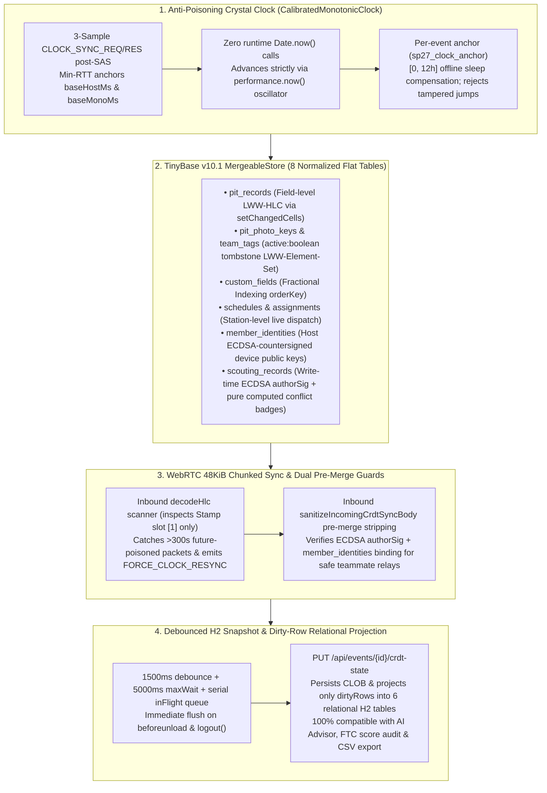

# ScoutingPro27 🚀

<p align="left">
  
  
  
  
  
  
  
  
  
  
</p>

<p align="left">
  <b>Language:</b>
  <a href="README.md"><b>简体中文</b></a> |
  <a href="README_en.md"><b>English</b></a>
  &nbsp;|&nbsp;
  <b>Standalone User Guides (Step-by-Step Illustrated Manuals):</b>
  <a href="docs/USER_GUIDE.md"><b>Bilingual Hub</b></a> ·
  <a href="docs/USER_GUIDE.en.md"><b>English Guide</b></a> ·
  <a href="docs/USER_GUIDE.zh.md"><b>中文教程</b></a> ·
  <a href="docs/README.md"><b>Docs Index</b></a> ·
  <a href="CONTRACT.md"><b>API & JCEF Contract</b></a>
</p>

> 💡 **Independently conceived, architected, and full-stack developed by middle and high school students of FIRST Tech Challenge (FTC) Team 27570 B.E.A.R.**  
> A decentralized **WebRTC P2P + TinyBase CRDT/HLC collaborative scouting & tactical intelligence platform** built for extreme robotics competition arenas.

---

## ⚡ Imagine the Ultimate Competition-Day Nightmare

It is **15 minutes before Playoff Alliance Selection**, and your scouting operation is collapsing in real time:

1. **Online Spreadsheets Freeze and Refuse to Save**: 3,000 people are jamming the venue Wi-Fi under strict RF spectrum control, and cellular towers are choked. Your Google Sheets / Feishu / Tencent Docs tab is stuck on an endless "Reconnecting..." spinner. Six scouts in the bleachers just finished logging crucial qualification matches, and **not a single cell can be written**.
2. **One Misclicked Row Wipes Out Hours of Someone Else's Work**: Two scouts finally get a brief signal spike, scroll to the wrong row in panic, and type into the same team's entry at the same time — **silently overwriting and erasing an entire morning's worth of your top alliance candidate's hardware specs and match notes**.
3. **The Single Central Database Drops Offline and Everyone Stares in Helplessness**: Maybe your team hosted a central cloud server or a single-laptop LAN backend. The moment the venue Internet drops — or the lead laptop's battery dies, crashes, or gets unplugged — **that single point of failure dies, every scout's phone throws a connection error, and the whole team is left staring at dead screens**.
4. **Raw Spreadsheet Numbers Offer Zero Intuitive Tactical Clarity**: Your alliance captain is sweating in the queue line staring at hundreds of messy spreadsheet rows, unable to tell whose cycle time is actually repeatable, who exaggerated their pit claims, or whose official score was artificially inflated by opponent penalties.

### 🛡️ Under This Exact Worst-Case Scenario, ScoutingPro27 Solves Everything:

- **No Internet? Zero-Latency Offline Scoring + Sub-50ms P2P Direct Sync**: Built as an offline-first PWA backed by IndexedDB, scouts log matches and snap HD WebP photos completely offline. Whenever any path exists, phones on 4G/5G and laptops on Wi-Fi connect directly peer-to-peer via **WebRTC DataChannels** (with physical-NIC UPnP port mapping and an ECDH-encrypted WSS tunnel fallback) without relying on any cloud server.
- **Concurrent Edits on the Same Team? Cell-Level CRDT Conflict-Free Merge**: Powered by **TinyBase `MergeableStore` CRDT + Crystal-Oscillator Calibrated Hybrid Logical Clocks (HLC)**. If Scout A edits a robot's weight offline while Scout B edits its launcher type and tags, reconnecting **merges every individual field losslessly**. If two scouts accidentally score the same team in the same match, both records are preserved with **pure derived conflict badges** for human review, backed by write-time **ECDSA P-256 device signatures** against tampering.
- **Host Laptop Dies Mid-Tournament? Split-Brain-Proof Takeover + Teammate Relay Recovery**: Even if the primary host laptop suffers a hard hardware crash and stays dead for 2 hours, scouts keep working offline. The lead can log into their account on a teammate's shared backup laptop (1-click entry from the Dashboard with zero invite code needed) or even open a **brand-new empty laptop** and enter the 6-character invite code: **`hostEpoch` Fencing + Mobile Witness Discovery** automatically promotes the new host, **relays signed historical records from offline teammates' phones through online peers**, and automatically fences/demotes the old laptop if it ever revives while merging its pre-crash exclusive data.
- **Instant Battlefield Decisions**: **FTC Official Rule A215 Advancement Points (`invErf`) + Roll-Down Badges**, **Predict Cycle Time (≥6-cycle outlier-trimmed speed)**, **Swarm RP Mobility tracking**, the **"Brag Index"** truth auditor, a **60fps Viper-Style Laser Tactical Whiteboard**, and a **streaming AI Tactical Advisor** turn raw data into instant alliance picks.

**With ScoutingPro27, your team will never stress over scouting logistics again.**

---

## 📖 Standalone User Guide (For Scouts & Team Leads)

> To keep this README focused on architecture and engineering, **step-by-step illustrated manuals and technical docs are organized under `docs/`** (including **Chapter 0** for Windows `.msi` / macOS Apple Silicon `.dmg` installation and Gatekeeper bypass instructions):
> - 📘 **[Bilingual User Guide Hub (docs/USER_GUIDE.md)](docs/USER_GUIDE.md)**
> - 🇺🇸 **[English Step-by-Step Illustrated Guide (docs/USER_GUIDE.en.md)](docs/USER_GUIDE.en.md)**
> - 🇨🇳 **[中文保姆级图文教程 (docs/USER_GUIDE.zh.md)](docs/USER_GUIDE.zh.md)**
> - 📄 **Offline PDFs** *(gitignored locally generated artifacts — run `npm run export:userguide-pdf` inside `frontend/` to export `docs/ScoutingPro27_UserGuide_EN.pdf` and `docs/ScoutingPro27_UserGuide_ZH.pdf`)*
> - 🗂️ **[Full Documentation Directory (QA, Releases, Plans) (docs/README.md)](docs/README.md)** · **[REST / WebSocket / CRDT / JCEF Contract (CONTRACT.md)](CONTRACT.md)**

---

## 1. Core Capabilities vs. Existing Scouting Solutions

| Dimension | ScoutingPro27 (This Project 🚀) | Online Spreadsheets<br/>(Google / Feishu / Excel) | Local Master-Slave LAN Systems | Classic Offline QR<br/>(ScoutingPASS etc.) | Cloud SaaS Scouting Sites |
| :--- | :---: | :---: | :---: | :---: | :---: |
| **Core Sync Engine** | **WebRTC P2P + TinyBase CRDT/HLC** | Centralized cloud doc sync | Local Server + Hotspot/BT | Static single-direction QR | Centralized cloud CRUD |
| **Cloud Server Cost** | **$0 / yr (Truly Decentralized)** | Requires public internet | Dedicated local server setup | $0 / yr | Recurring server & domain fees |
| **Venue Blackout Resilience** | **100% Offline + Auto Anti-Entropy Merge** | **Spins endlessly; cannot write** | Fails outside local Wi-Fi | Works, but manual QR queue | **Total outage when offline** |
| **Concurrent Same-Row Edits** | **Field-Level LWW-HLC + Derived Conflict** | **Accidental row overwrites & data loss** | Coarse whole-record overwrite | Manual post-match merge errors | Last HTTP POST overwrites prior |
| **Host Crash / SPOF Recovery** | **Epoch Fencing + Teammate Signed Relay** | Account/network lock halts team | **Host crash halts everyone** | Master crash requires rescanning | **DB outage halts everyone** |
| **System Clock Tamper Guard** | **3-RTT Crystal Clock + 300s Skew Fence** | Server timestamp only | Vulnerable to skewed phone clocks | None | Server timestamp only |
| **Zero-Trust Security** | **ECDH + 4-Digit SAS + TOFU + ECDSA Sig** | Leaked link allows vandalism | Plaintext / basic password | QR codes easily photographed | Standard HTTPS + password |
| **Tactical Analytics** | **Rule A215 Adv. Pts + Brag Index + Cycle** | **Wall of raw numbers; unintuitive** | External Tableau/scripts needed | External Tableau needed | Basic averages / OPR only |
| **Whiteboard & AI Advisor** | **60fps Laser Sim Board + Streaming AI** | None | Separate static drawing tool | None | Rare |

---

## 2. Complete Tech Stack

ScoutingPro27 pairs a **Vue 3 + TypeScript 6 Offline-First PWA Frontend** with a **Java 21 + Javalin 7 + H2 + JCEF Native Desktop Host Backend**:

### 2.1 Frontend & Mobile PWA (`frontend/`)
- **Core Framework & Build Toolchain**:
  - **Vue `^3.5.40`** (Composition API / `<script setup>`)
  - **TypeScript `~6.0.0`** + **`vue-tsc ^3.3.7`** (Strict static type checking)
  - **Vite `^8.1.5`** (Rolldown-powered production bundler)
  - **Pinia `^4.0.2`** (Reactive state stores bidirectionally bridged to CRDT)
  - **Vue Router `^4.6.4`** & **Vue I18n `^9.14.5`** (**1,430 1:1 aligned bilingual keys** with instant hot-switching)
- **Distributed CRDT & Anti-Poisoning Clock Layer**:
  - **TinyBase `^10.1.0`** (`MergeableStore` cell-level LWW-CRDT, `createCustomSynchronizer`, `persister-indexed-db`, `getHlcFunctions` 16-char HLC codec, and `maxClockSkewSeconds=300` guard)
  - **`CalibratedMonotonicClock`**: 3-sample min-RTT handshake zero-point calibration + `performance.now()` monotonic crystal oscillator + `[0, 12h]` offline sleep compensation & cold-restart anchor (`sp27_clock_anchor_${eventId}`) + Byzantine-resilient 5-minute cluster median witness alignment
- **WebRTC P2P Mesh & Zero-Trust Cryptography**:
  - **WebRTC `RTCDataChannel`**: Star-hub anti-entropy delta fan-out, 48 KiB framing (`CRDT_SYNC_CHUNK`), backpressure-aware `DataChannelSender`
  - **MQTT over WSS (`mqtt ^5.15.2`)**: Multi-broker failover + companion LAN WebSocket (`/ws/signal/{room}`) + retained `epoch-beacon` sub-topic + **`VirtualDataChannel`** (3.8s automatic fallback to ECDH-encrypted WSS tunnel when UDP is blocked, with non-destructive background probes to hot-upgrade back to native UDP)
  - **Web Crypto API + Pure-JS Fallback Engine (`crypto.ts` / `identityStore.ts`)**:
    - **ECDH (P-256) + HKDF-SHA256 + AES-256-GCM**: End-to-end encryption for signaling and virtual channels
    - **ECDSA (P-256 / SHA-256)**: Persistent device signing keypair, write-time record signing (`authorSig`), and Host-countersigned `member_identities` (`hostSig`) dual verification
    - **PBKDF2-HMAC-SHA256 (100,000 iterations)**: Full-payload signaling authentication (with pure-JS midstate-accelerated HTTP LAN fallback) + 5,000-entry `NonceLruCache` replay defense + 4-digit **SAS** + **TOFU** trust store
- **Multi-Protocol AI Copilot, Offline Storage & UI System**:
  - **AI Copilot Workspace (`Alt+I`)**: Persistent side dock supporting **OpenAI / Gemini / Anthropic** protocols, multi-profile roster, multi-thread sessions, separated SSE `reasoning` / `text` / `usage` streams, 5 FTC personas & 5 `/` commands (`@team` completion + clickable team chips)
  - **PWA (`vite-plugin-pwa ^1.3.0` / Workbox)** & **IndexedDB** (`sp27_crdt_${eventId}`, `scoutingpro_security_v1`, offline WebP photo queue)
  - **QR & Rich Markdown**: `qrcode ^1.5.4`, `jsqr ^1.4.0`, `markdown-it ^15.0.0`, `highlight.js ^11.12.0`, `dompurify ^3.4.14`
  - **Design & Motion**: Cold Graphite Pit Wall token system (`#0B0E10` + `#39FF14`), bundled `Orbitron` / `Manrope` / `Noto Sans SC` variable fonts, CSS `linear()` spring physics, and 60fps Canvas 2D laser trajectory whiteboard

### 2.2 Desktop Host Backend & Native Container (`Backend/`)
- **Runtime & Microservice Core**:
  - **Java 21 (LTS)** & **Javalin `7.2.3`** (Jetty 12 async REST API, LAN WebSocket signaling relay, and SSE AI streaming proxy)
  - **Gson `2.11.0`** & **SLF4J Simple `2.0.17`** (Dual console + isolated per-instance file logging)
- **Database, Connection Pool & Schema Migrations**:
  - **H2 Database `2.2.224`** (`127.0.0.1` loopback-bound `AUTO_SERVER` + multi-instance `--data-dir` / `--no-auto-server` isolation)
  - **HikariCP `5.1.0`** & **Jdbi3 `3.45.1`** (`jdbi3-core` + `jdbi3-sqlobject` with deadlock retry)
  - **Flyway `13.10.3`** (`V1`–`V9` automated SQL migrations incl. `V8` Custom TURN / CRDT & `V9` AI Copilot profiles/threads + `CrdtProjectionService` and `AiSchemaBootstrap` idempotent schema self-healing)
- **Authentication & Physical-NIC NAT Traversal**:
  - **Auth0 `java-jwt 4.6.2`** + **jBCrypt `0.4`** + **AES-256-GCM** local secret vault
  - **Offbynull PortMapper `2.0.6`** (`PortForwardingService.java`: filters out Clash TUN / WSL / VMware virtual adapters and probes **UPnP IGDv1/v2 incl. `WANIPv6FirewallControl:1`, NAT-PMP, and PCP** on physical NICs for `50000-50009/UDP` short-lease port mappings)
- **Native Desktop Shell & Packaging**:
  - **JCEF (`jcefmaven 146.0.10`)** (Embedded Chromium desktop container locking `webrtc.udp_port_range=50000-50099`; **Windows** uses frameless rounded `CustomTitleBar` + `WindowResizer` with `?shell=desktop` header dedup, while **macOS / Linux** use native OS window frames + `SplashScreen`)
  - **Maven Shade Plugin `3.6.0`** (Executable `ScoutingPro27.jar`) + GitHub Actions CI for Windows `.msi` & macOS Apple Silicon `.dmg`

### 2.3 Automated Testing & Verification Stack
- **Frontend Unit Tests**: **Vitest `^2.1.9`** + **`@vue/test-utils ^2.4.11`** + **`@pinia/testing ^0.1.7`** + **`happy-dom ^15.11.7`** (**95 test files / 811 tests**)
- **Backend Unit Tests**: **JUnit Jupiter `5.10.2`** + **AssertJ `3.27.7`** + **Javalin TestTools `7.2.3`** (**39 test classes / 199 tests**)
- **Full-Stack Disaster-Recovery & Interactive E2E**: **Puppeteer `^25.5.0`** + in-process MQTT-over-WS broker + multi-JVM isolated H2 `E2EClusterManager` (**4 canonical E2E suites**: `multi-client.e2e.js`, `qr-mobile-join.e2e.js`, `inbox-lifecycle.e2e.js`, `comprehensive-interactive.e2e.js`; `frontend/generators/` houses guide screenshot/PDF tools & judge demos) + GitHub Actions CI gates (`.github/workflows/ci.yml` / `build-installer.yml` / `deploy-pwa.yml`)

---

## 3. Core Architecture Deep Dive

### 3.1 TinyBase CRDT + Crystal-Calibrated HLC + Write-Time ECDSA Signing
To eliminate whole-row LWW overwrites and single-host `hostSeq` bottlenecks, ScoutingPro27 models collaborative domains as normalized flat tables inside TinyBase `MergeableStore`:



### 3.2 Control-Plane Epoch Fencing (`hostEpoch`) & Dual-Entry Disaster Recovery
ScoutingPro27 enforces a strict architectural separation between **control-plane authority (`hostEpoch`)** and **data-plane timestamps (`HLC`)**: `hostEpoch` governs who is the legitimate active Host and fences stale hosts, but never overrides cell-level HLC timestamps during data merges.

```mermaid
sequenceDiagram
    autonumber
    participant HostA as "Primary Host A (H2 #1)"
    participant HostB as "Shared-DB Backup Laptop B (H2 #2)"
    participant MQTT as "MQTT Signaling + Retained epoch-beacon"
    participant Phones as "Scout Phones S1/S2 (Witness + CRDT)"
    participant HostC as "Bare-Metal Empty Laptop C (H2 #3)"

    Note over HostA,Phones: "Stage 1: HostA creates room (Epoch=1), publishes Retained Beacon, SAS & 3-RTT clock calibration"
    HostA->>MQTT: "publish retained epoch-beacon (epoch=1, eventId=UUID, hostId=Lead)"
    Note over HostA: "Stage 2: HostA logs 1 exclusive local record, then suffers hard power crash (no handoff!)"
    Note over Phones,HostB: "Stage 3: 2-Hour Hostless Window — +10yr Date.now tamper ignored, concurrent Pit edits, offline reload"
    Phones->>Phones: "S1 edits Pit weight + offline reload; S2 edits launcher + tags + ECDSA-signed match record"
    HostB->>HostB: "AssistantBob edits schedule + signed record -> logout() flushes CRDT to shared H2 #2"

    Note over HostB,Phones: "Stage 4 (Primary Path): Lead logs into Shared-DB Laptop B — Zero-Invite-Code Takeover (Epoch=2)"
    HostB->>HostB: "Dashboard loads authoritative event card directly from H2 #2; Lead clicks to enter"
    HostB->>MQTT: "1.5s HOST_DISCOVERY -> collects mobile EPOCH_WITNESS -> promotes to Epoch=2"
    Phones<-->HostB: "CRDT anti-entropy merges Pit weight + launcher + photoKey + soft-deleted tags + Bob's offline work"

    Note over HostA,HostB: "Stage 5 (Split-Brain Fencing): Old HostA revives with stale Epoch=1 heartbeat"
    HostA->>MQTT: "host_heartbeat (epoch=1)"
    HostB-->>HostA: "epoch_superseded (epoch=2)"
    HostA->>HostA: "Fenced! Auto-demotes to Standby Client & connects to HostB"
    HostA<-->HostB: "CRDT anti-entropy losslessly merges HostA's pre-crash exclusive record to all nodes"

    Note over HostC,Phones: "Stage 6 (Fallback Path): HostB & S2 go offline; Empty Laptop C joins via 6-char invite code (Epoch=3)"
    HostC->>MQTT: "HOST_DISCOVERY -> recovers authoritative UUID from S1 EPOCH_WITNESS into H2 #3"
    Phones<-->HostC: "S1 relays offline teammate S2's ECDSA-signed historical records into empty HostC!"
```

### 3.3 BIOBUZZ 2026–2027 Scoring Engine, FTC Rule A215 Advancement & Brag Index
1. **BIOBUZZ Rules & Speed Telemetry**:
   - **No-Climbing Endgame**: Models final-60s `Nectar (+2, max 8)`, `Bottom Nectar (+5/flower, ≤ Nectar)`, `Pollen (+2)`, `Garden (+1)`, `Park (+5)`, legal `G418` bottom descore, and `G410` early-Nectar (`>60s` remaining) foul tracking.
   - **Swarm RP Mobility**: Tracks per-robot mobility (`Leave +3` + `Auto Park +5` + `Endgame Park +5` = max `13` pts) to pair alliances reaching `≥ 16` combined pts.
   - **Predict Cycle Time, Min Cycles & Cycle Variance**: Once a match logs `≥ 6` TeleOp cycles (`≥ 5` valid intervals `≤ 120s`), automatically trims the fastest single outlier and averages the next 4 shortest gaps, paired with non-broken **Min Cycles** and **Cycle Variance**.
2. **FTC Official Rule A215 Advancement Engine (`AdvancementCalculator.java`)**:
   - Ships with pre-configured FTC Events API v2.0 proxy credentials (zero manual API key required) to compute **Qualification (`invErf` 2–16 pts) + Alliance Selection + Playoff + Judged Awards** and official `/advancement` roll-down status in sticky Column #1 (`Adv. Pts`), plus net-score discrepancy auditing excluding opponent penalties.
3. **Brag Index Reality Auditor (`Brag Index`)**:
   - Computes $\text{OverallRatio} = \frac{\text{ClaimedTotalScore}}{\max(\text{MaxActualScore}, \text{AvgActualScore} \times 1.05, 1)}$ (excluding `isBroken` matches when healthy matches exist) into **🎯 Realistic (`≤1.25x`)**, **🟡 Optimistic (`1.25x~1.65x`)**, **⚠️ Overclaimed (`1.65x~2.20x`)**, and **🔥 Mythical (`>2.20x`)**, and cross-checks match `rawData` to award **`Flower Verified 🌸`** / **`Park Verified ✅`** badges.

### 3.4 Multi-Protocol AI Copilot Tactical Workspace (V9)
- **Three Native Protocols & Multi-Profile Roster (`ai_provider_profiles`)**: Supports **OpenAI / GPT Compatible** (DeepSeek, Kimi, SiliconFlow, keyless local Ollama, etc.), **Google Gemini (`v1beta` with `-latest` aliases & custom proxies)**, and **Anthropic Claude (`x-api-key`)**. API keys are AES-256-GCM encrypted at rest, masked on read, protected by `AiUrlGuard` SSRF filtering, and live-probed via `GET/POST /api/ai/test-connection`.
- **Persistent Dock & Multi-Thread Sessions (`ai_chat_threads`)**: Desktop top-bar `AI Copilot` (`Alt+I`) toggles a side dock alongside Rankings/Whiteboard without aborting SSE streams. Includes 5 FTC personas (`Alliance Strategist`, `Pre-Match Coach`, `Brag & Risk Auditor`, `15-Sec Pit Brief`, `Custom Prompt`), 5 slash commands (`/pick`, `/match`, `/compare`, `/audit`, `/brief`), `@team` focus pills, separated SSE `reasoning` / `text` / `usage` streaming, and 1-click Markdown export.

---

## 4. Developer & Automated Verification Guide

### 4.1 Prerequisites & Quick Start
- **Requirements**: JDK 21+, Maven 3.8+, Node.js `>=22.18.0` or `>=24.12.0`
- **Build & Run**:
  ```powershell
  # 1. Build frontend production assets (includes TypeScript 6 check & PWA Service Worker)
  cd frontend
  npm install
  npm run build

  # 2. Start backend microservice (--headless skips JCEF desktop window and serves on port 8080)
  cd ../Backend
  mvn compile exec:java -Dexec.mainClass="com.bear27570.app.Main" -Dexec.args="--headless --port=8080"

  # 3. Package standalone executable Fat JAR (target/ScoutingPro27.jar)
  mvn package -DskipTests
  ```

### 4.2 Automated Test & Disaster-Recovery E2E Suite
See [`CONTRACT.md`](CONTRACT.md) for full REST, WebSocket, CRDT, and JCEF contracts.

```powershell
# 1. Frontend TypeScript 6 static type check (0 errors)
cd frontend
npm run type-check

# 2. Frontend Vitest unit & component tests (95 test files / 811 tests passing)
npm test

# 3. Backend Maven JUnit 5 test suite (39 test classes / 199 tests passing, incl. Flyway V1-V9 & CRDT dirty-row projection)
cd ../Backend
mvn test

# 4. Full-Stack E2E Suites (runs all 4 canonical suites; run `npm run test:e2e:multi` for the 12-step disaster-recovery suite alone)
# multi-client.e2e.js covers: 3-RTT crystal calibration -> +10yr/-1yr clock spoofing & 2036 HLC packet interception -> HostA hard kill
# -> 2h offline concurrent field-level Pit/Tag/Schedule edits & offline PWA reload -> Shared-DB HostB direct takeover (Epoch=2)
# -> Revived HostA Epoch=1 fencing & exclusive record merge -> Bare-metal HostC invite-code Witness recovery (Epoch=3)
# -> Teammate ECDSA-signed relay recovery & dual forgery rejection -> USB .info idempotency -> 4-node byte equality & temp H2 cleanup
cd ../frontend
npm run test:e2e
```

---

## 📄 License & Acknowledgements

- **License**: Released under the open-source **MIT License**.
- **Acknowledgements**: Special thanks to **FIRST**, the open-source communities behind Vue.js, TinyBase, Javalin, WebRTC, and EMQX, and every member and mentor of **FTC Team 27570 B.E.A.R.**!

<p align="center">
  <b>Designed & Built with ❤️ by FTC Team 27570 B.E.A.R.</b><br/>
  <i>Empowering Every Robot Alliance with Next-Gen Distributed Intelligence.</i>
</p>
