# ScoutingPro 27 Beginner User Guide (BIOBUZZ Pit Wall Edition · Bleacher & Pit Field Manual)

> **Welcome to ScoutingPro 27 (Pit Wall Edition)!** This manual is written for **first-time student scouts, parents, and bleacher volunteers** who have never used scouting software before.  
> Upgraded to the **Cold Graphite Pit Wall** high-contrast theme (with custom titlebar header deduplication on Windows desktop shells, while macOS/Linux desktop and web/mobile PWA keep the full top header). Zero technical jargon—every chapter walks through exactly 4 practical steps: **Where to Tap (matching the colored callouts in each screenshot) → What to Enter → What Success Looks Like → What to Do If You Mis-Tap or Lose Signal**.
>
> 🌐 **需要中文版本？** Switch to the [**中文保姆级教程 (`USER_GUIDE.zh.md`)**](./USER_GUIDE.zh.md) or return to the [**Bilingual Hub (`USER_GUIDE.md`)**](./USER_GUIDE.md).

---

## 🧭 30-Second Role Cheat-Sheet (Start Immediately)

Check what role you are helping with today and jump straight to your chapters:

| Your Arena Role | Top Tab You Use | What You Actually Do at the Venue | Go To Chapters |
| :--- | :--- | :--- | :--- |
| 🚩 **Event Host / Lead (1 laptop)** | Create Event → **Mobile QR** / **Schedule** / **Scouts & Settings** | Create the competition lobby, show the QR code, bind your **FTC Event Code** to pull official rosters & schedules, drag-select & auto-assign schedules, and add **Custom Fields** or **Custom TURN** if needed | [Ch 1](#chapter-1-open-the-app--create-your-callsign) · [Ch 2](#chapter-2-scan-qr-to-join-the-same-event-even-without-venue-internet) · [Ch 9](#chapter-9-match-schedule--assignments-how-batch-scheduling-works) · [Ch 14](#chapter-14-how-to-add--manage-custom-fields) · [Ch 15](#chapter-15-official-ftc-data-sync-roll-down-advancement-and-custom-turn) |
| 📱 **Stand / Bleacher Scout (phone or laptop)** | **Scout** · **History** | Tap your 1-tap Schedule Banner to pre-load your match, log points & cycles, and use **`History` → `Edit`** anytime if you need to fix a submitted match | [Ch 3](#chapter-3-10-second-pre-match-setup-mode-alliance--pit-cross-check) – [Ch 7](#chapter-7-mobile-single-handed-wizard-scout-standing-up-with-one-thumb) · [Ch 12](#chapter-12-how-to-edit--fix-saved-match-records) |
| 🔧 **Pit Scout (roaming the team pits)** | **Pit Scout** | Walk pit-to-pit and open the **Pit Form Drawer**: record **weight**, **Compact Small / Wide Large** chassis, flower mechanism, and claimed scores | [Ch 8](#chapter-8-pit-scouting-robot-size-weight--actual-pit-form-drawer) |
| 🎯 **Drive Coach / Alliance Selection Lead** | **Rankings** · **Whiteboard** · **AI Copilot** | Check sticky **Advancement Points (w/ Roll-Down)**, **Predict Cycle Time**, **Swarm RP**, and **Brag Index**; bind an **API Key** so the **AI Copilot** analyzes live event data right beside the rankings, and animate Whiteboard routes | [Ch 10](#chapter-10-rankings--brag-index-picking-honest-alliance-partners) · [Ch 11](#chapter-11-tactical-whiteboard-plan--play-animated-routes-before-queuing) · [Ch 13](#chapter-13-how-to-bind-an-api-key--use-ai-copilot) · [Ch 15](#chapter-15-official-ftc-data-sync-roll-down-advancement-and-custom-turn) |

---

## Table of Contents

0. [Download & Install (macOS Users Read This First)](#chapter-0-download--install-macos-users-read-this-first)
1. [Open the App & Create Your Callsign](#chapter-1-open-the-app--create-your-callsign)
2. [Scan QR to Join the Same Event (Even Without Venue Internet)](#chapter-2-scan-qr-to-join-the-same-event-even-without-venue-internet)
3. [10-Second Pre-Match Setup: Mode, Alliance & Pit Cross-Check](#chapter-3-10-second-pre-match-setup-mode-alliance--pit-cross-check)
4. [First 30 Seconds: Logging the Autonomous Phase](#chapter-4-first-30-seconds-logging-the-autonomous-phase)
5. [2-Minute TeleOp Phase & How "Predict Cycle Time" Works](#chapter-5-2-minute-teleop-phase--how-predict-cycle-time-works)
6. [BIOBUZZ Endgame (Last 60 Seconds) & Offline-Safe Submit](#chapter-6-biobuzz-endgame-last-60-seconds--offline-safe-submit)
7. [Mobile Single-Handed Wizard: Scout Standing Up With One Thumb](#chapter-7-mobile-single-handed-wizard-scout-standing-up-with-one-thumb)
8. [Pit Scouting: Robot Size, Weight & Actual Pit Form Drawer](#chapter-8-pit-scouting-robot-size-weight--actual-pit-form-drawer)
9. [Match Schedule & Assignments: How Batch Scheduling Works](#chapter-9-match-schedule--assignments-how-batch-scheduling-works)
10. [Rankings & Brag Index: Picking Honest Alliance Partners](#chapter-10-rankings--brag-index-picking-honest-alliance-partners)
11. [Tactical Whiteboard: Plan & Play Animated Routes Before Queuing](#chapter-11-tactical-whiteboard-plan--play-animated-routes-before-queuing)
12. [How to Edit & Fix Saved Match Records](#chapter-12-how-to-edit--fix-saved-match-records)
13. [How to Bind an API Key & Use AI Copilot](#chapter-13-how-to-bind-an-api-key--use-ai-copilot)
14. [How to Add & Manage Custom Fields](#chapter-14-how-to-add--manage-custom-fields)
15. [Official FTC Data Sync, Roll-Down Advancement, and Custom TURN](#chapter-15-official-ftc-data-sync-roll-down-advancement-and-custom-turn)
16. [Emergency Troubleshooting FAQ](#chapter-16-emergency-troubleshooting-faq)

---

## Chapter 0: Download & Install (macOS Users Read This First)

### Windows Users
1. Go to [GitHub Releases](https://github.com/Lucalmz/ScoutingPro27/releases) and download the latest **`ScoutingPro27-windows-x.x.x.msi`**.
2. Double-click the MSI installer and follow the prompts—done!

### macOS Users (Apple Silicon)
1. Go to [GitHub Releases](https://github.com/Lucalmz/ScoutingPro27/releases) and download the latest **`ScoutingPro27-mac-arm64-x.x.x.dmg`**.
2. Double-click the `.dmg` to mount it and drag ScoutingPro27 into your **Applications** folder.

> ⚠️ **Bypassing macOS Gatekeeper (Required on First Launch)**
>
> Because the app is not yet Apple-notarized, macOS will block it with **"cannot be opened because the developer cannot be verified"**. Follow one of these methods to open it:
>
> **Method 1: Right-Click → Open (Recommended, Fastest)**
> 1. Open **Finder** → **Applications**, locate **ScoutingPro27**.
> 2. Hold the **Control** key and **click** the app icon (or simply **right-click** it).
> 3. Select **"Open"** from the context menu.
> 4. A security dialog appears—click **"Open"** to confirm.
> 5. ✅ You only need to do this once. After that, double-clicking works normally.
>
> **Method 2: Allow in System Settings (If Method 1 Doesn't Work)**
> 1. Double-click ScoutingPro27 (it will be blocked—this step registers it with the system).
> 2. Open **System Settings** → **Privacy & Security**.
> 3. Scroll to the bottom. Under **Security**, you'll see: **"ScoutingPro27 was blocked from use because it is not from an identified developer."**
> 4. Click the **"Open Anyway"** button.
> 5. Enter your Mac login password or use Touch ID to confirm.
> 6. ✅ The app will launch normally from now on.
>
> **Method 3: Terminal Command (Advanced Users)**
> ```bash
> # Remove the quarantine attribute (one-time only)
> xattr -dr com.apple.quarantine /Applications/ScoutingPro27.app
> ```
> After running this, double-clicking the app opens it without any further prompts.

### Web / PWA (No Installation Needed)
If you're a bleacher scout or simply don't want to install the desktop app, just scan the QR code or click the invite link from your phone or laptop browser—no download required.

---

## Chapter 1: Open the App & Create Your Callsign

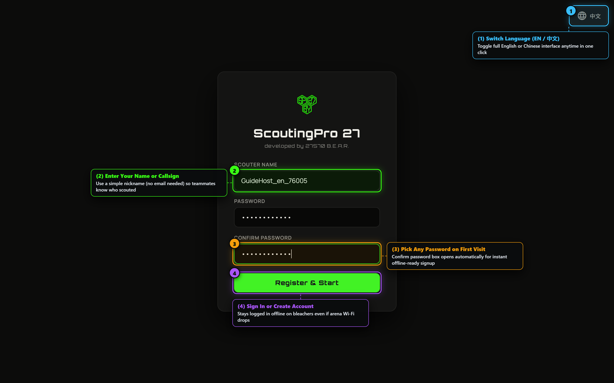

### Where to Tap & What to Enter
1. **Top-right `(1)` globe button**: Click anytime to switch the entire interface between **English** and **中文**.
2. **`(2)` SCOUTER NAME box**: Type a simple name or callsign your teammates recognize (for example `"Alex"` or `"27570_Sam"`). **No email address or verification code is needed.**
3. **`PASSWORD` & `(3)` `CONFIRM PASSWORD`**: On your first visit with a new name, entering a password automatically opens the **Confirm Password `(3)`** field so you can create an instant account right in the bleachers.
4. **Bright green `(4)` `Register & Start` button**: Click once to enter the lobby.

### What Success Looks Like
- You land on the **Event Lobby**:
  - **If you are a Scout / Volunteer**: Join your team's existing event using the 6-character code or QR code from Chapter 2 (no need to create a separate event).
  - **If you are the Event Host / Lead**: Click **Create Event**, name today's tournament (e.g., `2026 BIOBUZZ Regional`), and open the lobby.

### What If Signal Drops Later?
- Your sign-in session stays saved in your browser locally—even if stadium Wi-Fi disconnects or you close and reopen your tab, you stay logged in offline.

---

## Chapter 2: Scan QR to Join the Same Event (Even Without Venue Internet)

Once the Host creates an event, clicking **`Mobile QR`** in the top bar opens the invite window:

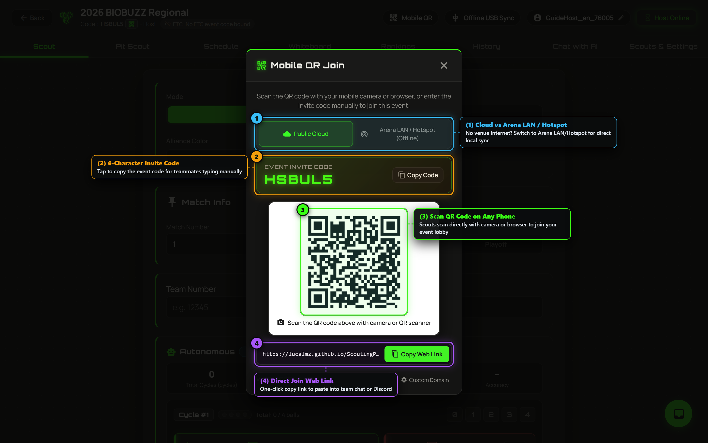

### Where to Tap & What to Enter
1. **Pick `(1)` Connection Channel (`Public Cloud` vs `Arena LAN / Hotspot (Offline)`)**:
   - When scouts have regular cellular/Wi-Fi internet, keep **`Public Cloud`**.
   - **Dead gym / no outside internet?** Turn on a phone hotspot or local router for the Host laptop and click **`Arena LAN / Hotspot (Offline)`**! The QR link automatically switches to the local network address so everyone still syncs peer-to-peer with zero internet.
2. **Scan `(3)` the big QR code**: Scouts point any phone camera (or QR app) directly at the screen to jump straight into the exact event.
3. **Can't scan from far away?** Tap `(2)` **`Copy Code`** (e.g., `56QA3C`) to type the 6-character code manually, or tap `(4)` **`Copy Web Link`** to drop the one-tap URL into Discord / team chat.

### What Success Looks Like
- Every scout sees the exact same Event Title and 6-character code in their top header with a green online indicator—any match or pit card submitted anywhere appears automatically on the Host rankings and schedule.
- **Understanding the 5-Tier Transport HUD Labels (Tap the status pill for details)**:
  - **`IPv6 Direct` / `LAN Direct` / `IPv4 Hole-punch`**: True peer-to-peer sub-50ms direct links! On startup, the desktop Host automatically probes physical-NIC UPnP/NAT-PMP/PCP (`50000–50009/UDP`) to boost cross-network P2P punch-through.
  - **`ECDH Tunnel (TLS)`**: If venue Wi-Fi blocks UDP or a scout's phone runs a VPN, the app automatically switches within 3.8 seconds to a **zero-TURN-quota** end-to-end encrypted WSS tunnel while silently probing in the background to upgrade back to Direct P2P.
  - **`TURN Relay`**: Strict last-resort fallback only when Direct P2P and the ECDH TLS tunnel are both unreachable.

---

## Chapter 3: 10-Second Pre-Match Setup: Mode, Alliance & Pit Cross-Check

Open the **`Scout`** tab before the match timer starts. Spend 10 seconds setting the top four items (if your Host assigned you on the schedule, an assignment banner at the top fills Match, Alliance, and Team # in 1 tap):

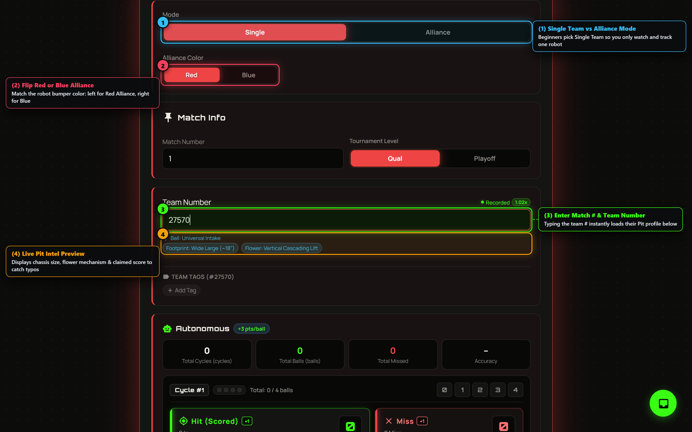

### Where to Tap & What to Enter
1. **`(1)` Mode (`Single` vs `Alliance`)**: Beginners always choose **`Single`**. Watch and count **one single robot** cleanly without stress.
2. **`(2)` Alliance Color switch (`Red` vs `Blue`)**: Look at the robot's bumpers/team marker on the field—flip left for **Red**, right for **Blue**. The whole form border turns red or blue so you never confuse sides.
3. **Match Info & `(3)` Team Number**: Verify `Match Number` (`1`) and `Qual` / `Playoff`, then type the **4–5 digit Team #** (`27570`) in box `(3)`.
4. **Verify `(4)` Live Pit Intel Preview**: As soon as you finish typing the team number, a blue/green hint card pops up right underneath showing Pit data—such as `Ball: Universal Intake`, `Footprint: Wide Large (~18")`, `Flower: Vertical Cascading Lift`, and `● Recorded 1.02x`.

### What Success Looks Like
- Glance from the preview card `(4)` to the real robot on the field—does the chassis footprint and lift match? Catching a wrong team number here takes 2 seconds and protects the entire team's rankings.

---

## Chapter 4: First 30 Seconds: Logging the Autonomous Phase

During the opening 30-second Autonomous period, keep your eyes on your assigned robot and work inside **`Autonomous +3 pts/ball`**:

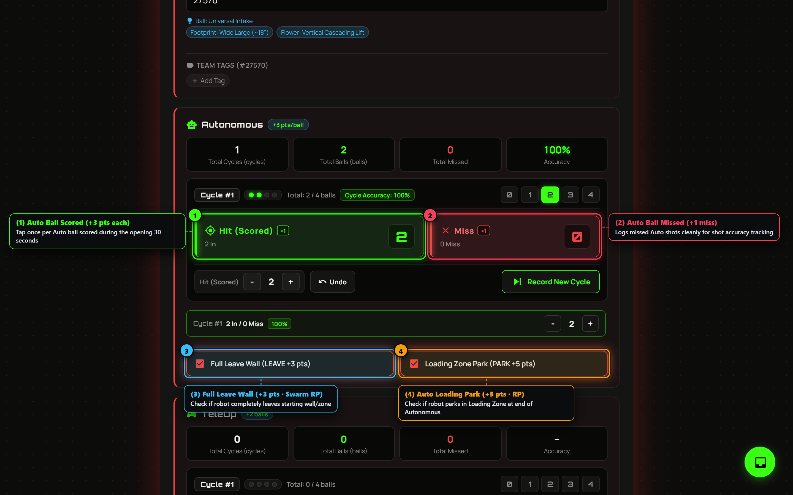

### Where to Tap
1. **Robot scores an Auto ball → tap `(1)` big green `Hit (Scored) +1`** (**+3 pts per Auto ball**). Or tap the `0 1 2 3 4` preset chips at upper-right to log multi-ball dumps quickly.
2. **Robot shoots and misses → tap `(2)` red `Miss +1`**: Doesn't add points, but tracks shot accuracy (%).
3. **Robot completely leaves starting wall/zone → check `(3)` `Full Leave Wall (LEAVE +3 pts)`**: Adds **+3 pts** AND counts toward **Swarm RP**!
4. **Robot parks cleanly in Loading Zone at end of Auto → check `(4)` `Loading Zone Park (PARK +5 pts)`**: Adds **+5 pts** AND counts toward **Swarm RP**!

### Mis-Tapped?
- Tap **`↩ Undo`** directly under the green button or tap **`-`** on the cycle row to subtract 1 ball immediately.

---

## Chapter 5: 2-Minute TeleOp Phase & How "Predict Cycle Time" Works

When drivers pick up the controllers for the 2-minute TeleOp period, move to **`TeleOp +2 balls`**. Your taps here directly unlock the tournament's most important speed metric: **Predict Cycle Time**:

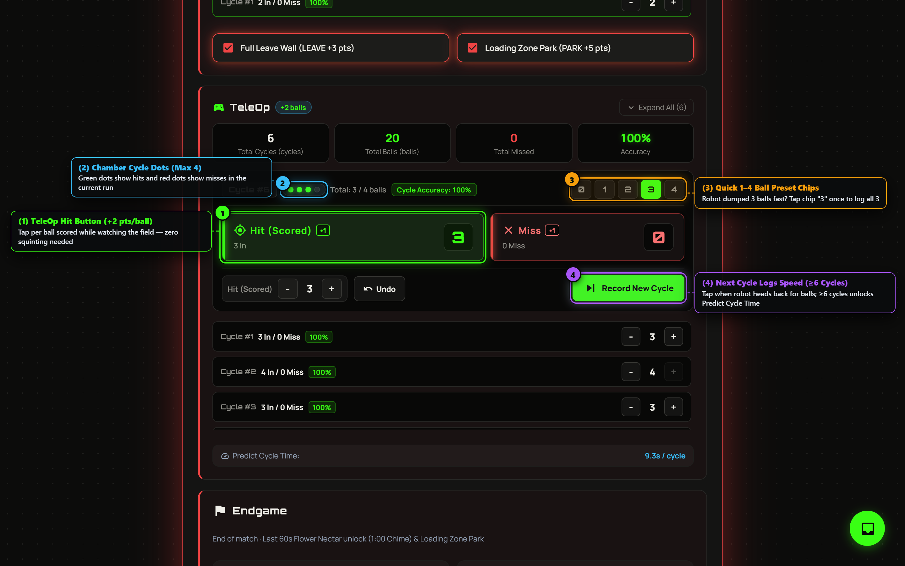

### What Counts as a "Cycle"?
Robot drives to intake balls → drives back and shoots that load = **1 cycle**:
1. **Tap `(1)` `Hit (Scored) +1`** (**+2 pts/ball**), or tap **`(3)` Quick 1–4 Ball Preset Chips**: If the robot rapidly dumps 3 balls, tapping **`3`** once logs all 3 balls instantly.
2. **Watch `(2)` Chamber Cycle Dots (Max 4)**: Green dots count scored balls and red dots count misses in the active trip.
3. **Important! When the robot turns around after scoring that load → tap bright green `(4)` `▶| Record New Cycle`**! *(If a cycle hits 4 balls, the app also starts the next cycle automatically, but when a robot leaves after 1, 2, or 3 balls, tapping `(4)` marks the exact turnaround timestamp).*

### Why Does `Predict Cycle Time` Require ≥ 6 Cycles?
Notice **`Predict Cycle Time: 9.3s / cycle`** at the bottom right of the TeleOp panel:
- **What it measures**: True repeatable cycle speed (pickup → score → repeat) used to forecast playoff scoring capacity.
- **Why < 6 cycles shows `— (<6 cyc)`**: You need timestamps across multiple round trips (`≥ 6 cycles`, giving at least `5` valid cycle gaps ≤ `120s` so stalled/disconnected intervals are ignored). The formula automatically **drops the single fastest outlier gap** (so one lucky accidental double-tap doesn't fake fast stats) and **averages the next 4 fastest gaps** (`9.3s / cycle`). Under 6 cycles, the app refuses to invent fake numbers and clearly shows `— (<6 cyc)`.

---

## Chapter 6: BIOBUZZ Endgame (Last 60 Seconds) & Offline-Safe Submit

Scroll to the bottom for the BIOBUZZ **`Endgame`** panel. Keep this core rule front and center:

> 🌸 **There is NO climbing/hanging in BIOBUZZ!** Endgame scoring is all about **last-60s Flower Nectars, Bottom Nectar Bonus, Pollens, Garden Balls, Loading Zone Park, and legal G418 Descore**.

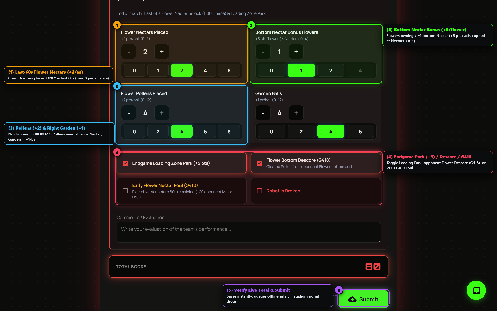

### Where to Tap & What to Count
1. **`(1)` `Flower Nectars Placed` (+2 pts/ball, 0–8)**:
   - ⚠️ **CRITICAL RULE**: Count **ONLY** Nectars placed **inside the final 60 seconds (after the 1:00 chime)**! Maximum 8 per alliance across the field. Use quick chips `0 1 2 4 8` or `- / +`.
2. **`(2)` `Bottom Nectar Bonus Flowers` (+5 pts/flower, `≤ Nectars`, 0–4)**:
   - Count how many of the 4 Flowers have at least one of **your alliance's Nectars sitting at the bottom** (+5 pts bonus per Flower!). The form prevents impossible values above Nectars or 4.
3. **`(3)` `Flower Pollens Placed` (+2 pts/ball, 0–12) & `Garden Balls` beside it (+1 pt/ball, 0–12)**:
   - Log smaller Flower **Pollens** in `(3)` (by rule, Flower Pollens score only when your alliance has placed Nectar).
   - Balls pushed/placed into your corner **Garden** go into `Garden Balls` on the right (**+1 pt/ball**).
4. **`(4)` Endgame Status Toggles**:
   - **`Endgame Loading Zone Park (+5 pts)`**: Check if the robot finishes parked in its Loading Zone (**+5 pts**, counts toward Swarm RP!).
   - **`Flower Bottom Descore (G418)`**: Check when a robot legally pulls opponent Pollen out from the bottom port of a Flower.
   - **`Early Flower Nectar Foul (G410)`**: If an impatient robot places a Nectar **before** the final 60 seconds, check this flag so strategy leads note the **+20 pt Major Foul** awarded to the opponent.
   - **`Robot is Broken`**: Check if the robot dead-stopped, tipped, or browned out so match averages include a clear mechanical note.
5. **Check `TOTAL SCORE` (`80`) & tap green `(5)` `Submit`**:
   - Need extra context? Add a quick note in `Comments / Evaluation` and tap **`Submit`**.

### Zero Signal When You Hit Submit?
- **Safe!** Every submission saves immediately to your device's encrypted offline queue first. The instant your phone catches 1 second of Wi-Fi, hotspot, or cellular signal, it syncs cleanly to the Host automatically.

---

## Chapter 7: Mobile Single-Handed Wizard: Scout Standing Up With One Thumb

Opening the exact same URL or QR link on any smartphone automatically launches the **thumb-first 5-Step Wizard**—no pinching or zooming required:

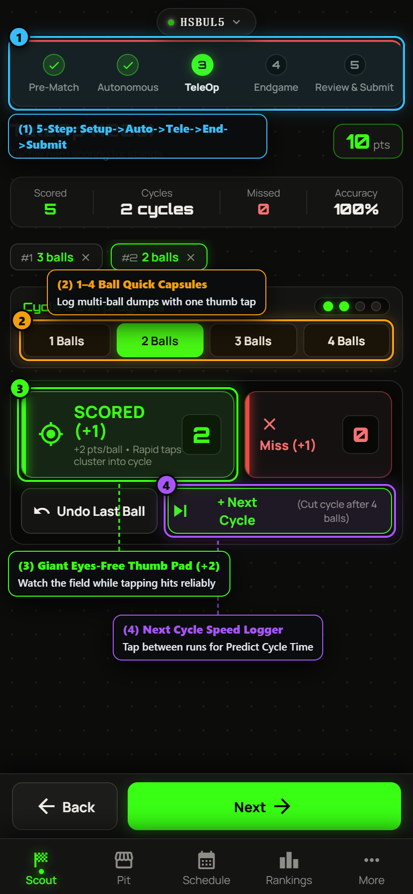

### How It Works on Your Phone
1. **`(1)` 5-Step Top Progress Bar**: Breaks the match into `1 Pre-Match → 2 Autonomous → 3 TeleOp → 4 Endgame → 5 Review & Submit`. Tap any step circle anytime to fix an earlier entry.
2. **`(2)` `1–4 Ball Quick Capsules`** + **`(3)` Giant Green `SCORED (+1)` Pad**: Giant thumb target lets you keep your eyes glued on the robot without staring down at your screen.
3. **`(4)` `+ Next Cycle` Speed Logger**: Sits right under your thumb alongside `Undo Last Ball` and `Miss (+1)`—tapping between runs captures clean **Predict Cycle Time** intervals from the bleachers. Tap **`Next →`** at the bottom to advance to Endgame & Submit, or use the bottom bar (`Scout / Pit / Schedule / Rankings / More`) to browse anytime.

---

## Chapter 8: Pit Scouting: Robot Size, Weight & Actual Pit Form Drawer

Before qualification matches kick off, walk the pits using the **`Pit Scout`** tab to record robot hardware traits and self-reported estimates:

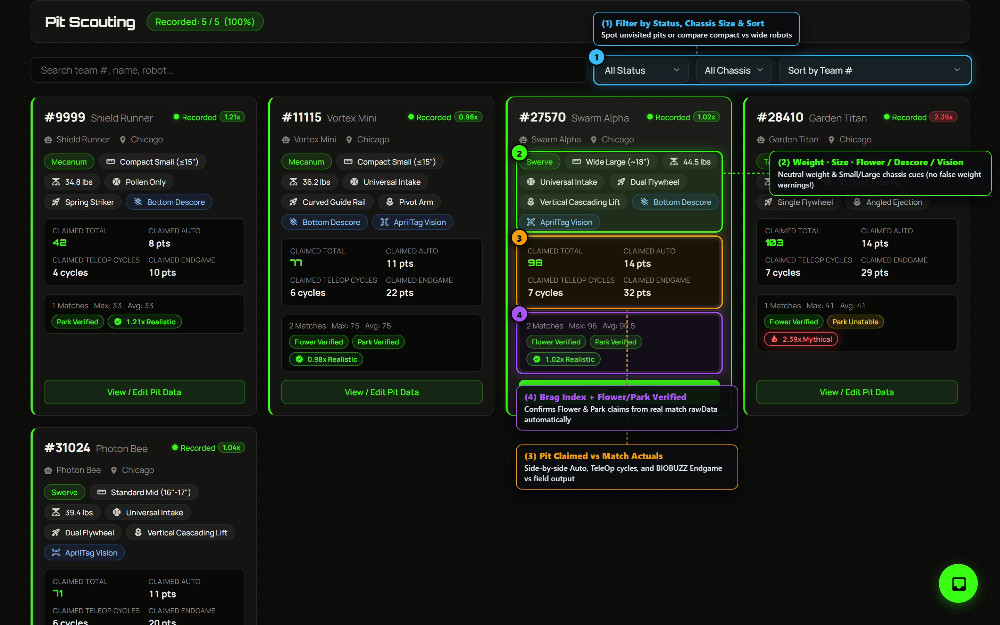

### Where to Tap & What to Look For
1. **Search Box & `(1)` Filter / Sort Dropdowns**: Search any team #, filter **`Unrecorded`** to spot missed pits immediately, or filter by **Chassis Footprint** (`Compact Small`, `Standard Mid`, `Wide Large`).
2. **`(2)` Hardware Trait Badges (Objective & Zero False Weight Warnings)**:
   - Notice Team `#27570`: **`Swerve`**, **`Wide Large (~18")`** (note how `#11115` shows **`Compact Small (≤15")`**), **`44.5 lbs`**, **`Universal Intake`**, **`Dual Flywheel`**, **`Vertical Cascading Lift`**, **`Bottom Descore`**, and **`AprilTag Vision`**.
   - > 🛡️ **Clean Design**: Robot weight and Small/Large footprint are shown purely as neutral strategic intel (e.g., to spot whether two wide robots might jam the same lane)—**never triggering annoying false "overweight" alerts**.
3. **`(3)` Pit Claimed vs Match Actuals & `(4)` Brag Index Verification**:
   - Card `(3)` lines up what the team told you in the pits (`Claimed Total 98 / Auto 14 / 7 cycles / Endgame 32`) directly above real match performance (`2 Matches · Max 96 · Avg 90.5`).
   - Compare `#27570` (`(4)`) vs `#28410` on the right:
     - **`#27570`** earns green **`Flower Verified`**, **`Park Verified`**, and **`1.02x Realistic`**—they deliver on every claim!
     - **`#28410`** claimed `103` pts but averages `41` pts, automatically displaying yellow **`Park Unstable`** and red **`2.39x Mythical`**!
### What Does the Actual Pit Form Drawer Look Like?
Tap green **`View / Edit Pit Data`** at the bottom of any card to slide open the **Pit Form Drawer** (works 100% offline as well):

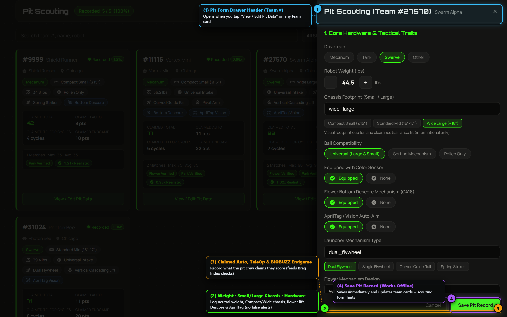

1. **`(1)` Drawer Header**: Double-check the Team # at top right (`Team #27570`) so you are logging the right pit booth.
2. **`(2)` Core Hardware & Tactical Traits (Neutral Specs, Zero False Alerts)**:
   - **Drivetrain**: Pick `Mecanum`, `Swerve`, `Tank`, or `Other`;
   - **Robot Weight (lbs)**: Use `-` / `+` or type the weight (e.g., `44.5 lbs`);
   - **Chassis Footprint (Small / Large)**: Pick `Compact Small (≤15")`, `Standard Mid (16"-17")`, or `Wide Large (~18")` so drive teams immediately know whether two partners can share tight lanes;
   - **Ball & Mechanism Toggles**: Toggle **Universal Intake / Sorting / Pollen Only**, **Color Sensor**, **Flower Bottom Descore (G418)**, **AprilTag Vision**, and **Launcher / Flower Lift Mechanism**.
3. **`(3)` Claimed Auto, TeleOp & BIOBUZZ Endgame**: Scroll slightly down to enter what the pit crew says they can score (Auto pts, TeleOp cycles, last-60s Nectars/Pollens, Endgame Park)—these numbers power the **Brag Index** comparison above.
4. **`(4)` Tap Green `Save Pit Record`**: Updates the team card immediately and shares specs with your scouting team.

---

## Chapter 9: Match Schedule & Assignments: How Batch Scheduling Works

Click the **`Schedule`** tab to organize who watches which robot across every match—eliminating duplicate scouting on one robot while leaving another unscouted:

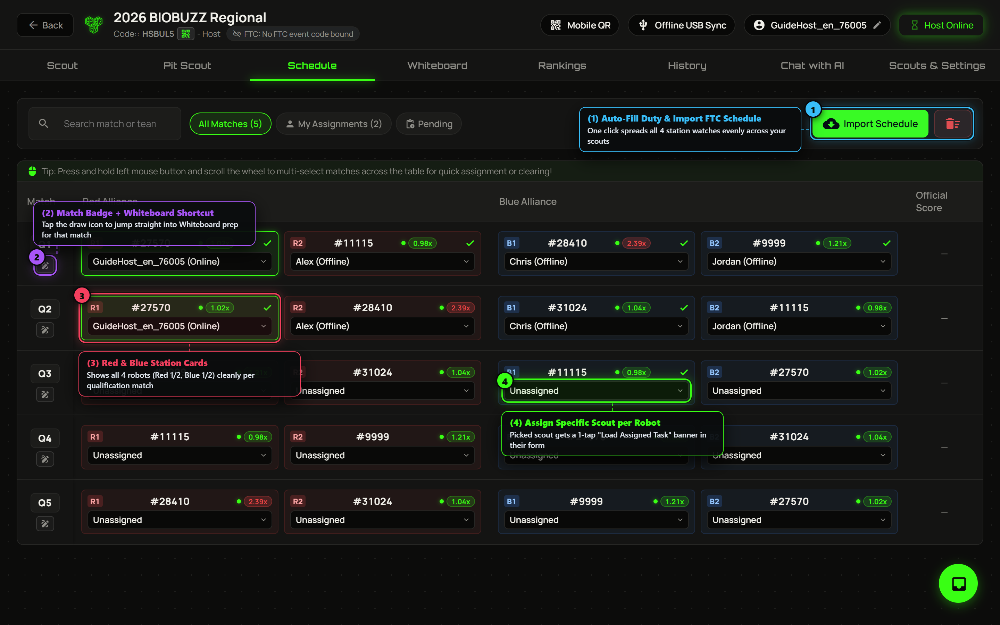

### Step 1: Import Official Matches (or Filter Existing Ones)
1. **`(1)` `Import Schedule`**: If you bound an official FTC Event Code in `Scouts & Settings`, click **`Import Schedule`** to pull the full Qualification match list (`R1, R2, B1, B2`) automatically.
2. Use the filter pills (`All`, `My Assignments`, `Pending`, `Discrepancy`) anytime to spot unassigned stations or audit missing/duplicate submissions.

### Step 2: Two Ways to Assign Scouts
1. **Method A — Single-Station Dropdown (Quick Tweaks)**:
   - Under any match's **`(3)` Red / Blue Station Cards**, open the **`(4)` Scout Dropdown** and pick a scout name.
2. **Method B — Drag-Select + Auto-Distribute (Fastest for 30+ Matches)**:
   - **Click and hold your left mouse button** on the match table and **drag across rows** (you can scroll your **mouse wheel** while dragging to sweep dozens of matches at once!).
   - Release the mouse to reveal the **Bulk Action Bar**: pick a target station (`All Stations` or specific `Red 1` / `Blue 2`) and click **`Auto-Assign Evenly`** to distribute duties fairly across every scout in the room (or click **`Clear`** to reset).

### Step 3: How Scouts Receive Their Tasks
- The moment a scout is assigned on the schedule, **their phone/laptop `Scout` tab displays a 1-tap Task Banner** at the top (`Next: Q3 · Red #27570`)—tapping it pre-loads the match, alliance color, and Team # automatically!
- Need a quick pre-match huddle? Click the **`(2)` Draw Icon** under `Q1` / `Q2` to jump straight into the **Tactical Whiteboard** with all 4 teams of that match loaded.

---

## Chapter 10: Rankings & Brag Index: Picking Honest Alliance Partners

Once qualification matches accumulate, open **`Rankings`** (scroll the table horizontally to inspect every column):

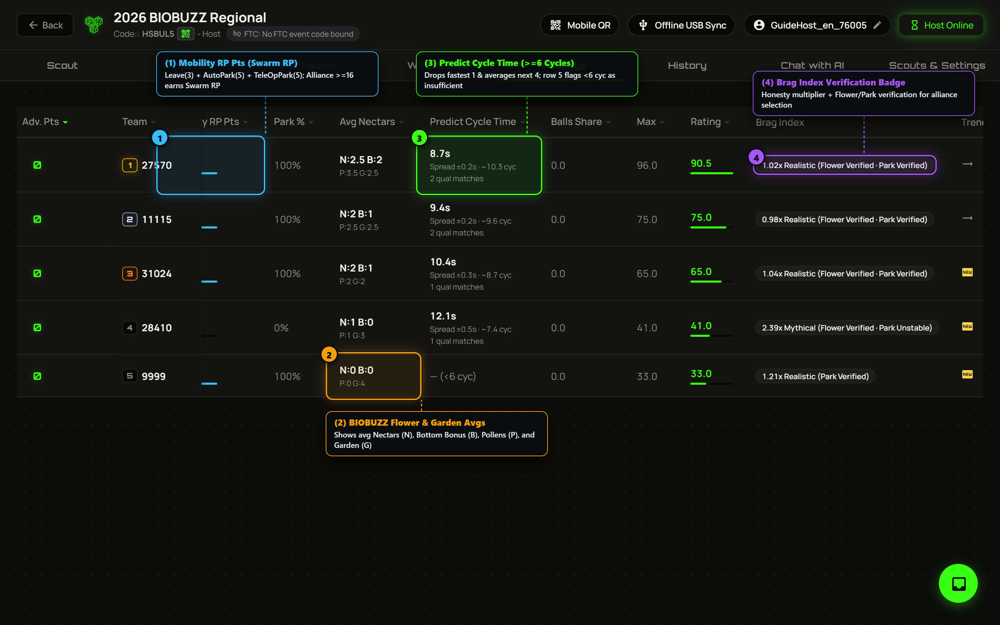

### The 4 Columns Every Captain Checks Before Alliance Selection
1. **`(1)` Sticky Column #1 `Adv. Pts` (Official Advancement Points)**:
   - When you bind an official FTC Event Code (see [Chapter 15](#chapter-15-official-ftc-data-sync-roll-down-advancement-and-custom-turn)), the first pinned column computes live total Advancement Points (Qual + Alliance + Playoff + Judged Awards per FTC Rule A215) and tags each team's live cut status: **`ADVANCING`**, **`ROLLED DOWN`**, **`PRE-QUAL`**, **`DECLINED`**, **`INELIGIBLE`**, **`BUBBLE`**, or **`COMPETING`**!
2. **`(2)` `Predict Cycle Time` (`≥ 6 Cycles`)**:
   - Row 1 (`#27570`) displays green **`8.7s · Spread ±0.2s · ~10.3 cyc · 2 qual matches`**—fast AND ultra-consistent!
   - Row 5 (`#9999`) only logged 4 cycles, so it clearly displays **`— (<6 cyc)`** rather than guessing.
3. **`(3)` `Min Cycles` & `Cycle Variance`** (immediately right of `Predict Cycle Time`):
   - **`Min Cycles`** shows the team's lowest single-match TeleOp cycle count in non-broken matches (exposing bad-match floors hidden by averages).
   - **`Cycle Variance`** computes population variance across non-broken matches—lower variance (`0.0`, `0.3`) means rock-solid match-to-match consistency.
4. **`(4)` `Brag Index Verification Badge`**:
   - Look for **`≤ 1.25x Realistic`** (green) with **`Flower Verified · Park Verified`** (`#27570` = `1.02x Realistic`).
   - Multiplier key: `≤ 1.25x` = **Realistic**; `> 1.25x` = **Optimistic**; `> 1.65x` = **Overclaimed**; `> 2.20x` = **Mythical** (`#28410` at `2.39x Mythical` + `Park Unstable`). Always trust proven field data!

> 💡 **Scroll left in the table to also inspect `Mobility RP Pts` (`Swarm RP`) & `Avg Nectars` (`BIOBUZZ Flower & Garden`)**:
> - **`Mobility RP Pts`**: Combines **Leave (+3) + Auto Park (+5) + Endgame Park (+5)** = max **13.0 pts** per robot; two robots combining for **≥ 16 pts** earn your alliance the **Swarm RP**!
> - **`Avg Nectars`**: Displays `N:2.5 B:2 / P:3.5 G:2.5` (avg **Nectars**, **Bottom Bonus Flowers**, **Pollens**, **Garden Balls**), cleanly separating Flower specialists from Garden-only pushers.

---

## Chapter 11: Tactical Whiteboard: Plan & Play Animated Routes Before Queuing

One minute before stepping onto the field, pull your alliance partner over to the **`Whiteboard`** tab:

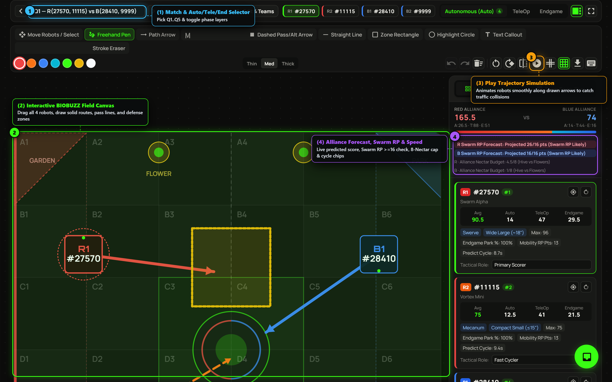

### Where to Tap
1. **`(1)` Match & Phase Layer Selector (`Autonomous (Auto)` / `TeleOp` / `Endgame`)**: Pick your upcoming match (`Q1 - R(27570, 11115) vs B(28410, 9999)`) and draw separate clean route plans for each match phase.
2. **`(2)` Interactive BIOBUZZ Field Canvas**: Drag `R1`, `R2`, `B1`, `B2` robots to starting positions, draw **Path Arrows** (solid routes), **Dashed Pass/Alt Arrows**, and **Zone Rectangles**.
3. **`(3)` `Play Sim` Animation Button**: Click the round play icon `(3)` to watch all robots smoothly animate along your drawn paths simultaneously—catching mid-field lane collisions *before* the buzzer sounds!
4. **`(4)` Alliance Forecast, Swarm RP & Speed Strip**: Instantly projects **`RED 165.5 vs BLUE 74`**, verifies **`R Swarm RP Forecast: Projected 26/16 pts (Swarm RP Likely)`**, tracks the **`8-Nectar` alliance cap**, and surfaces each partner's **`Wide Large` / `Compact Small` footprint**, **`Predict Cycle: 8.7s`**, and tactical role right underneath.

---

## Chapter 12: How to Edit & Fix Saved Match Records

Submitted a match and immediately realized you missed 1 ball in Cycle 2 or typed `27571` instead of `27570`? **No need to delete and re-enter!** Open the **`History`** tab anytime to edit:

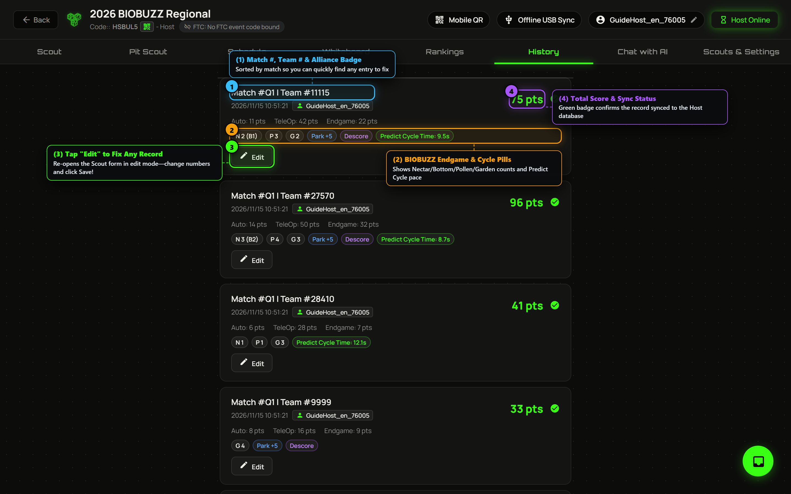

### Where to Tap
1. **Locate `(1)` Match #, Team # & Scout Name**: Cards are sorted chronologically (`Match #Q1 | Team #11115`) so you can find your entry in seconds.
2. **Verify `(2)` BIOBUZZ Pills & `(4)` Score / Sync Status**: Shows `N2 (B1) P3 G2 Park +5 Descore Predict Cycle Time: 9.5s` and green **`75 pts ✔`** (confirming the record synced to the Host).
3. **Tap `(3)` `Edit`**:
   - Jumps straight back into the **`Scout`** form in **Edit Mode** with all your original Auto, TeleOp, cycle gaps, BIOBUZZ Endgame counters, and notes restored;
   - Fix the numbers and tap **`Save`** at the bottom—Rankings and Brag Index update automatically!
   - > 💡 **Permission Tip**: Regular scouts can edit **their own** submissions; the **Event Host / Captain** can edit **any scout's** record in the room.

---

## Chapter 13: How to Bind an API Key & Use AI Copilot

Before Alliance Selection, instead of manually scanning dozens of rows, bind an LLM **API Key** and open the side-by-side **AI Copilot** workspace so the built-in AI Coach reads all live match telemetry, Predict Cycle Times, and Brag Index badges right alongside your Rankings or Whiteboard:

### Step 1: Configure Multi-Protocol API Profiles in Top-Bar `AI Copilot ⚙ Settings`

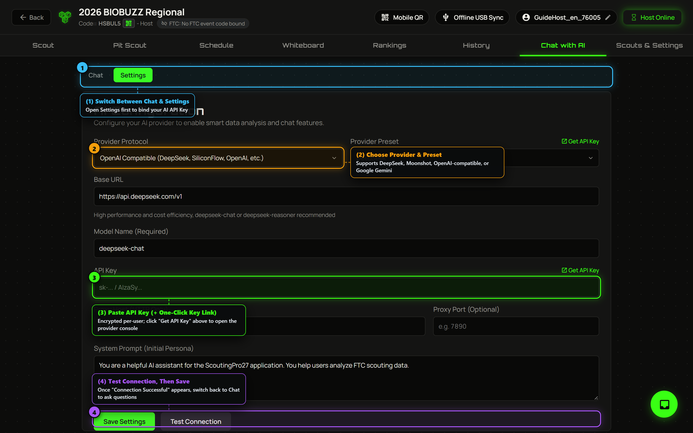

1. **Click the ⚙ gear icon next to `AI Copilot` in the top bar** to open the **AI Configuration** dialog, then pick `(1)` your **Provider Protocol** (**OpenAI Compatible**, **Google Gemini**, or native **Anthropic Claude**).
2. **Choose `(2)` Provider Preset & Multi-Profile Roster**:
   - Pick a built-in preset (`DeepSeek`, `Moonshot / Kimi`, `OpenAI`, `Google Gemini`, `Anthropic Claude`, etc.) to auto-fill the Base URL and recommended model (local `Ollama` loopback endpoints work without an API key); you can save multiple profiles in the left roster and switch anytime.
3. **Generate & Paste `(3)` `API Key`**:
   - Need a key? Click the green **`↗ Get API Key`** link above the input box to open the provider's console, copy your `sk-...` / `AIzaSy...` key, and paste it in (AES-256 encrypted per user).
4. **Click `(4)` `Test Connection`, then green `Save Settings`**:
   - Once verified, save and close the modal—you can now toggle **AI Copilot** from any tab!

### Step 2: Open the Persistent `AI Copilot` Dock & Ask Plain-Language Questions

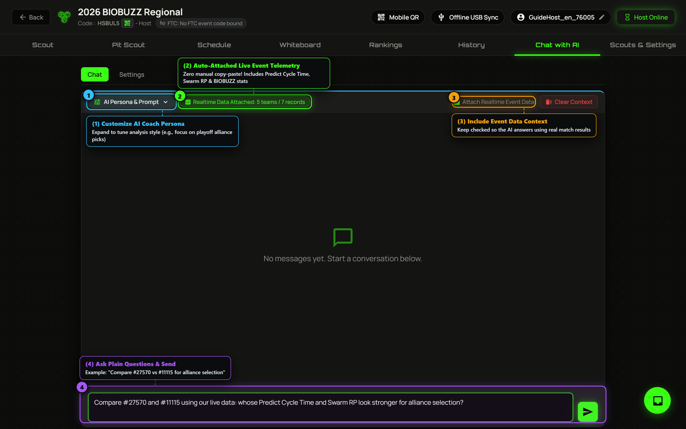

1. **Click `AI Copilot` in the top bar (or press `Alt + I`)** to open the right-side dock alongside your main view without hiding Rankings or the Tactical Whiteboard (on mobile, tap **`More → AI Chat`** in the bottom bar; once open, the 5th slot dynamically switches to **`AI Chat`**).
2. **`(1)` Choose AI Coach Persona**: Switch instantly between the 5 built-in personas (**`Alliance Strategist`**, **`Pre-Match Coach`**, **`Brag & Risk Auditor`**, **`15-Sec Pit Brief`**, and **`Custom Prompt`**).
3. **`(2)` `Live Data On` Toggle + `(3)` Live Telemetry Meter**:
   - **Zero copy-pasting spreadsheets!** Keep `(2)` enabled and `(3)` displays how many live rankings, schedules, and pit records are bundled with every question (expand the tune icon beside it to toggle individual data sections).
4. **Type in `(4)` & Send (`@team` & `/slash` supported)**:
   - Type **`@`** to tag and focus specific teams, **`/`** for 5 quick analysis commands (`/pick`, `/match`, `/compare`, `/audit`, `/brief`), or ask naturally—e.g., `"Compare #27570 and #11115 using our live data: whose Predict Cycle Time and Swarm RP look stronger for alliance selection?"`
   - Reasoning models' thinking tokens automatically collapse into a dedicated thinking drawer separate from the final answer; any **`#team`** badge supports hover preview and click-to-open Team Detail Drawer, plus multi-thread history and 1-click Markdown export.

### Step 3: Start a Direct Voice Call with AI Copilot

1. **Click the `Voice` button next to Send in the composer** to start talking to AI Copilot without leaving your live event data. Click **`Minimize to bar`** anytime to keep chatting hands-free while browsing Rankings, Schedule, or the Whiteboard.
2. **Google Gemini / OpenAI Profiles (Native Full-Duplex Realtime Voice)**:
   - With **Google Gemini** (defaults to `gemini-3.8-live`, with `gemini-3.8-live-extended-thinking` and selectable **`Voice`** options like `Kore`, `Puck`, `Zephyr`, `Aoede`, `Charon`, and `Fenrir` in the call settings) or **OpenAI** (defaults to `gpt-realtime`), ScoutingPro 27 automatically opens a low-latency full-duplex live audio channel through the backend.
   - Starts in **`Hands-Free VAD`** mode by default: just speak naturally and interrupt AI replies mid-sentence by talking or clicking **`Interrupt`**. In noisy bleachers, switch anytime to **`Push-to-Talk`** (hold the on-screen button or **Spacebar**, release to send).
   - Live speech captions are saved automatically into the active chat thread with a **`Voice`** badge.
3. **DeepSeek / Claude / Ollama & Other Providers (Universal Turn-Based Voice + Read Aloud)**:
   - On models without a native realtime audio endpoint, the call switches cleanly to turn-based Voice Mode: hold to speak and the backend transcribes your audio via **`Speech Recognition (STT)`** (automatically or manually borrowing any saved Gemini, OpenAI, Groq, or SiliconFlow profile so desktop clients never stall on offline Web Speech), then reads streamed reply sentences aloud in real time.
   - **Listen to any saved message**: every AI response card also includes a **`Read aloud`** (🔊) toggle button.
4. **Microphone Access Tip**:
   - The native desktop app accesses your microphone directly; when opening from a phone browser over LAN, mobile browsers require `HTTPS` or `localhost` to permit microphone capture.

---

## Chapter 14: How to Add & Manage Custom Fields

Want to track extra team-specific observations beyond built-in BIOBUZZ scoring (e.g., `"Defense Resilience 1–5"`, `"Intake Jam Risk"`, or `"Driver Comms"`)? Hosts can add custom fields in 30 seconds without touching code:

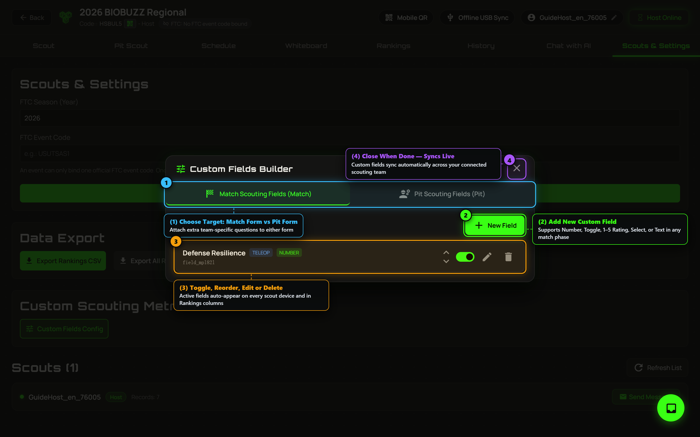

### Where to Tap
1. **Open `Scouts & Settings` → click `Custom Fields Config`** (the `tune` icon button) to open the modal above.
2. **Choose `(1)` Target Form**: Pick **`Match Scouting Fields (Match)`** for stand scouts or **`Pit Scouting Fields (Pit)`** for pit scouts.
3. **Click `(2)` Green `+ New Field`**:
   - Enter a **Field Name** (e.g., `Defense Resilience`);
   - Pick which **Phase** it appears in (`Autonomous`, `TeleOp`, `Endgame`, or `Post-Match Overall`);
   - Choose a control type (**Number**, **Yes/No Toggle**, **1–5 Rating**, **Single/Multi-Select**, or **Text**) and save.
4. **Manage `(3)` Field Cards & `(4)` Close to Sync Live**:
   - Reorder with up/down arrows, toggle active on/off, edit, or delete anytime;
   - Closing the modal pushes the new field live to every connected scout form—and lets you display it as a column in **`Rankings`**!

---

## Chapter 15: Official FTC Data Sync, Roll-Down Advancement, and Custom TURN

Once you bind your official FTC Event Code, ScoutingPro 27 connects through its backend proxy to the **FIRST Inspires FTC Events API v2.0 (`https://ftc-api.firstinspires.org`)** to automatically fetch team rosters, qualification/playoff schedules, official match scores, and **live Advancement Points with roll-down status**—zero manual spreadsheet typing required:

> 💡 **Do scouts or coaches need to register their own FTC API Token?**  
> **No!** The Java backend comes pre-configured with built-in FTC Events API credentials proxied through `/api/ftc/{season}/...`. As long as the **Host laptop** has internet access when binding/refreshing, all connected scouts share the synced results (and can still scout offline afterward). *(Optional for server admins: override built-in credentials anytime via env vars `FTC_API_USER` and `FTC_API_TOKEN` before launching the backend.)*

### Step 1: Find Your Season Year & Event Code on FTC Events
1. Open **`https://ftc-events.firstinspires.org/`** in a browser and click your tournament page.
2. Check the browser URL—it always follows:  
   `https://ftc-events.firstinspires.org/<SeasonYear>/<EventCode>`
3. Copy those two values carefully (**watch the starting-year rule!**):
   - **FTC Season (Year)**: Enter the **starting year** from the URL. For example, the 2025–2026 competition season uses `/2025/...`, so enter **`2025`** (and **`2026`** for 2026–2027).
   - **FTC Event Code**: Copy the alphanumeric code at the end of the URL (e.g., `AUADQ`, `AECMP`, `USUTSAS1`, `CNSHQ`).

### Step 2: Bind the Official Event & Optional Custom TURN in `Scouts & Settings`

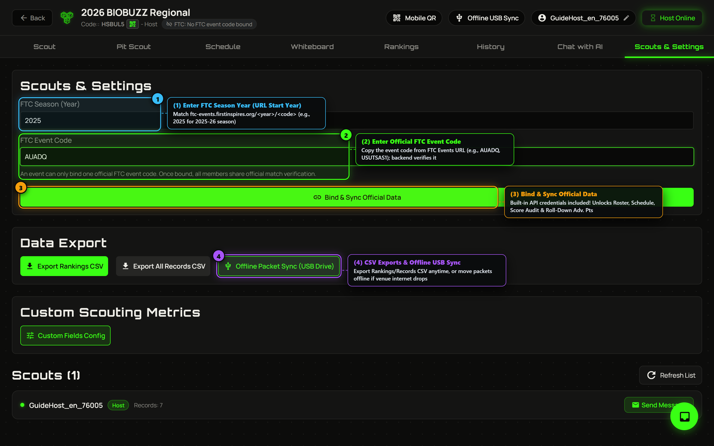

1. Open the far-right **`Scouts & Settings`** tab on the Host computer.
2. Fill **`(1)` `FTC Season (Year)`** (e.g., `2025`).
3. Fill **`(2)` `FTC Event Code`** (e.g., `AUADQ`—automatically trimmed/uppercased and validated against FIRST's servers).
4. Click **`(3)` `Bind & Sync Official Data`**:
   - Once verified, the top header shows the green **`FTC: <CODE> (<YEAR>)`** verified badge and pulls initial official match scores and advancement standings automatically;
   - During the tournament, click **`Update & Re-sync Official Data`** anytime to refresh latest results.
5. **Panel `(4)` (Host Only): `Custom TURN Relay Server (Optional)` & Data Export / USB Sync Below**:
   - **Leave blank for standard events!** If your team operates a private `coturn`, Twilio, or dedicated Metered TURN server, enter your `turn:` / `turns:` URLs, username, and credential and click **`Save Custom TURN`**. Credentials are encrypted with AES-256 in the Host database and automatically synced to all scouts (bypassing the shared default fallback account); click **`Reset to Default Fallback`** anytime to revert;
   - Directly below sits **Data Export** (`Export Rankings CSV`, `Export All Records CSV`) and **Offline Packet Sync (USB Drive)**.

### Step 3: 4 Places Official Data Powers Up Your Event Automatically

| What Official Info You Want | Where to Tap in ScoutingPro 27 | What Updates Automatically |
| :--- | :--- | :--- |
| **1. Full Event Team Roster** | **`Pit Scout`** → top-right **`Sync Official Roster`** | Pulls all officially registered team numbers & names into your Pit dashboard so Pit scouts never skip a team or mistype numbers |
| **2. Qualification & Playoff Schedule** | **`Schedule`** → **`Import Schedule`** → **`FTC Official Sync`** → **`Fetch Schedule from FTC Official API`** | Imports every `R1 / R2 / B1 / B2` match card and published scores in one click—ready immediately for drag-select auto-assignment |
| **3. Official Score Reconciliation Audit** | **`Schedule`** → **`Discrepancy`** pill / **`Top 5 Audit`** button | Compares bleacher-scouted totals against official net match scores (excluding fouls) so captains instantly spot mis-scouted matches |
| **4. Live Advancement Points & Roll-Downs** | **`Rankings`** → sticky Column #1 **`Adv. Pts`** (auto-updated on sync/load) | Totals Qual + Alliance + Playoff + Judged Awards (FTC Rule A215 max-1 award) and reads official `/advancement` slots & roll-down state to badge **`ADVANCING`**, **`ROLLED DOWN`**, **`PRE-QUAL`**, **`DECLINED`**, **`INELIGIBLE`**, or **`BUBBLE`** *(hover cell for full 4-part breakdown & official `#slot`)* |

---

## Chapter 16: Emergency Troubleshooting FAQ

| Situation | Exact 5-Second Fix |
| :--- | :--- |
| **Q1: I tapped `Hit` one extra time by mistake!** | Tap **`↩ Undo`** under the big green button, or tap **`-`** next to that cycle in the cycle list below. |
| **Q2: The bleachers have zero cellular/Wi-Fi signal when I click Submit.** | Submit anyway! Your data saves safely in your device's local queue and automatically uploads to the Host the second connectivity returns. |
| **Q3: Neither Cloud nor Host Hotspot works in the venue—how do I move data?** | Click **`Offline USB Sync`** in the top bar (or **`More → Tools`** on mobile) to export a `.info` sync packet (Hosts can also export `.event` event setup packages, formatted internally as JSON), send it via USB stick/AirDrop/Bluetooth to the Host laptop, and click **Import** in `Offline USB Sync`. |
| **Q4: Why does a team show `— (<6 cyc)` instead of seconds in Predict Cycle Time?** | Predict Cycle Time requires **at least 6 logged TeleOp cycles** (`≥ 5` valid cycle gaps ≤ `120s`) using **`Record New Cycle`** / **`+ Next Cycle`**, then drops the single fastest outlier and averages the next 4 gaps. |
| **Q5: How do I remember BIOBUZZ Endgame rules quickly?** | **No climbing!** Only: **last-60s Nectars (+2)**, **Bottom Nectar Flowers (+5 each)**, **Pollens (+2)**, **Garden Balls (+1)**, **Loading Park (+5)**, **G418 Descore**, and check **G410** if a Nectar goes in before the 1:00 mark! |
| **Q6: Binding fails with `"FTC official event not found"` or `"service unreachable"`!** | Double-check `ftc-events.firstinspires.org/<year>/<code>`—make sure you entered the season **start year** (`2025` for 2025–26, not `2026`). If the Host laptop is completely offline at the venue, use **`Import Schedule` → `CSV`** temporarily and click **`Update & Re-sync Official Data`** once internet returns. |
| **Q7: A scout phone shows `ECDH Tunnel (TLS)` while running a VPN—is that normal?** | **Yes—and it uses zero TURN quota!** When mobile VPNs (such as Clash/TUN) or strict venue Wi-Fi block UDP, ScoutingPro 27 seamlessly uses the end-to-end encrypted WSS tunnel while probing for Direct P2P in the background. Disabling the phone VPN upgrades back to `IPv6 Direct` / `IPv4 Hole-punch`, or Hosts can add a **Custom TURN** server in `Scouts & Settings` (see [VPN P2P Test Guide](./testing/VPN_P2P_TEST_GUIDE.md)). |
| **Q8: macOS says "cannot be opened because the developer cannot be verified"!** | In Finder → Applications, **right-click** (or Control-click) ScoutingPro27 → choose **"Open"** → click **"Open"** in the dialog. This is a one-time step. If that doesn't work, go to **System Settings → Privacy & Security** and click **"Open Anyway"** at the bottom. See [Chapter 0](#chapter-0-download--install-macos-users-read-this-first) for full details. |
