# ScoutingPro 27 新手全流程使用手册（BIOBUZZ 赛季 · 零基础看台/维修区保姆级指南）

> **欢迎使用 ScoutingPro 27！** 这是一份写给**第一次碰电脑或手机打分、零基础的新手队员、家长与场边志愿者**的保姆级说明书。  
> 全篇没有任何晦涩技术术语——每一章都只讲 4 件实在事：**你要点哪里（对应图片里的彩框编号）→ 填什么 → 看到什么才算成功 → 点错了/没网了怎么办**。
>
> 🌐 **需要英文版手册？** 请切换至 [**English User Guide (`USER_GUIDE.en.md`)**](./USER_GUIDE.en.md) 或返回 [**双语速查总入口 (`USER_GUIDE.md`)**](./USER_GUIDE.md)。

---

## 🧭 30 秒赛场极速分工卡（拿来就用）

上场前先看自己负责哪个岗位，直接跳到对应章节即可：

| 你的赛场角色 | 要点哪个顶部页签 | 你在现场只需要做什么 | 对应章节 |
| :--- | :--- | :--- | :--- |
| 🚩 **主机 / 队长（通常 1 人用笔记本）** | 登录后建赛事 → **手机扫码** / **赛程排班** / **考察员与设置** | 建好比赛活动、拉人扫码进场、绑定 **FTC 官方赛事代码**一键拉名单与赛程、拖拽批量排班，并按需配置**自定义字段** | [第 1 章](#第-1-章打开软件并秒建你的名字) · [第 2 章](#第-2-章拉队友扫码进同一场比赛没外网也不怕) · [第 9 章](#第-9-章赛程排班谁盯哪台车怎么批量排班) · [第 14 章](#第-14-章怎么自定义字段给打分表展位表加专属指标) · [第 15 章](#第-15-章怎么从-ftc-官方获取赛事信息名单赛程对账与顺延晋级分) |
| 📱 **看台计分员（拿手机在看台盯车）** | **表单** · **历史** | 点顶部排班横幅秒开计分；如果刚才哪场点错了，去 **「历史」** 点 **「编辑」** 就能改回正确分数 | [第 3 章](#第-3-章开赛前-10-秒准备选模式阵营与核对队号) ~ [第 7 章](#第-7-章手机单手盲操向导看台站着一只手记完) · [第 12 章](#第-12-章怎么改记录提交错了随时回到表单修改) |
| 🔧 **维修区侦察员 (Pit Scout)** | **展位侦察** | 拿着手机去各队展位点开**抽屉表单**：记录机器人**体重**、**紧凑小车 / 宽体大车**、放花机构与自述分数 | [第 8 章](#第-8-章展位侦察-pit-scout怎么记大小车体重与实际录入界面) |
| 🎯 **教练 / 战术与选联队决策手** | **排名** · **战术白板** · **AI 对话** | 看首列**官方晋级分（含顺延）**、**预测单轮耗时**、**Swarm RP**、**吹牛指数**，绑好 **API Key** 让 AI 直接读取全场实测数据帮你挑联队，赛前用白板推演路线 | [第 10 章](#第-10-章排名天梯与吹牛指数怎么选真正靠谱的联队队友) · [第 11 章](#第-11-章战术白板赛前-1-分钟画路线并播放动画防撞车) · [第 13 章](#第-13-章怎么绑定-api-key-并和-ai-对话) · [第 15 章](#第-15-章怎么从-ftc-官方获取赛事信息名单赛程对账与顺延晋级分) |

---

## 目录

1. [打开软件并秒建你的名字](#第-1-章打开软件并秒建你的名字)
2. [拉队友扫码进同一场比赛（没外网也不怕）](#第-2-章拉队友扫码进同一场比赛没外网也不怕)
3. [开赛前 10 秒准备：选模式、阵营与核对队号](#第-3-章开赛前-10-秒准备选模式阵营与核对队号)
4. [前 30 秒自动阶段 (Autonomous) 怎么记](#第-4-章前-30-秒自动阶段-autonomous-怎么记)
5. [2 分钟手动阶段 (TeleOp) 与“预测单轮耗时”怎么算](#第-5-章2-分钟手动阶段-teleop-与预测单轮耗时怎么算)
6. [BIOBUZZ 终局 (Endgame) 最后 60 秒规则与核对提交](#第-6-章biobuzz-终局-endgame-最后-60-秒规则与核对提交)
7. [手机单手盲操向导：看台站着一只手记完](#第-7-章手机单手盲操向导看台站着一只手记完)
8. [展位侦察 (Pit Scout)：怎么记大小车、体重与实际录入界面](#第-8-章展位侦察-pit-scout怎么记大小车体重与实际录入界面)
9. [赛程排班：谁盯哪台车、怎么批量排班](#第-9-章赛程排班谁盯哪台车怎么批量排班)
10. [排名天梯与“吹牛指数”：怎么选真正靠谱的联队队友](#第-10-章排名天梯与吹牛指数怎么选真正靠谱的联队队友)
11. [战术白板：赛前 1 分钟画路线并播放动画防撞车](#第-11-章战术白板赛前-1-分钟画路线并播放动画防撞车)
12. [怎么改记录：提交错了随时回到表单修改](#第-12-章怎么改记录提交错了随时回到表单修改)
13. [怎么绑定 API Key 并和 AI 对话](#第-13-章怎么绑定-api-key-并和-ai-对话)
14. [怎么自定义字段：给打分表/展位表加专属指标](#第-14-章怎么自定义字段给打分表展位表加专属指标)
15. [怎么从 FTC 官方获取赛事信息（名单 / 赛程 / 对账 / 晋级分顺延）](#第-15-章怎么从-ftc-官方获取赛事信息名单赛程对账与顺延晋级分)
16. [常见问题急救箱（点错了 / 断网了 / U盘同步 / 抓不到官方数据）](#第-16-章常见问题急救箱)

---

## 第 1 章：打开软件并秒建你的名字

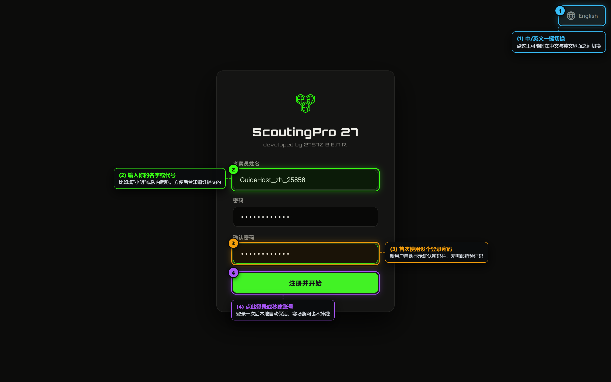

### 你要点哪里 & 填什么
1. **看右上角 `(1)`**：如果打开时页面是英文，先点一下右上角带地球图标的按钮，立刻全界面变成中文（之后任何界面都能点它随时切换）。
2. **点 `(2)`「考察员姓名」输入框**：随便起个队友能认出你是谁的名字或代号（比如“小明”、“27570_Alice”），**不需要邮箱，也不需要手机号**。
3. **填密码并看 `(3)`「确认密码」**：如果你是第一次在这个名字下登录，输入完密码后，下面会自动多出一个 **「确认密码」框 `(3)`**，再输一遍相同密码即可（不用找队长领邀请账号，当场秒建）。
4. **点绿色大按钮 `(4)`「注册并开始」**。

### 看到什么才算成功
- 页面会自动跳转到**赛事大厅**：
  - **如果是队员 / 记分员**：你只要在大厅里选「加入活动 (Join Event)」，输入队长给你的 **6 位邀请码**（或直接扫下一章的二维码），不用自己乱建新赛事。
  - **如果是主机 / 队长**：点击「新建活动」，填好比赛名称（例如 `2026 BIOBUZZ 华东区域赛`），点创建就正式开张了。

### 点错了 / 忘记密码怎么办
- 登录一次后，系统会把身份**持久保存在你自己的浏览器本地**；哪怕比赛馆突然断网、你把网页关掉重开，回来还是登录状态，不会让你卡在门外。

---

## 第 2 章：拉队友扫码进同一场比赛（没外网也不怕）

主机建好比赛后，点页面最上方工具栏的 **「手机扫码」**，就会弹出下面这个二维码窗口：

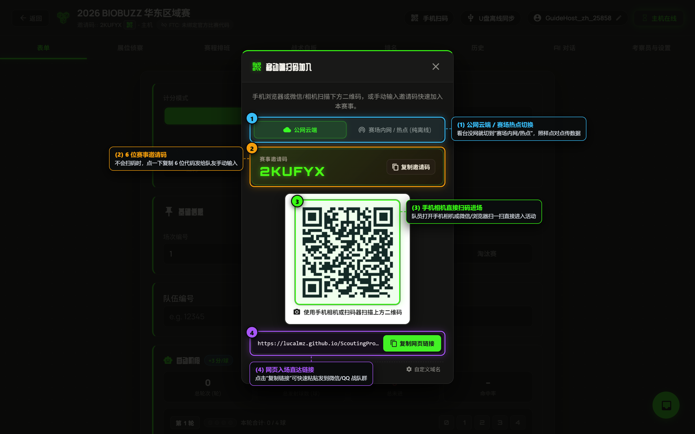

### 你要点哪里
1. **先选 `(1)` 网络通道**（最关键！）：
   - 场馆手机有 4G/5G/Wi-Fi 外网时，默认用 **「公网云端」**，队员各用各的流量就能互传数据。
   - **如果体育馆地下室没信号 / 断网了**：队长笔记本开个手机热点或连上局域网，点击切换到右边 **「赛场内网 / 热点 (纯离线)」**！二维码里的地址会自动切成本地内网地址，不需要外网照样全队高速同步。
2. **用手机拍 `(3)` 中间大二维码**：队友直接用手机自带相机、微信或浏览器扫一扫，点开链接直接进同一场活动。
3. **扫不出来？用 `(2)` 6 位邀请码或 `(4)` 复制链接**：
   - 点一下 `(2)` 旁边的 **「复制邀请码」**（图里示例为 `RPC226`），让队友在自己手机“加入活动”页手输这 6 个字母；
   - 或者点 `(4)` 亮绿色按钮 **「复制网页链接」**，直接粘贴丢进战队微信群/QQ 群，点链接免输邀请码直达！

### 看到什么才算成功
- 队友手机顶部状态栏出现绿色/在线提示，且标题显示同一场比赛名字和相同的 6 位邀请码，说明你们已经在同一个“群”里了，任何人交的打分表都会自动汇总到主机和排名榜上。

---

## 第 3 章：开赛前 10 秒准备：选模式、阵营与核对队号

进到 **「表单」** 页后，每场比赛前只需要花 10 秒核对最上面的 4 件事（如果是被队长排班指派的，上面还会弹横幅，点一下自动把场次/阵营/队号全填好！）：

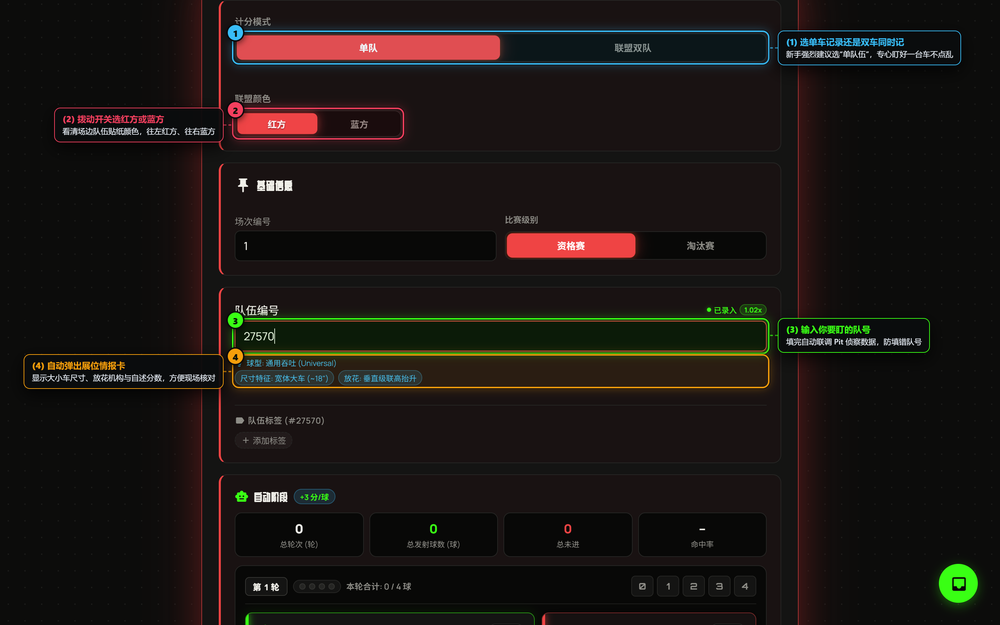

### 你要点哪里 & 填什么
1. **点 `(1)`「计分模式」**：默认选左边的 **「单队」**。
   > 💡 **新手必看**：第一次上场**千万选「单队」**！一只眼睛专心只盯场上 1 台机器人，绝不会手忙脚乱。（只有老练的队长想同时代记两台联盟车时才切“联盟双队”）。
2. **拨动 `(2)`「联盟颜色」红蓝开关**：看清你要盯的那台机器人外壳/队牌是红是蓝——**左边点亮红方，右边点亮蓝方**。整张表单的边框会立刻跟着变成红色或蓝色，一眼就不会记串行。
3. **填「基础信息」与 `(3)`「队伍编号」**：确认「场次编号」（如 `1`）和「比赛级别」（`资格赛` / `淘汰赛`），再在 `(3)` 里输入你要盯的 **4~5 位队号**（如 `27570`）。
4. **看 `(4)` 自动弹出的浅蓝提示卡**：只要展位侦察录过这支队伍，你刚输完队号，下面就会立刻弹出它的真实特征——例如图里的：`通用吞吐 (Universal)`、`尺寸特征: 宽体大车 (~18")`、`放花: 垂直级联高抬升` 以及右上角的 `● 已录入 1.02x`。

### 看到什么才算成功
- 抬头瞄一眼场地里的那台车，看看它是不是真的像 `(4)` 描述的那样、外观是不是写的那支队！这一步能帮你 **100% 避免“输错队号把别人分数算错队”的致命低级失误**。

---

## 第 4 章：前 30 秒自动阶段 (Autonomous) 怎么记

比赛前 30 秒机器人完全靠预写程序自己动，队员把手放在 **「自动阶段 +3 分/球」** 这块区域，只管盯着它看：

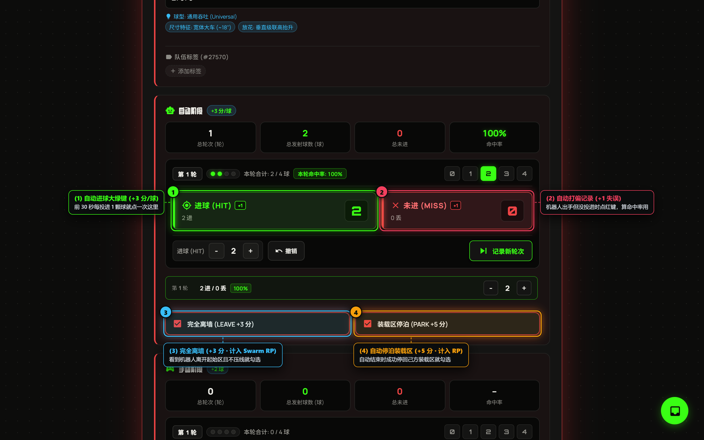

### 你要点哪里
1. **看见投进 1 颗球 → 点 1 下 `(1)` 大绿键「进球 (HIT) +1」**（自动阶段每进 1 球 = **+3 分**）。如果看漏了连进几球，直接点右上角 `[0][1][2][3][4]` 快捷数字也行，或者用底下的 `- / +` 微调。
2. **看见射偏 / 没投进 → 点 1 下 `(2)` 右边红键「未进 (MISS) +1」**：打偏不算分，但记录下失误次数后，系统能算出这台车到底准不准（命中率 %）。
3. **看见机器人完全离开起始墙/区（不压线）→ 勾选左下角 `(3)`「完全离墙 (LEAVE +3 分)」**：不仅加 **3 分**，还算入关键的 **Swarm RP 联盟机动分**！
4. **30 秒自动结束时，机器人成功停回己方装载区 → 勾选右下角 `(4)`「装载区停泊 (PARK +5 分)」**：直接加 **5 分**，同样算入 Swarm RP！

### 点错了怎么办
- 不小心多点了一球？绿键左下角就有深灰色的 **「↩ 撤销」** 按钮，点一下立刻退回前一球，也可点小数字槽旁边的 **`-` 号**减 1。

---

## 第 5 章：2 分钟手动阶段 (TeleOp) 与“预测单轮耗时”怎么算

自动阶段 30 秒一过，手移到下面的 **「手动阶段 +2 球」**。这 2 分钟的打法节奏，直接决定了排名榜里最值钱的 **“预测单轮耗时 (Predict Cycle Time)”** 能不能算出来：

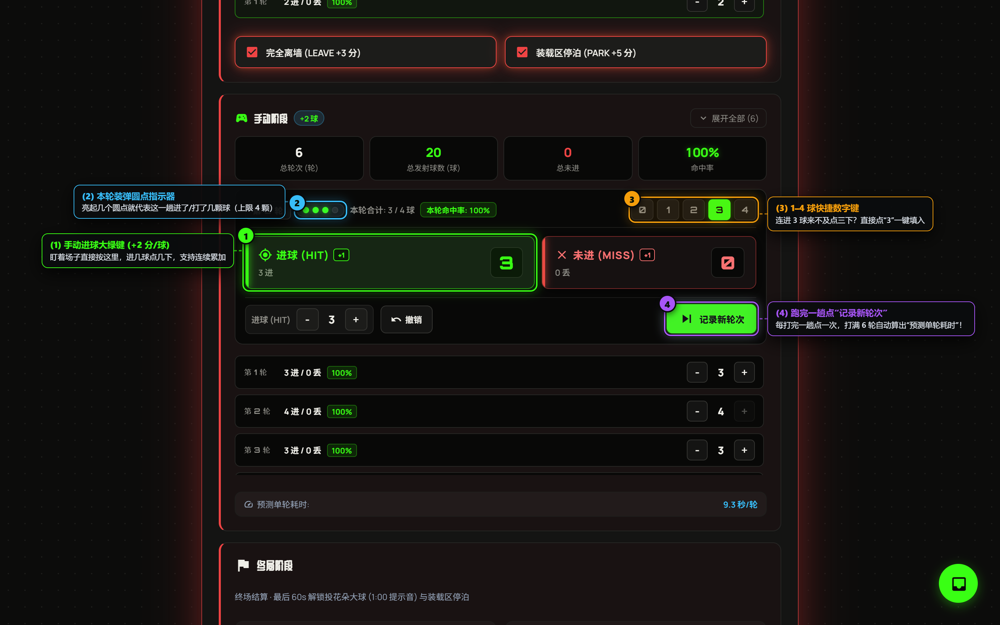

### 什么是“一轮 (Cycle)”？你要按什么节奏点？
机器人跑到取球区捡球 → 跑回发射区把这一趟带的所有球投完，**这就叫完整跑了 1 轮**：
1. **单颗连点 `(1)`「进球 (HIT) +1」**（手动阶段每进 1 球 = **+2 分**）或**快速按 `(3)`「1–4 球快捷数字键」**：
   - 比如机器人一次“啪啪啪”连进 3 颗球，手点三下绿键来不及，直接点一下数字 **`3`**，当轮瞬间变成 3 球！
2. **看 `(2)`「本轮装弹圆点指示器」**：绿点代表命中、红点代表打偏，1 趟最多装 4 颗球。
3. **重点！每当这台车打完这一趟、掉头回去再捡球时 → 点 1 下 `(4)` 亮绿色「▶| 记录新轮次」**（注意：当一轮累计满 4 颗球时系统也会贴心自动切下一轮，但没投满 4 球就调头走时**务必手动点一下“记录新轮次”**！）。

### 为什么我没看到秒数？什么是“预测单轮耗时”？
看图底部右侧那行蓝色小字：**`预测单轮耗时：9.3 秒/轮`**。很多新手好奇它怎么算的、为什么有的队显示 **`不足 6 轮`**：
- **它用来干嘛**：告诉你“这台车稳态跑完一趟捡球→投球到底要几秒”，用来预估淘汰赛能打多少轮。
- **为什么必须 ≥ 6 轮才计算？**：因为**1 次轮次只代表 1 个时间点，第 1 轮和第 2 轮之间才叫 1 个“间隔耗时”**。系统硬性要求：
  1. 手动阶段有效轮次**至少打满 6 轮**（才有至少 5 个有效间隔，且排除超过 120 秒停机摆烂的异常间隔）；
  2. 系统会把最快的 1 次极端爆发手速剔除掉（防止手滑连按欺骗数据），取接下来**最快的前 4 次间隔的平均值**作为最终速度（比如图里的 **9.3 秒/轮**）！
  - 如果整场只打了 3、4 轮（不到 6 轮），数据样本太少不准确，页面就会诚实地标出 **`— (不足6轮)`**，绝对不拿假数据忽悠教练。

---

## 第 6 章：BIOBUZZ 终局 (Endgame) 最后 60 秒规则与核对提交

滑到表单最下面，就是本赛季新版 **「终局阶段」**。这一页**非常重要，请务必先记住一句话**：

> 🌸 **BIOBUZZ 赛季没有爬升（No Climbing / Hang）！** 终局看的是**最后 60 秒往花朵投放 Nectar / 占底 / Pollen / 往 Garden 推球 / 装载区停泊 / 合法底口掏球**。

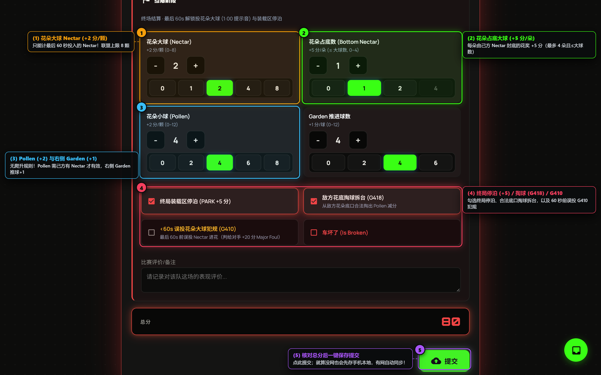

### 你要点哪里 & 填什么
1. **填 `(1)`「花朵大球 (Nectar)」（+2 分/颗，上限 0–8）**：
   - ⚠️ **死命令**：只计**比赛倒计时进入最后 60 秒（听到 1:00 提示音之后）**才放进花朵的大球 Nectar！整个联盟场上最多一共 8 颗。直接点下方 `0 / 1 / 2 / 4 / 8` 快捷数字或 `- / +`。
2. **填 `(2)`「花朵占底数 (Bottom Nectar)」（+5 分/朵，0–4）**：
   - 场上共有 4 朵花，哪几朵花的最底部是由**己方 Nectar 封底/占据**的，就点几朵（每朵重奖 **+5 分**！注意：系统会自动防呆限制它不能超过你填的 Nectar 颗数，也不能超过 4 朵）。
3. **填 `(3)` 第二行左侧「花朵小球 (Pollen)」（+2 分/颗，0–12）与右侧「Garden 推进球数」（+1 分/球，0–12）**：
   - 放进花朵的小球记到 **Pollen**（注意官方规则：花朵里的 Pollen 需在己方联盟有 Nectar 放置后才能有效拿高分）；
   - 把球推进角落地上 **Garden** 区域的，直接点右侧的 **Garden 推进球数**（**+1 分/球**）。
4. **勾选 `(4)` 四大关键状态开关**：
   - **终局装载区停泊 (PARK +5 分)**：终局结束前机器人稳稳停回己方装载区就勾选（+5 分，同样算入 Swarm RP 机动分！）。
   - **敌方花底掏球拆台 (G418)**：看到机器人从**对手花朵底口合法掏出 Pollen**破坏对方花分时勾选（留作战术复盘与分析标签，不扣己方分）。
   - **`<60s 误投花朵大球犯规 (G410)`**：如果心急的机器人**还没到最后 60 秒（1:00 提示音前）就提前把 Nectar 放进花朵了**，请果断勾选此项，提醒数据组：该行为会被裁判吹 G410 重大犯规（判给对手 **+20 分 Major Foul**）！
   - **车坏了 (Is Broken)**：万一这台车半路断电死机/零件散架趴窝不动，请勾选，这样排名平均分和笔记会标明“本场故障”。
5. **点最下方亮绿按钮 `(5)`「提交」**：
   - 提交前瞄一眼上面的红色数字总分（如图为 **`80`**）对不对劲，有需要可在「比赛评价/备注」写一句大白话（如“放花超稳但被对手撞断线”），然后点 **`提交`**！

### 断网了点“提交”会丢失吗？
- **完全不会！** 哪怕看台此刻 1 格信号都没有，点下 **「提交」** 后数据会立刻先加密存进你手机本地仓库；只要等会信号恢复（哪怕 1 秒钟），软件会在后台悄悄把它补传给队长主机，一条都不丢！

---

## 第 7 章：手机单手盲操向导：看台站着一只手记完

在体育馆看台经常没座位、没桌子放电脑。只要你**用手机浏览器打开同一个网址或扫码进来**，软件会自动切换成**竖屏大拇指单手向导**（不用双指放大缩小页面！）：

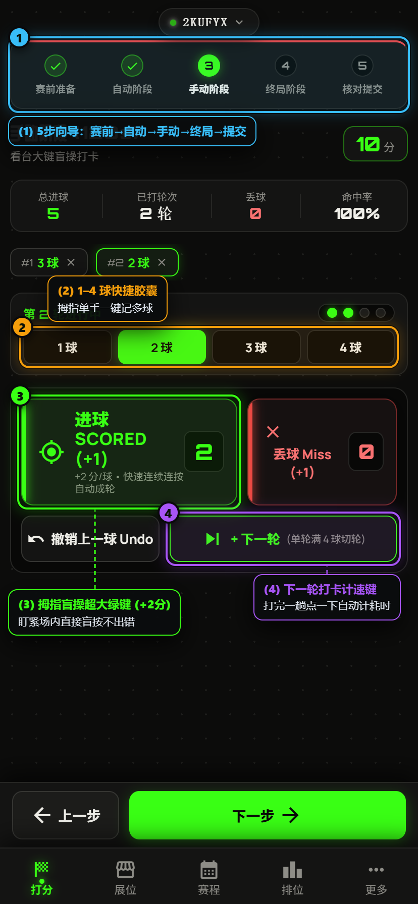

### 你要点哪里
1. **看顶部 `(1)` 5 步向导条**：把整场比赛拆成 `1 赛前准备 → 2 自动阶段 → 3 手动阶段 → 4 终局阶段 → 5 核对提交` 五步。每一步屏幕只显示当前需要按的大按钮；想回去改自动阶段的分数，直接点上面小圆圈 **`2`** 就能跳回去，改完点底下绿色的 **「下一步 →」** 回来。
2. **用 `(2)`「1–4 球快捷胶囊」** + **盲按 `(3)`「超大绿键 (+2 分)」**：
   - 绿键面积占了大半个屏幕，眼睛完全不用低头看手机，**死死盯着场上机器人用大拇指盲按就行**！
3. **每跑完一趟点 `(4)`「▶| + 下一轮」**：就在大拇指正下方，顺手一点立刻打卡记时间，照样自动算出 **Predict Cycle Time**；点完最后第 5 步提交后，底部常驻导航栏（`打分 / 展位 / 赛程 / 排位 / 更多`）也能让你随时切换去看展位数据或排班。

---

## 第 8 章：展位侦察 (Pit Scout)：怎么记大小车、体重与实际录入界面

开赛前或比赛间隙，去维修区 (Pit) 挨家串门登记每支队伍的硬件家底和自述能力，就点顶部/底部的 **「展位侦察」** 页：

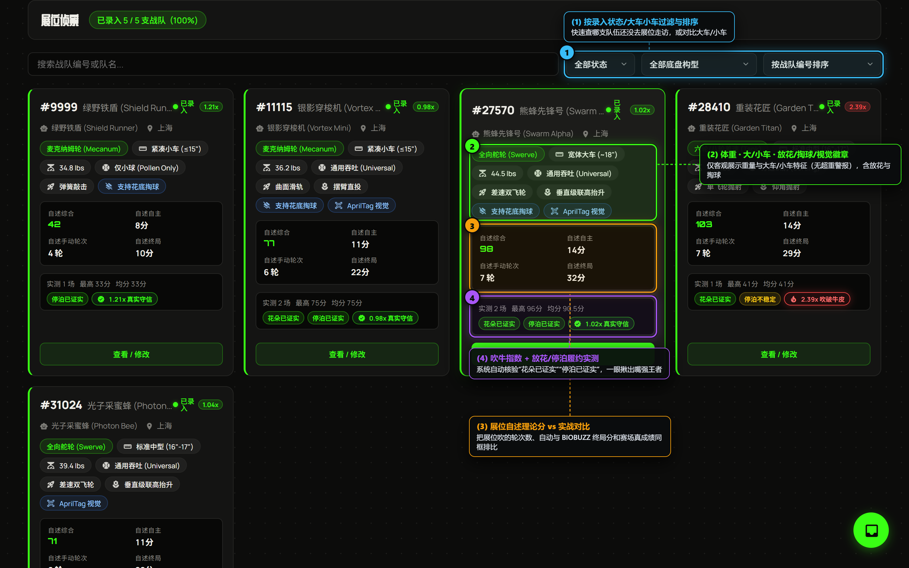

### 你要点哪里 & 看什么
1. **用左上角搜索框与右上角 `(1)` 筛选排序器**：
   - 想找哪支队伍还没走访，在下拉框切到「未录入」，一个都不漏；还可以按 **底盘尺寸大小（紧凑小车 / 标准中型 / 宽体大车）** 筛选过滤！
2. **看 `(2)` 硬件特征胶囊（客观展示 · 绝无误报警）**：
   - 图里 `#27570 熊蜂先锋号` 的绿色高亮框清楚展示了：**全向舵轮 (Swerve)**、**宽体大车 (~18")**、**44.5 lbs**、**通用吞吐 (Universal)**、**垂直级联高抬升**（放花机构）、**支持花底掏球**、**AprilTag 视觉**；
   - 旁边 `#11115` 则是 **紧凑小车 (≤15")**、`36.2 lbs`。
   - > 🛡️ **注意**：这里只如实、客观地记录**真实重量**和**大车/小车外形特点**，帮助联队评估会不会在窄通道挤在一起——**不会动不动弹出虚假的“超重红字警报”吓唬人**！
3. **看 `(3)` 与 `(4)`「展位自述理论分 vs 实战对比」与“吹牛指数”**：
   - `(3)` 把这支队在维修区跟你说的话（`自述综合 98 / 自主 14 / 手动 7 轮 / 终局 32`）和后面真正上场打出来的成绩（`实测 2 场 最高 96 分 均分 90.5 分`）放在同一张卡片里照妖镜式对比！
   - **看 `(4)` 与右邻 `#28410` 的鲜明对比**：
     - `#27570` 底下亮绿徽章：**`花朵已证实`** **`停泊已证实`** **`1.02x 真实守信`**——说能拿 98、实战真打 90.5，说到做到！
     - 看最右边 `#28410` 的紫色/红色徽章：自述 103 分、实战均分只有 41 分，系统自动给他打上 **`2.39x 吹破牛皮`** 与 **`停泊不稳定`**（黄色预警）——选联队时谁在吹牛一目了然！

### 点开「查看 / 修改」后的实际录入界面长什么样？
点卡片最底下的绿色按钮 **「查看 / 修改」**，右侧会滑出 **展位侦察抽屉表单**（如下，断网时也一样能填写保存）：

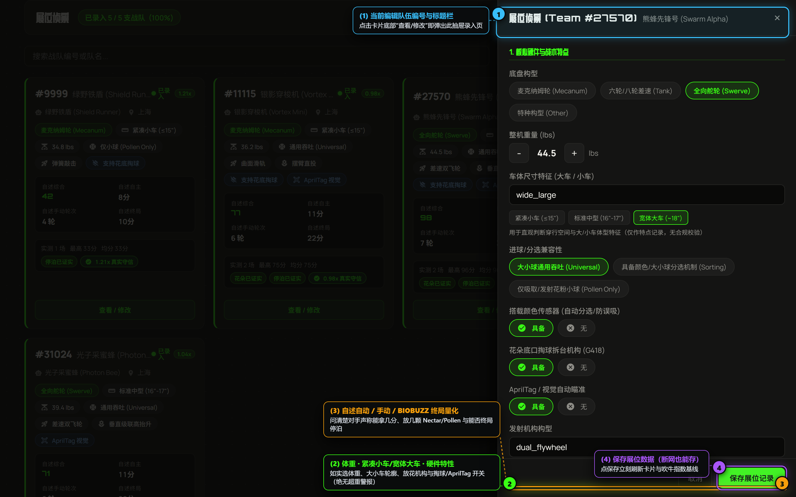

1. **`(1)` 标题栏**：确认右上角显示的队号（如 `Team #27570`）没找错展位。
2. **`(2)` 核心硬件与战术特点（客观特征，绝无误报警）**：
   - **底盘构型**：点选 `麦克纳姆轮 (Mecanum)` / `全向舵轮 (Swerve)` / `六轮八轮差速 (Tank)`；
   - **整机重量 (lbs)**：用 `-` / `+` 或直接输入磅数（如 `44.5 lbs`）；
   - **车体尺寸特征（大车 / 小车）**：直接点选 `紧凑小车 (≤15")`、`标准中型 (16"-17")` 或 `宽体大车 (~18")`，方便白板与选联队时一眼判断通道会不会挤在一起；
   - **进球兼容与特色机构**：勾选是否支持 **大小球通用吞吐**、**颜色传感器**、**花底口掏球拆台 (G418)**、**AprilTag 自动瞄准**，以及 **发射机构 / 放花抬升构型**（往下滑还能填 **自述能力量化**）。
3. **`(3)` 自述自动 / 手动 / BIOBUZZ 终局量化**：往下滑填写对方声称“自动能拿几分、手动能跑几轮、最后 60 秒能放几颗 Nectar/Pollen、能否停泊”，这组数会直接成为上面“吹牛指数”的对照基线。
4. **`(4)` 点击右下角绿色「保存展位记录」**：保存后立即刷新展位卡片，并同步给队友作赛前参考。

---

## 第 9 章：赛程排班：谁盯哪台车、怎么批量排班

队长或排班员点顶部 **「赛程排班」**，一页就能搞定全天“谁盯哪场哪台车”，彻底避免多人挤着记同一台车、另一台车漏记的尴尬：

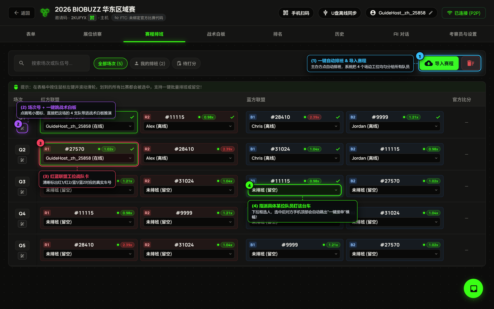

### 第一步：把赛程导入进来（或先手动建场次）
1. 点右上角 **`(1)`「导入赛程」**：如果已在「考察员与设置」填好了 FTC 官方赛事代码，点一下就能把整天资格赛对阵表（红1、红2、蓝1、蓝2 队号）全部拉进来。
2. 还没出官方表时，也可以先按预设场次排好，或点顶部筛选胶囊切换 **`全部场次`**、**`我的任务`**、**`待安排`**（快速找出还没指派人的空位）以及 **`冲突核查`**（查看有没有人漏交或记重）。

### 第二步：两种排班方法（零基础推荐“拖拽框选 + 自动分配”）
1. **方法 A — 单场手动点选（适合临时微调）**：
   - 在任意场次的 **`(3)` 红蓝工位卡片**（`R1 / R2 / B1 / B2`）下面，点开 **`(4)` 下拉菜单**直接选中某位队员名字即可。
2. **方法 B — 一口气批量排几十场（主机端最省力）**：
   - 在赛程表左侧/行内**按住鼠标左键拖动**（拖动的同时还可以顺手**滚动鼠标滚轮**往下拉），就能像在表格里框选一样一口气选中一整片场次；
   - 松开鼠标后页面会自动弹出 **「批量操作浮条」**：你可以选择目标工位（`全部工位` 或单独只分 `Red 1` / `Blue 2`），点 **「智能均匀分配」**，系统就会把选中场次平均分给当前房间里的所有队员；想推翻重来点 **「清空排班」** 即可。

### 第三步：队员手机上怎么接单？
- 只要排班员在电脑上选定了某位队员，**那位队员自己的手机「表单」页最上方就会自动跳出排班任务横幅**（写着 `下一场 Q3 · 红方 #27570`），他**点一下横幅就自动把场次、阵营和队号全填好**，直接按大绿键开始记分！
- 赛前临时想讨论战术？直接点每行场次号码下方的 **`(2)` 小画笔图标**，秒切到**战术白板**并自动加载这场的 4 支队。

---

## 第 10 章：排名天梯与“吹牛指数”：怎么选真正靠谱的联队队友

打完几场资格赛后，去 **「排名」** 看所有参赛队伍的真实战斗力（表格宽时可以左右滑动查看更多列）：

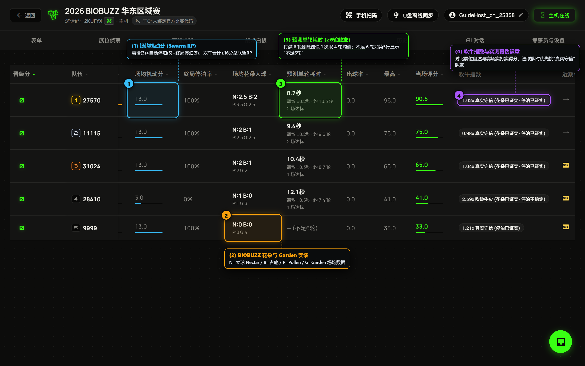

> 💡 **表头第 1 固定列「晋级分 (Adv. Pts)」**：若已绑定 FTC 官方赛事代码（见 [第 15 章](#第-15-章怎么从-ftc-官方获取赛事信息名单赛程对账与顺延晋级分)），表格最左侧第 1 列会实时计算每支队伍的官方总晋级分（资格赛 + 选队 + 淘汰赛 + 奖项，按 Rule A215 去重），并自动标出 **`晋级区`**、**`顺延晋级`**、**`已保送`**、**`已放弃`**、**`无资格`**、**`候选`** 等状态徽章！

### 选联队必看这 4 列 `(1)(2)(3)(4)`
1. **`(1)`「场均机动分 (Swarm RP)」**（图里第 1 名 `#27570` 为 **`13.0`**）：
   - 算的是 **离墙 (+3) + 自动停泊 (+5) + 终局停泊 (+5)**，满打满算最高 13 分！
   - 为什么要看这列？因为 BIOBUZZ 联盟两台车机动分合计 **≥ 16 分** 就能额外拿 **Swarm 排名分 (Swarm RP)**！挑两个稳定 `13.0` 的队友（26 ≥ 16），等于白白锁定胜负之外的关键 RP！
2. **`(2)`「场均花朵大球 (BIOBUZZ 花朵与 Garden 实绩)」**：
   - 每行清楚写着 `N:2.5 B:2 / P:3.5 G:2.5`：分别对应场均 **Nectar 大球**、**Bottom 占底花数**、**Pollen 小球**、**Garden 推球**。看一眼就知道谁真会放花，谁只是专职往 Garden 推球（比如第 5 行 `#9999` 是 `N:0 B:0 P:0 G:4`）。
3. **`(3)`「预测单轮耗时 (≥6 轮触发)」**（第 1 行绿色 **`8.7 秒`**，第 5 行 **`— (不足6轮)`**）：
   - 会显示 `8.7秒 · 离散 ±0.2秒 · 约 10.3 轮 · 2 场达标`。离散度越小（比如 `±0.2秒`）说明这台车每一轮跑得极其稳定；第 5 行因为只有 4 轮不足 6 轮，诚实标出 **`— (不足6轮)`**。
4. **`(4)`「吹牛指数与实测真伪徽章」**：
   - **`1.02x 真实守信 (花朵已证实 · 停泊已证实)`**（绿色）：展位吹多少、场上真打多少，而且花朵得分和停泊都有实战证据！
   - **倍率含义速查**：`≤ 1.25x` = **真实守信**；`> 1.25x` = **偏乐观**；`> 1.65x` = **夸大其词**；`> 2.20x` = **吹破牛皮**（如图第 4 行 `#28410` 的 `2.39x 吹破牛皮`，直接拉响警报，先挑前三名再选他！）。

---

## 第 11 章：战术白板：赛前 1 分钟画路线并播放动画防撞车

下一场要上场了，赶紧叫上同盟车队员，一起看 **「战术白板」** 提前 1 分钟对齐路线：

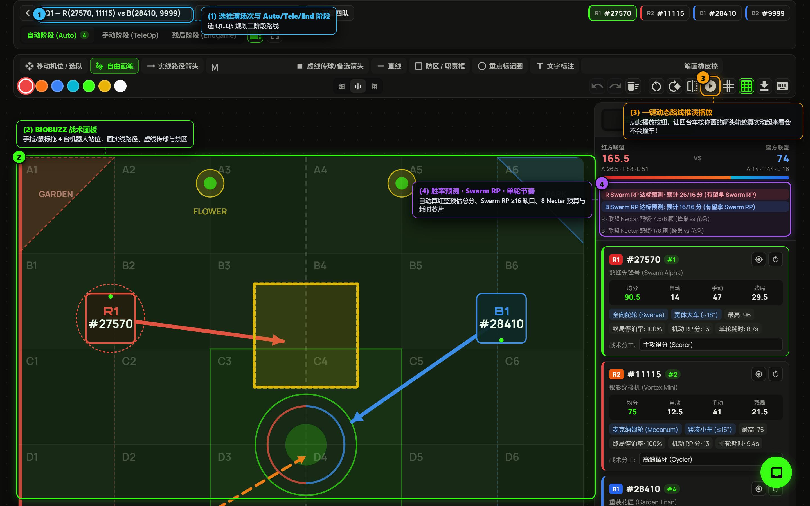

### 你要点哪里
1. **顶部 `(1)` 选场次与三阶段开关**：选 `Q1 - R(27570, 11115) vs B(28410, 9999)` 任意场次，点右上「**自动阶段 (Auto)** / **手动阶段 (TeleOp)** / **残局阶段 (Endgame)**」分别画 3 张互不干扰的战术草图；也可以手动点击右侧各车分工下拉框分配「主攻得分 / 高速循环」。
2. **在 `(2)` 绿色 BIOBUZZ 场地画板上拖放画线**：
   - 用顶上工具条把 4 台车（`R1`、`R2`、`B1`、`B2`）拖到起始位置，选「实线路径箭头」画跑位路线、选「虚线传球/备选箭头」画传球或应急路线、选「防区/职责框」标明各自扫区或封锁范围。
3. **点右上工具栏 `(3)`「▶ 播放」按钮**：
   - 这是白板最神奇的功能！点一下 **`▶`**，画布上的机器人小图标真的会沿着你刚刚画的多条箭头同时按速度跑一遍——**立刻就能看出自动阶段两台己方车会不会在花朵前面迎面撞车！**
4. **看右侧 `(4)` 胜率预测与 Swarm RP / Nectar 预算条**：
   - 实时算出：`红方 165.5 vs 蓝方 74`、`R Swarm RP 达标预测：预计 26/16 分（有望拿 Swarm RP）`、`联盟 Nectar 配额：4.5/8 颗`，底下还贴心附带每台车的真实身高大小标签（如 `宽体大车` vs `紧凑小车`）和 `单轮耗时：8.7s`，避免两台大车抢同一条窄道！

---

## 第 12 章：怎么改记录：提交错了随时回到表单修改

刚点完提交，突然发现把“第 2 轮”记少了一颗球，或者把 `27570` 输成了 `27571`？**不用删掉重录！** 点顶部或手机底部 **「历史」** 页签就能随时修改：

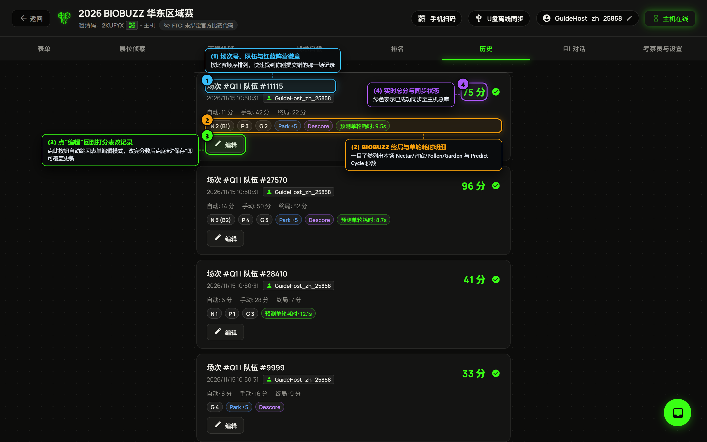

### 你要点哪里
1. **看 `(1)` 场次号、队伍号与记录人**：按比赛先后顺序排好（如 `场次 #Q1 | 队伍 #11115`），一眼找到你想改的那一条。
2. **核对 `(2)` BIOBUZZ 明细与单轮耗时，以及 `(4)` 总分与同步状态**：
   - 卡片里直接列出 `N2 (B1) P3 G2 Park +5 Descore 预测单轮耗时: 9.5s` 和右边绿色 **`75 分 ✔`**（绿色对勾表示已同步到主机总库）。
3. **点击 `(3)`「编辑」按钮**：
   - 软件会自动跳回 **「表单」** 页并把当时填写的所有数字、开关、周期和备注原封不动还原出来；
   - 改好你想修正的分数或队号后，拉到最下面点 **「保存」**，历史记录、排名榜和吹牛指数会立刻自动重算更新！
   - > 💡 **权限小贴士**：普通队员可以修改**自己提交的记录**；**主机 / 队长** 可以修改房间里**任何一位队员**的记录。

---

## 第 13 章：怎么绑定 API Key 并和 AI 对话

到了选联队前夕，不想自己一条条翻表格？你可以给软件绑上一个大模型 **API Key**，让内置的 **AI 教练** 直接读取本场所有队伍的真实比赛成绩、单轮耗时和吹牛指数，用大白话给你出谋划策：

### 第一步：在「AI 对话 → 设置」绑定你的 API Key

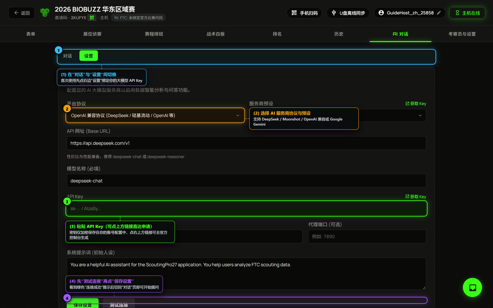

1. **点顶部「AI 对话」，再切到 `(1)` 右边「设置」子页签**。
2. **在 `(2)` 选择平台协议与预设**：
   - 国内团队最省心可以直接选 **`OpenAI 兼容协议`** 下的 **DeepSeek** 或 **Moonshot (Kimi)** 预设（`API 网址` 和 `模型名称` 会自动填好）；如果用 Google **Gemini**，切到 Gemini 协议即可。
3. **申请并粘贴 `(3)` `API Key`**：
   - 还没有 Key？直接点输入框右上角绿色的 **`↗ 获取 Key`** 链接，就会跳转到官方控制台申请一串 `sk-...` 或 `AIzaSy...` 开头的密钥，复制粘贴进来即可（密钥只加密保存在你自己的账号配置里）。
4. **先点 `(4)`「测试连接」，再点绿色「保存设置」**：
   - 看到屏幕提示连接成功后，就可以切回左边的 **「对话」** 页开聊了！

### 第二步：在「对话」页直接用大白话问 AI

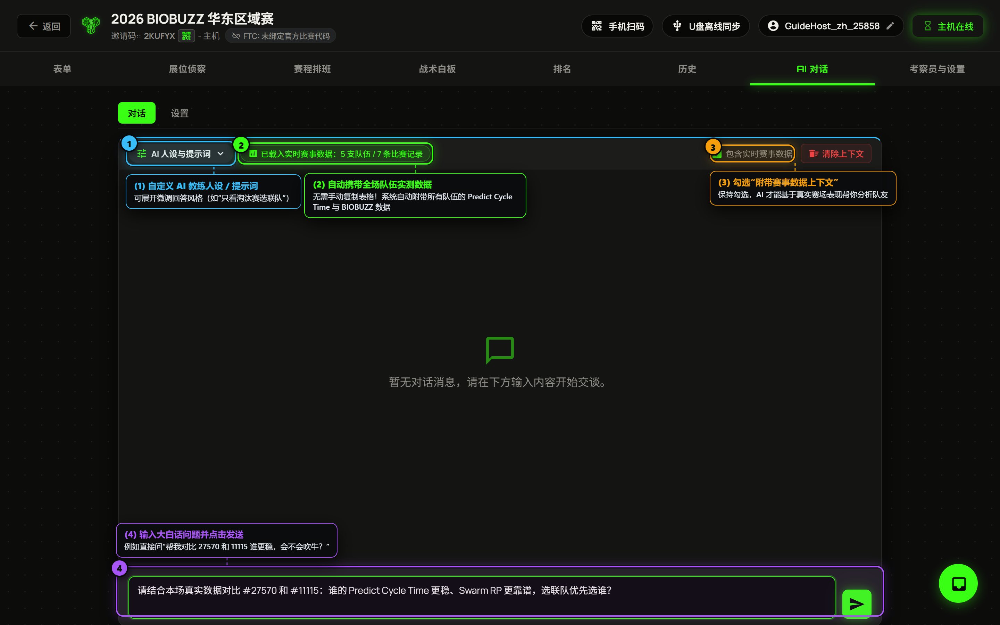

1. **`(1)` AI 人设与提示词**：默认已是专业 FTC 赛事分析教练；如果想让他重点关注淘汰赛防守或 Swarm RP，可点开微调一句提示词。
2. **`(2)` 绿色「已载入实时赛事数据」徽章 + `(3)`「包含实时赛事数据」开关**：
   - **完全不用自己手动复制 Excel！** 只要保持 `(3)` 勾选，每次提问时软件都会自动把全场队伍的 **BIOBUZZ 均分、Nectar/Pollen/Garden、Predict Cycle Time 和吹牛指数** 打包发给 AI。
3. **在 `(4)` 底部输入框打字并点绿色发送键**：
   - 直接像微信聊天一样问就行，例如：`“请结合本场真实数据对比 #27570 和 #11115：谁的 Predict Cycle Time 更稳、Swarm RP 更靠谱，选联队优先选谁？”`

---

## 第 14 章：怎么自定义字段：给打分表/展位表加专属指标

除了软件内置的 BIOBUZZ 记分项，如果你的队伍还想额外追踪一些**你们队专属的观察指标**（比如：`“防守抗干扰能力 1–5 分”`、`“地盘有没有护栏”`、`“司机配合默契度”`），主机/队长不用改代码，30 秒就能自己加字段：

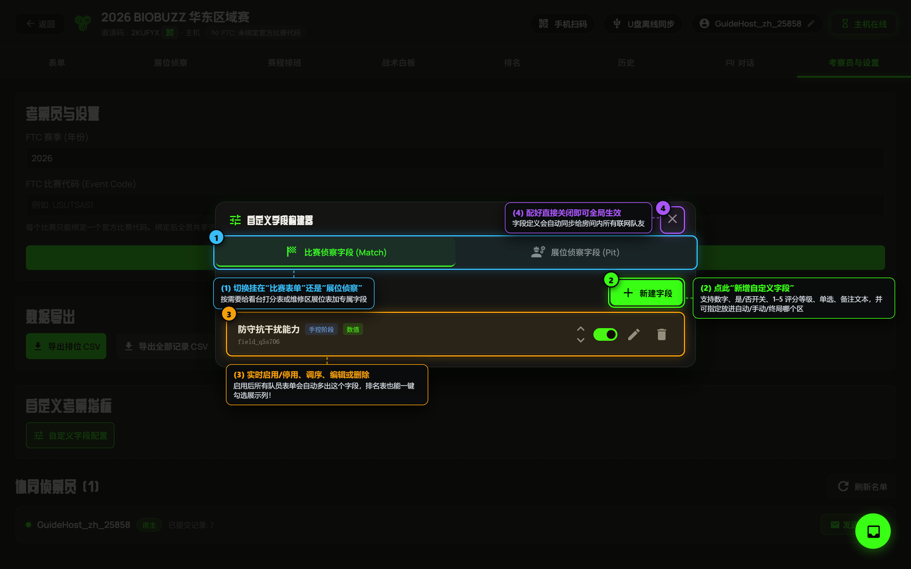

### 你要点哪里
1. **点顶部「考察员与设置」→ 左下角「自定义字段配置」按钮**，弹出上图窗口。
2. **在 `(1)` 顶部选择要挂到哪张表**：
   - 想在看台打分时记录，选 **`比赛侦察字段 (Match)`**；想在维修区串门时记录，选 **`展位侦察字段 (Pit)`**。
3. **点击 `(2)` 绿色「+ 新建字段」**：
   - 输入**字段名称**（例如 `防守抗干扰能力`）；
   - 选择挂在哪个阶段（`自动阶段` / `手控阶段` / `终局阶段` / `赛后总评`）；
   - 选择控件类型：**数字计数器**、**是/否开关**、**1–5 评分等级**、**单选/多选胶囊** 或 **文字备注**，然后点保存。
4. **用 `(3)` 卡片随时管理，点 `(4)` 关闭即刻生效**：
   - 建好后每张字段卡片上都有**上下调序箭头**、**绿色启用开关**、**铅笔编辑**和**删除图标**；
   - 关掉窗口后，所有连进房间的手机/电脑打分表里都会自动出现这个新问题，**连「排名」页表格也能直接展示这一列**！

---

## 第 15 章：怎么从 FTC 官方获取赛事信息（名单 / 赛程 / 对账 / 晋级分顺延）

绑定官方赛事代码后，ScoutingPro 27 会直接从 **FIRST Inspires FTC 官方 API (`https://ftc-api.firstinspires.org`)** 实时拉取赛区队伍名单、资格赛/淘汰赛对阵、官方比分与**晋级积分及顺延状态**——全队再也不用手动一条条抄赛程和手算积分：

> 💡 **新手需要自己去 FTC 官网注册 API Token 吗？**  
> **不需要！** Java 后端已经内置官方接口凭证并通过本地服务端代理（`/api/ftc/{season}/...`）统一拉取。只要**主机（Host）电脑能联网**即可开箱即用；队员手机连上主机局域网或 P2P 房间后直接共享同步结果。（仅运维人员如需改用自己的开发者密钥，可在启动后端前配置环境变量 `FTC_API_USER` 与 `FTC_API_TOKEN`。）

### 第一步：先在 FTC 官网找到「赛季年份」和「比赛代码 (Event Code)」
1. 浏览器打开官方赛事网站 **`https://ftc-events.firstinspires.org/`**，点进你要参加的那一站比赛。
2. 直接看浏览器地址栏里的网址，格式一定是：  
   `https://ftc-events.firstinspires.org/<赛季年份>/<比赛代码>`
3. 记下两项参数（**务必注意起始年份规则**）：
   - **FTC 赛季 (年份)**：填网址里的**赛季起始年份**。例如 2025–2026 跨年赛季在官网网址里是 `/2025/...`，这里就填 **`2025`**；2026–2027 赛季填 **`2026`**。
   - **FTC 比赛代码 (Event Code)**：网址末尾那串字母数字代码，例如 `AUADQ`、`AECMP`、`USUTSAS1`、`CNSHQ`。

### 第二步：在「考察员与设置」绑定官方赛事代码

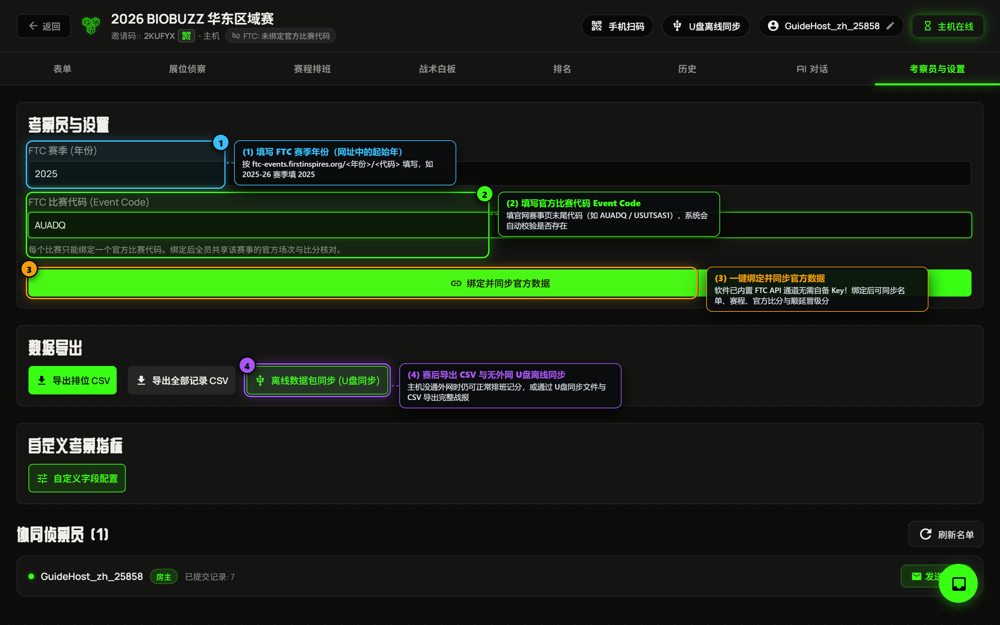

1. 主机 / 队长切到顶部最右边 **`考察员与设置`** 页签。
2. 在 **`(1)`「FTC 赛季 (年份)」** 输入官方起始年份（如 `2025`）。
3. 在 **`(2)`「FTC 比赛代码 (Event Code)」** 输入赛区代码（如 `AUADQ`，大小写均可，系统会自动规范化并向官方校验是否存在）。
4. 点击 **`(3)` 绿色「绑定并同步官方数据」** 按钮：
   - 绑定成功后，页面顶部标题栏会出现绿色认证徽章 **`FTC: <代码> (<年份>)`**，并立刻完成首轮官方赛程、比分与晋级分拉取；
   - 赛中随时回来点 **`「更新绑定并重新同步」`** 即可刷新最新官方数据。
   - **区域 `(4)`** 同时提供赛后 **「导出排行榜 CSV / 导出明细 CSV」** 与无网应急 **「离线数据包同步 (U盘同步)」**。

### 第三步：绑定后 4 个位置一键拉取官方实时数据

| 你想要什么官方信息 | 在软件里点哪里 | 同步后会自动带来什么效果 |
| :--- | :--- | :--- |
| **1. 全场官方参赛队名单** | **`展位侦察`** → 右上角 **「同步 FTC 官方名单」** | 自动拉取所有官方报名战队编号与队名，生成整墙展位卡片，维修区走访零漏队、零手误 |
| **2. 官方资格赛 / 淘汰赛赛程表** | **`赛程排班`** → 右上角 **「导入赛程」→「FTC 官方同步」→「立即从 FTC 官方拉取赛程」** | 一键写入全部 `R1 / R2 / B1 / B2` 对阵表与官方已出比分，直接拖拽框选给队员批量排班 |
| **3. 官方比分核对与偏差审计** | **`赛程排班`** → 顶部 **`偏差核查`** 胶囊 / **`核查前5偏差`** 按钮 | 自动比对“看台记录总分”与“官方比赛净得分（已核减犯规罚分）”，快速揪出哪一场记多或漏记 |
| **4. 实时晋级积分与顺延状态** | **`排名`** → 最左侧第 1 固定列 **「晋级分」**（刷新或同步赛程时自动更新） | 按 FTC Rule A215 实时汇总 **资格赛 + 选队 + 淘汰赛 + 奖项分**，并读取 `/advancement` 官方顺延状态，直接标出 **`晋级区`**、**`顺延晋级`**、**`已保送`**、**`已放弃`**、**`无资格`**、**`候选`** 徽章（鼠标悬停可看 4 项拆解与顺延顺位 `#slot`） |

---

## 第 16 章：常见问题急救箱

| 遇到什么问题 | 第一时间怎么办（100% 实测有效） |
| :--- | :--- |
| **Q1：我刚不小心点错了两下“进球”，分数多了 4 分怎么办？** | 点绿色打分按钮下方深灰色的 **「↩ 撤销」**；如果是上一轮（比如第 2 轮）点错了，在“已记录轮次列表”那一行旁边直接按 **`-` 号**就能把那一轮改小。 |
| **Q2：体育馆看台完全没信号，我点提交数据会没了吗？** | **不会丢！** 本地有离线保险箱，断网照样继续打分、提交、看展位；等走到走廊有信号或连回主机热点，软件会自动默默把排队的记录补传上去。 |
| **Q3：手机既连不上云端又连不上主机 Wi-Fi，怎么交数据？** | 点页面顶部栏的 **「U盘离线同步」**，导出一个 JSON 文件，插上 U 盘或开蓝牙/隔空投送发给队长电脑，队长同样点「U盘离线同步 → 导入」秒合入总库！ |
| **Q4：为什么有的队伍“预测单轮耗时”一直显示 `— (不足6轮)`？** | 因为算单轮耗时必须有足够多真实的连续间隔样本——必须用手动阶段的 **「▶&#124; 记录新轮次」** 记满 **≥ 6 轮**（且每轮之间相隔不超过 120 秒），软件去掉最快的 1 次后取后续 4 次平均才会出秒数。 |
| **Q5：怎么记住这是 BIOBUZZ 赛季的新终局？** | 牢记**没有爬升**！只有：**最后 60 秒才放的 Nectar (+2)**、**己方占底花 (+5/朵)**、**Pollen (+2)**、**Garden 推球 (+1)**、**停泊 (+5)**、**G418 掏球**，遇到 60 秒前提前偷放 Nectar 记得勾 **G410**。 |
| **Q6：绑定 FTC 官方代码提示“未查询到官方赛事”或“无法连接服务”？** | 先核对网址 `ftc-events.firstinspires.org/<年份>/<代码>` 中的**起始赛季年份**（例如 2025–26 赛季填 `2025` 而非 `2026`）与代码拼写；若现场主机完全断外网，可先切到 **「导入赛程 → CSV 导入」** 手动粘贴对阵表照常使用，等连网后再点「更新绑定并重新同步」补拉官方比分与晋级分。 |
