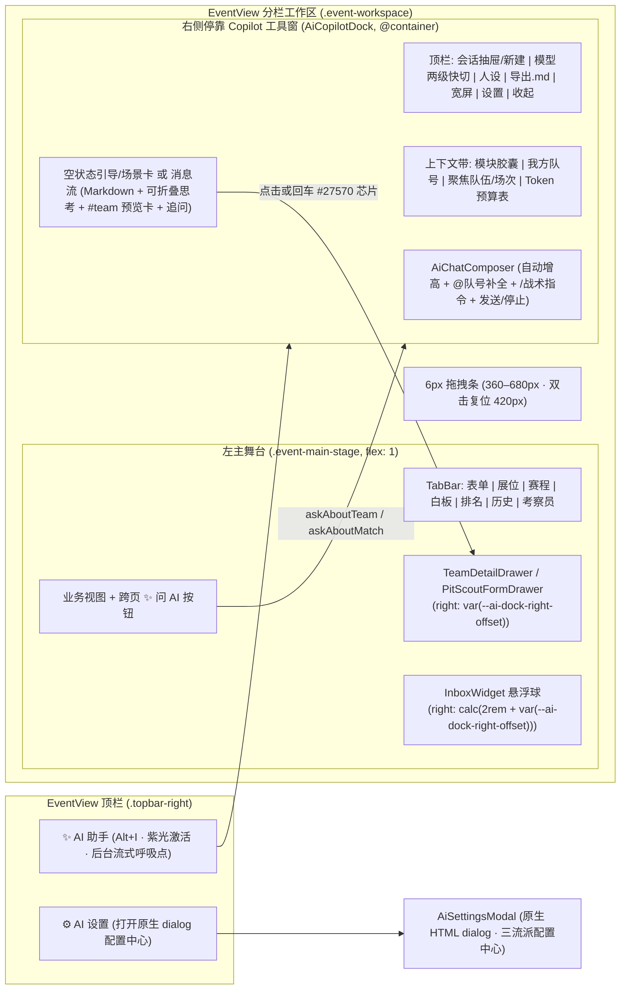

# ScoutingPro27 AI Copilot 商业化重构与三流派协议工程实施规划

> **文档定位**：独立架构与工程实施规划文档（已取代并移除已落地的 `CRDT_HLC_IMPLEMENTATION_PLAN.md`；仅作方案设计与工程契约，本文档落盘时不改动任何业务源码与测试）。  
> **目标基线**：v1.0.4+（BIOBUZZ 2026–2027 · `frontend` Vue 3.5 + Vite 8.1 + TypeScript 6.0 + `Backend` Java 21 + Javalin 7.2 + H2 2.2.224 + Flyway `V1`–`V8` + JCEF Chromium 146）。

---

## 1. 元信息、现状痛点诊断与总体目标

### 1.1 现状核心痛点实证（为什么目前偏 Demo 感）

对比项目中打磨精细的 Pit Wall 排名表、吹牛指数与战术白板，当前的 AI Chat 功能停留在“单页勉强调通接口的聊天框 MVP”阶段，存在以下 5 类明确的技术与产品短板：

1. **Markdown 排版严重断裂与宽表溢出**
   - [AiChatMessages.css](file:///e:/AppDevelope/ScoutingPro27/frontend/src/components/ai/AiChatMessages.css#L71-L74) 在 `.message-content` 设置了 `white-space: pre-wrap`，被子级 `.markdown-body` 继承，导致 `markdown-it` 渲染的 `<ul>`、`<li>`、`<p>` 标签之间的源码换行符被直接渲染为大段空行，出现项目符号 `•` 与正文分离错位（实证见 [07_chat_with_ai.png](file:///e:/AppDevelope/ScoutingPro27/docs/promo/screenshots/07_chat_with_ai.png)）。
   - [markdown.ts](file:///e:/AppDevelope/ScoutingPro27/frontend/src/utils/markdown.ts#L12-L22) 代码块缺少语言头与一键复制按钮；宽对比表格无横向滚动容器，在侧边栏场景下会撑爆气泡宽度。

2. **推理模型“深度思考”混入正文，且缺失 Anthropic 流派**
   - [AiClient.java](file:///e:/AppDevelope/ScoutingPro27/Backend/src/main/java/com/bear27570/app/util/AiClient.java#L440-L445) 将 OpenAI 兼容推理模型（如 `deepseek-reasoner`）的 `delta.reasoning_content` 直接当作正文输出，用户无法区分思考与结论，也无法折叠。
   - [AiClient.java](file:///e:/AppDevelope/ScoutingPro27/Backend/src/main/java/com/bear27570/app/util/AiClient.java#L478-L488) 遍历 Gemini `parts[]` 时未判断官方 `thought: true` 标记，会把 Gemini Thinking 内容直接混入回答正文。
   - 完全缺失 **Anthropic / Claude 流派**（`x-api-key` + `anthropic-version` + `Messages API`）支持，导致 Claude 官方及国内日益普及的 `/anthropic` 协议端点（DeepSeek、Kimi、智谱、MiniMax 等）无法直接配置使用。

3. **模型与配置模型设计缺陷（易覆盖、易过时、不可手填）**
   - [V1__Init.sql](file:///e:/AppDevelope/ScoutingPro27/Backend/src/main/resources/db/V1__Init.sql#L57-L69) 中 `ai_settings` 主键为 `(user_id, provider)`，仅允许 `OPENAI` 与 `GEMINI` 各存一条记录。在 OpenAI 兼容流派下从 DeepSeek 切换到硅基流动、OpenAI 或本地 Ollama 会**直接覆盖原有 API Key 与配置**。
   - [AiSettingsPanel.vue](file:///e:/AppDevelope/ScoutingPro27/frontend/src/components/ai/AiSettingsPanel.vue#L210-L216) 对 Gemini 锁死了下拉列表（仅 3 个选项，不允许自由输入模型名）；各厂商模型迭代极快，硬编码列表极易过期。
   - [ai.ts](file:///e:/AppDevelope/ScoutingPro27/frontend/src/stores/ai.ts#L12) 中的 `activeProvider` 仅存内存，页面刷新即重置回 `OPENAI`。
   - [AiRoutes.java](file:///e:/AppDevelope/ScoutingPro27/Backend/src/main/java/com/bear27570/app/routes/AiRoutes.java#L229-L249) 的 `/api/ai/test-connection` 已请求 `/models` 拿到 `200 OK` 却直接丢弃响应体，未提供「拉取可用模型」能力。
   - [AiClient.java](file:///e:/AppDevelope/ScoutingPro27/Backend/src/main/java/com/bear27570/app/util/AiClient.java#L51-L57) 的自动 VPN 端口探测未判断目标主机是否为本机回环，会把本地 Ollama（`http://localhost:11434/v1`）误转发至 Clash/v2rayN 代理导致连不通；Gemini 端硬编码官方 URL，国内无法配置反代 `baseUrl`。

4. **单死会话、切 Tab 断流、交互粗糙与控件遮挡**
   - [V1__Init.sql](file:///e:/AppDevelope/ScoutingPro27/Backend/src/main/resources/db/V1__Init.sql#L71-L77) 中 `ai_chat_sessions` 主键是 `(user_id, event_id)`，单场赛事仅有一条全局会话。
   - [EventView.vue](file:///e:/AppDevelope/ScoutingPro27/frontend/src/views/EventView.vue#L518) 通过 `v-else-if="activeTab === 'ai'"` 挂载 `AiChatView`，切去排名或赛程页查数据时直接销毁组件，**当场中断正在生成的 SSE 流**，且 [AiChatView.vue](file:///e:/AppDevelope/ScoutingPro27/frontend/src/components/ai/AiChatView.vue#L80-L86) 的 1 秒防抖保存未在卸载前立即 flush，极易丢失刚发送或刚编辑的消息。
   - 交互细节悬空：`copyMessage`（[AiChatView.vue](file:///e:/AppDevelope/ScoutingPro27/frontend/src/components/ai/AiChatView.vue#L248-L254)）仅有空注释 `// Copied` 无反馈；`keyLostError`（L78）为未赋值死状态；流式期间每次 chunk 在模板内全量执行 `renderMarkdown` + `applyTeamChipsToHtml`（L199-L207），违背 [teamMatcher.ts](file:///e:/AppDevelope/ScoutingPro27/frontend/src/components/ai/teamMatcher.ts#L10) 的 V4 约束并造成选区闪烁；缺少重新生成、回到底部、导出简报、自适应输入框与移动端适配。
   - 右下角全局悬浮球 [InboxWidget.vue](file:///e:/AppDevelope/ScoutingPro27/frontend/src/components/common/InboxWidget.vue#L133-L138)（`bottom: 2rem; right: 2rem`）在桌面端与右下角聊天区域/发送按钮冲突。

5. **FTC 赛场领域深度与全应用联动不足**
   - [contextBuilder.ts](file:///e:/AppDevelope/ScoutingPro27/frontend/src/components/ai/contextBuilder.ts) 遗漏了赛程表（`scheduleStore`）、官方晋级分/状态（`advancementPoints` / `advancementStatus`）、自定义字段（`customFieldsStore`）、循环离散度（`predictCycleSpread`）、拆台率（`descoreRate`）、展位重量/备注与“我方队号”。
   - 大赛事无上限拼接全量逐场记录，极易冲爆模型上下文窗口，且不支持聚焦少数重点队伍/场次。
   - 空状态为空白黑屏，缺少 BIOBUZZ 规则基座、专业人设与场景卡片；[teamMatcher.ts](file:///e:/AppDevelope/ScoutingPro27/frontend/src/components/ai/teamMatcher.ts) 仅高亮 `rankings` 中的队号；排名页、赛程表、队伍详情与 AI 相互孤立。

### 1.2 总体目标与明确范围 (Scope & Non-Goals)

| 能力域 | 纳入策略 | 工程边界与原因说明 |
| :--- | :--- | :--- |
| **JetBrains 风格停靠式 Copilot 工作台** | **全面纳入** | 桌面端顶栏 `✨ AI 助手`（`Alt+I`）与 `⚙` 设置按钮；右侧可拖拽停靠侧栏（`360px–680px`）+ 宽屏专注模式；切 Tab 不断流。 |
| **多侧边栏空间共存（左主舞台避让）** | **全面纳入** | 通过 `--ai-dock-right-offset` 让 `TeamDetailDrawer`、`PitScoutFormDrawer`、`InboxWidget` 贴合 AI 左侧展开/避让，同屏对照不互相盖住。 |
| **三大协议流派（GPT / Gemini / Anthropic）** | **全面纳入** | 后端 `AiClient` 原生实现 OpenAI Chat Completions、Google Gemini `v1beta`、Anthropic Messages API（含流式拆思考、Usage、模型拉取、反代 URL）。 |
| **模型自由手填 + 自定义常用模型池 + Gemini 3 `-latest`** | **全面纳入** | 所有流派模型名皆可自由输入；Gemini 默认内置 `gemini-flash-latest` / `gemini-pro-latest` / `gemini-flash-lite-latest` 并支持增删与在线拉取。 |
| **多配置档案 & 多会话 Flyway `V9` 持久化** | **全面纳入** | `ai_provider_profiles` 与 `ai_chat_threads`，旧表 `ai_settings` / `ai_chat_sessions` 与旧接口 100% 向下兼容并在首读时懒迁移。 |
| **FTC 2026–2027 BIOBUZZ 领域上下文引擎 & 跨页联动** | **全面纳入** | 赛程/晋级分/自定义字段/我方队号/聚焦模式/Token 预算控制；排名、赛程、抽屉、详情页一键 `✨ 问 AI`。 |
| **多设备端到端同步用户私人 API Key / 对话** | **暂不纳入 (Non-Goal)** | 私人 API Key 严格使用本地主机 `AESUtil` 主密钥加密存当前节点 `ai_provider_profiles`，严禁经 WebRTC 广播给他人防密钥泄露。 |
| **自主写入/修改赛事打分记录的 Agent Tool Calls** | **暂不纳入 (Non-Goal)** | Copilot 定位为只读参谋与战术分析，不越权改动 CRDT 权威赛场数据，保障比赛数据不可篡改。 |
| **多模态图片/语音上传提问** | **预留接口，首版不做** | 本期聚焦高密度赛场数值、表格与战术文本问答，确保所有三大流派及国产中转模型 100% 可用。 |

---

## 2. 三大 API 协议流派规范、KEY 输入格式与常见公司归属

> **核心设计原则**：市面上所有主流大模型服务本质上均归属 **OpenAI / GPT 流派**、**Google Gemini 流派**、**Anthropic / Claude 流派** 三大接口协议之一。系统不再把用户锁死在过时的枚举下拉框中，而是按“**三大协议流派 + 可自由填写的模型/网址 + 智能 KEY 格式提醒**”构建。

### 2.1 三大流派技术规范总表

| 维度 | 流派一：OpenAI / GPT (`OPENAI`) | 流派二：Google Gemini (`GEMINI`) | 流派三：Anthropic / Claude (`ANTHROPIC`) |
| :--- | :--- | :--- | :--- |
| **协议标准** | OpenAI Chat Completions API | Google Generative Language REST `v1beta` | Anthropic Messages API |
| **默认 Base URL** | `https://api.openai.com/v1`（按预设切换） | `https://generativelanguage.googleapis.com/v1beta`（支持自定义反代） | `https://api.anthropic.com`（支持国产官方 `/anthropic` 端点与反代） |
| **核心对话端点** | `POST {base}/chat/completions` | `POST {base}/models/{model}:streamGenerateContent?alt=sse`（非流式 `:generateContent`） | `POST {base}/v1/messages` |
| **模型列表端点** | `GET {base}/models` → `data[].id` | `GET {base}/models` → `models[].name`（去 `models/` 前缀，过滤 `generateContent`） | `GET {base}/v1/models` → `data[].id`（兼容通道若 404 则降级提示可手填） |
| **认证请求头** | `Authorization: Bearer <KEY>`（本地 Ollama 空 Key 可省略） | `x-goog-api-key: <KEY>`（严禁放 URL 查询串防日志泄露） | `x-api-key: <KEY>` + **`anthropic-version: 2023-06-01`**（绝不用 Bearer） |
| **典型 KEY 前缀格式** | `sk-...`、`sk-proj-...`、`sk-svcacct-...`、`gsk_...`、`xai-...`、`sk-or-v1-...`、`sk-ws-...`、`<id>.<secret>`、本地部署可留空 | `AIza...`（常见 `AIzaSy...`，约 39 位；反代站可为自定义串） | `sk-ant-...`（如 `sk-ant-api03-...`）；国产 `/anthropic` 通道用各平台自有 Key |
| **System Prompt 位置** | `messages[0] = { "role": "system", "content": "..." }` | 顶层对象 `system_instruction: { "parts": [{ "text": "..." }] }` | 顶层字符串 `"system": "..."`（不可放进 `messages`） |
| **对话角色序列约束** | `user` / `assistant` 顺序即可 | 严格 `user` / `model` 交替，且必须以 `user` 开头 | 严格 `user` / `assistant` 交替，必须以 `user` 开头，末尾禁空 `assistant` |
| **Thinking / 思考过程** | `delta.reasoning_content` 或 `delta.reasoning` | 请求配 `generationConfig.thinkingConfig: { includeThoughts: true }`；响应 `part.thought === true` | 请求配 `thinking: { type: "enabled", budget_tokens }`；响应 `content_block_delta` 中 `delta.type === "thinking_delta"` |
| **Temperature 与思考冲突** | `o1`/`o3`/`o4`/`deepseek-reasoner`/`qwq` 等推理模型自动省略 `temperature` | 正常支持 `temperature`（旧快照不认 `thinkingConfig` 时 400 自动剥离重试） | 开启 `thinking` 时强制省略 `temperature`（Anthropic 规范禁止传 `< 1` 的 temperature），且 `max_tokens > budget_tokens` |
| **Token Usage 提取** | 请求加 `stream_options: { include_usage: true }`（若网关报 400 则剥离重试）；末包 `usage` | 响应顶层 `usageMetadata`（`promptTokenCount`, `candidatesTokenCount`, `thoughtsTokenCount`, `totalTokenCount`） | `message_start` 的 `message.usage.input_tokens` + `message_delta` 的 `usage.output_tokens` |

---

### 2.2 流派一：OpenAI / GPT 流派 (`OPENAI`) 详尽规范

1. **认证与 KEY 输入**：
   - 使用标准 HTTP Header：`Authorization: Bearer <API_KEY>`。
   - 当 `baseUrl` 解析为本地回环（`localhost`、`127.0.0.1`、`::1`，如 Ollama / LM Studio / vLLM）且用户未填写 Key 时，**允许留空保存**且请求时不附加空的 `Authorization` 头。
2. **端点归一化（沿用并增强 `resolveOpenAiChatEndpoint` / `resolveOpenAiModelsEndpoint`）**：
   - 若用户填 `https://api.deepseek.com` → 自动补 `/v1/chat/completions` 与 `/v1/models`。
   - 若以 `/v[0-9]+...` 结尾（如智谱 `/api/paas/v4`、火山方舟 `/api/v3`、阿里百炼 `/compatible-mode/v1`）→ 直接拼接 `/chat/completions` 与 `/models`。
   - 若已完整以 `/chat/completions` 结尾 → 对话直接复用，模型列表自动剥离 `/chat/completions` 后补 `/models`。
3. **流式请求体与防坑重试**：
   - 请求体默认携带 `"stream": true` 与 `"stream_options": { "include_usage": true }`。
   - **第三方网关 400 自动降级**：部分轻量中转站或旧版兼容服务不识别 `stream_options` 会返回 HTTP 400/422；当首次请求返回 400/422 且响应体提及 `stream_options` 或 `unrecognized` 时，后端移除 `stream_options` 自动静默重试一次，避免用户端莫名报错。
   - **推理模型 `temperature` 保护**：当模型名匹配 `^(o[134](-|$)|deepseek-reasoner|deepseek-r1|qwq|.*-thinking)`（大小写不敏感）时，请求体省略 `temperature`，彻底规避 OpenAI `o1`/`o3` 与部分严格网关因 `temperature != 1` 报 HTTP 400。
4. **SSE 解析规则 (`parseOpenAiSseChunk`)**：
   - `data: [DONE]` → `StreamChunk("done", null, null)`。
   - 若 `json.choices[0].delta` 存在：
     - 先读取 `delta.reasoning_content`（DeepSeek / SiliconFlow / vLLM / Moonshot 常用）或 `delta.reasoning`（OpenRouter 常用），非空则发出 `StreamChunk("reasoning", r, null)`；
     - 再读取 `delta.content`，非空则发出 `StreamChunk("text", c, null)`；
   - 若 `json.usage` 非空对象（常见于末包 `choices: []`）：提取 `prompt_tokens`、`completion_tokens`、`total_tokens` 发出 `StreamChunk("usage", null, usageObj)`。

---

### 2.3 流派二：Google Gemini 流派 (`GEMINI`) 详尽规范

1. **认证与 KEY 输入**：
   - 严格通过请求头传递：`x-goog-api-key: <API_KEY>`（不拼入 URL Query `?key=`，防止反向代理与控制台日志泄露明文密钥）。
   - 官方 Key 格式特征：`AIza` 开头（常见 `AIzaSy...`）；使用自定义反代时允许任意自定义格式字符串。
2. **自定义 Base URL 支持（解除硬编码限制）**：
   - 新增 `resolveGeminiBaseUrl(String baseUrl)`：
     - 空值默认：`https://generativelanguage.googleapis.com/v1beta`
     - 若用户输入 `https://my-gemini-proxy.example.com` → 规范为 `https://my-gemini-proxy.example.com/v1beta`
     - 若用户输入已包含 `/v1beta` 或 `/v1` → 去尾斜杠直接复用
   - 流式地址：`{base}/models/{urlEncodedModel}:streamGenerateContent?alt=sse`
   - 非流式地址：`{base}/models/{urlEncodedModel}:generateContent`
   - 模型列表：`{base}/models` → 解析 `models[]` 数组：优先保留 `supportedGenerationMethods` 含 `"generateContent"` 的条目，剥离 `"models/"` 前缀后返回，并与本地内置 3 个 `-latest` 别名合并去重。
3. **Thinking（`thought: true`）与兼容性防护（已对照官方 `generate-content.md` Schema 核验）**：
   - 当用户配置启用思考展示（默认开启，可由高级设置开关控制）时，在 `generationConfig` 中写入：
     ```json
     "thinkingConfig": {
       "includeThoughts": true
     }
     ```
   - **关键防坑规则**：
     - **严禁对非 Gemini 3+ 模型或未知 `-latest` 别名硬编码发送 `thinkingLevel`**（Google 官方 API 参考明确说明：`thinkingLevel` 仅适用于 Gemini 3 及以上模型，传给早期模型直接报错）。仅发送通用的 `includeThoughts: true`。
     - **400 自动降级重试**：部分不支持 `thinkingConfig` 的旧模型（如 `gemini-2.0-flash`）或老旧反代网关在收到 `thinkingConfig` 时会返回 `400 INVALID_ARGUMENT`；后端捕获 `400` 且报文包含 `thinking` / `thinkingConfig` 时，自动剥离 `thinkingConfig` 重新发起请求并将结果流畅返回，保证永不因开关导致模型报错不可用。
4. **Gemini SSE 解析与安全截断 (`parseGeminiSseChunk`)**：
   - 遍历 `candidates[0].content.parts[]` 的每个 `part`：
     - 读取 `part.text`；
     - 若 `part.has("thought") && part.get("thought").getAsBoolean()` 为 `true` → 发出 `StreamChunk("reasoning", text, null)`；
     - 否则 → 发出 `StreamChunk("text", text, null)`。
   - 检查 `candidates[0].finishReason`：若为 `"SAFETY"`、`"PROHIBITED_CONTENT"`、`"RECITATION"` 且当前未输出正文，则给出明确可读提示（而非静默无内容）。
   - 解析 `usageMetadata`：`promptTokenCount` → `prompt_tokens`，`candidatesTokenCount + thoughtsTokenCount` → `completion_tokens`，`totalTokenCount` → `total_tokens`，发出 `StreamChunk("usage", ...)`。
5. **Gemini 默认 3 类 `-latest` 别名 + 自由添加机制**：
   - 为兼顾开箱即用与官方滚动升级特性，新建 Gemini 档案默认内置 **3 个官方滚动 `-latest` 别名** 作为常用模型快捷池：
     1. `gemini-flash-latest`（**Flash · 均衡主力**，新建默认选中）
     2. `gemini-pro-latest`（**Pro · 旗舰深思**）
     3. `gemini-flash-lite-latest`（**Flash-Lite · 极速轻量化**）
   - 模型名称框为**完全可自由手填的文本框**，用户随时可手填任意具体版本（如 `gemini-2.5-flash`、`gemini-2.5-pro` 或未来新版）、点击 `+ 添加到常用芯片` 保存到该档案的 `customModels`，或点击「拉取可用模型」一键导入当前 Key 权限下的所有真实可用模型。

---

### 2.4 流派三：Anthropic / Claude 流派 (`ANTHROPIC`) 详尽规范

1. **认证头与常见错误规避**：
   - 必须携带三个标准 HTTP Header（**绝不使用 `Authorization: Bearer`**）：
     - `x-api-key: <API_KEY>`
     - `anthropic-version: 2023-06-01`（默认 `2023-06-01`，允许档案级自定义覆写）
     - `content-type: application/json`
   - 官方 KEY 格式特征：`sk-ant-...`（常见 `sk-ant-api03-...` / `sk-ant-admin01-...`）；国产大模型官方 `/anthropic` 兼容通道则使用各平台自身 API Key。
2. **端点归一化 (`resolveAnthropicMessagesEndpoint` / `resolveAnthropicModelsEndpoint`)**：
   - 空值默认：`https://api.anthropic.com`
   - 拼接逻辑（覆盖官方、反代与全部国产 Anthropic 兼容地址）：
     - 已以 `/v1/messages` 或 `/messages` 结尾 → 直接作为对话端点；模型端点替换为 `/v1/models`；
     - 已以 `/v1` 结尾（如 `https://api.anthropic.com/v1`）→ 拼 `/messages` 与 `/models`；
     - 其余基础路径（如 `https://api.anthropic.com`、`https://api.deepseek.com/anthropic`、`https://api.moonshot.cn/anthropic`、`https://open.bigmodel.cn/api/anthropic`、`https://api.minimaxi.com/anthropic`、`https://coding.dashscope.aliyuncs.com/apps/anthropic`）→ 自动追加 `/v1/messages` 与 `/v1/models`（与官方 Anthropic SDK 拼路径规则完全一致）。
   - **`/v1/models` 404 容错处理**：部分国产 Anthropic 兼容通道（或极简中转）仅实现了 `POST /v1/messages` 而未开放 `GET /v1/models`。因此在测试连接时：
     - 若 `/v1/models` 返回 `200 OK` → 解析 `data[].id` 返回真实模型清单；
     - 若 `/v1/models` 返回 `401` / `403` → 明确报错“Key 鉴权失败”；
     - 若 `/v1/models` 返回 `404` / `405` → 在测试结果中**区分提示**“端点网络可达，但该兼容网关未开放模型列表接口（HTTP 404），请直接在模型输入框填写模型名即可对话”，避免用户误以为配置失败。
3. **请求体四大强约束（`AiClient.callAnthropicStream`）**：
   1. **`max_tokens` 强制必填**：Anthropic 协议要求所有请求必须携带 `max_tokens`（普通模式默认 `4096`，可在高级设置调整）。
   2. **`system` 必须置于顶层**：将拼接好赛场数据的系统提示词写入顶层 `"system": "..."`，绝不放进 `messages[]`。
   3. **严格消息规整 (`normalizeAnthropicMessages`)**：
      - 仅保留 `"user"` 与 `"assistant"`（其他映射为 `"user"`），过滤空字符串消息；
      - 连续同角色消息自动用 `\n\n` 合并；
      - 若首条为 `"assistant"` 则前置一条 `"user": "Context init"`；
      - **剥离末尾非用户消息**：若末尾因意外出现 `assistant` 消息，移除或补齐规则保证最后一条必为 `user`（避免部分新款 Claude 因限制 Assistant Prefill 返回 400）。
   4. **Extended Thinking 与 `temperature` 互斥保护**：
      - 当档案开启 `enableThinking = true` 且模型支持思考（如 `claude-sonnet-4-*`、`claude-opus-4-*`、`claude-3-7-sonnet-*`、`deepseek-reasoner` 等，或用户手动打开开关）时：
        - 写入 `"thinking": { "type": "enabled", "budget_tokens": <thinkingBudget，默认 4096，最小 1024> }`；
        - 自动确保 `max_tokens >= thinkingBudget + 4096`（防止触发 `max_tokens must be greater than thinking.budget_tokens` 的 400 错误）；
        - **强制省略 `temperature`**（Anthropic 规定启用 Extended Thinking 时 `temperature` 只能为 `1` 或不传）。
      - 若遇到不支持 `thinking` 参数的中转通道返回 `400` 且提示 `thinking`，自动剥离 `thinking` 降级重发。
4. **Anthropic SSE 多事件状态机（`event:` + `data:` 双行解析）**：
   - Anthropic SSE 会发送 `event: <type>` 行紧随 `data: <json>` 行，状态机需逐行解析：
     - `message_start`：提取 `message.usage.input_tokens` 缓存在当次流上下文中；
     - `content_block_delta`：
       - `delta.type == "thinking_delta"` → 读取 `delta.thinking` 发出 `StreamChunk("reasoning", ...)`；
       - `delta.type == "text_delta"` → 读取 `delta.text` 发出 `StreamChunk("text", ...)`；
     - `message_delta`：读取 `usage.output_tokens`，结合缓存的 `input_tokens` 发出 `StreamChunk("usage", ...)`；
     - `message_stop`：发出 `StreamChunk("done", ...)`；
     - **`error`（中途流式异常）**：解析 `data.error.type` + `data.error.message`（例如 `overloaded_error`、`rate_limit_error`），立即抛给 SSE 错误通道让前端气泡显示可读错误而非无声中断。

---

### 2.5 常见公司 / 平台流派归属速查表与智能 KEY 识别

> **产品化落地**：下表不仅作为开发契约，还将以「**常见服务商流派速查**」折叠帮助卡的形式直接内嵌到前端 `AiSettingsModal.vue` 中，让不懂协议差异的队伍教练/学生 10 秒选对流派、填对网址。

#### A. 各流派主流厂商与推荐配置对照

| 归属流派 | 代表厂商 / 平台 | 默认 Base URL | 典型 KEY 格式特征 | 备注与代表模型参考（皆可自由手填） |
| :--- | :--- | :--- | :--- | :--- |
| **OpenAI / GPT 流派** (`OPENAI`) | **OpenAI 官方** | `https://api.openai.com/v1` | `sk-proj-...` / `sk-...` | `gpt-4.1`, `gpt-4o`, `o3-mini` |
| **OpenAI / GPT 流派** (`OPENAI`) | **DeepSeek (深度求索)** | `https://api.deepseek.com/v1` | 随机串 / `sk-...` | `deepseek-chat`, `deepseek-reasoner` |
| **OpenAI / GPT 流派** (`OPENAI`) | **SiliconFlow (硅基流动)** | `https://api.siliconflow.cn/v1` | `sk-...` | 托管 DeepSeek / Qwen / Llama 等众多开源模型 |
| **OpenAI / GPT 流派** (`OPENAI`) | **DashScope (阿里百炼 / 通义)** | `https://dashscope.aliyuncs.com/compatible-mode/v1` | `sk-...` / `sk-ws-...` | `qwen-plus`, `qwen-max`, `qwq-plus` |
| **OpenAI / GPT 流派** (`OPENAI`) | **Moonshot (月之暗面 Kimi)** | `https://api.moonshot.cn/v1` | 随机串 / `sk-...` | `moonshot-v1-32k`, `kimi-latest` |
| **OpenAI / GPT 流派** (`OPENAI`) | **Zhipu AI (智谱 BigModel)** | `https://open.bigmodel.cn/api/paas/v4` | `<id>.<secret>` | `glm-4-flash`, `glm-4-plus` |
| **OpenAI / GPT 流派** (`OPENAI`) | **Volcengine Ark (火山方舟豆包)** | `https://ark.cn-beijing.volces.com/api/v3` | UUID / 随机串 | 填写接入点 ID (`ep-...`) 或官方模型 ID |
| **OpenAI / GPT 流派** (`OPENAI`) | **OpenRouter (聚合网关)** | `https://openrouter.ai/api/v1` | `sk-or-v1-...` | 单 Key 通过 OpenAI 协议路由调用 Claude / Gemini / GPT |
| **OpenAI / GPT 流派** (`OPENAI`) | **Groq / xAI / Mistral** | 各官方 `/v1` 地址 | `gsk_...` / `xai-...` | 高速推理与 Grok / Mistral 系列 |
| **OpenAI / GPT 流派** (`OPENAI`) | **Ollama / LM Studio / vLLM** | `http://localhost:11434/v1` | **无需 Key（可留空）** | 纯离线本地赛场运行，自动绕过本机 VPN 代理 |
| **Google Gemini 流派** (`GEMINI`) | **Google AI Studio 官方** | `https://generativelanguage.googleapis.com/v1beta` | `AIza...` (`AIzaSy...`) | 默认 `gemini-flash-latest` / `gemini-pro-latest` / `gemini-flash-lite-latest` |
| **Google Gemini 流派** (`GEMINI`) | **Gemini 反向代理 / 镜像站** | 用户自填反代域名 | 依反代站而定 | 支持自定义 `baseUrl`，保持 Gemini 原生 `v1beta` 协议 |
| **Anthropic / Claude 流派** (`ANTHROPIC`) | **Anthropic 官方** | `https://api.anthropic.com` | `sk-ant-...` (`sk-ant-api03-...`) | `claude-sonnet-4-20250514` 等（推荐点击“拉取模型”或自填） |
| **Anthropic / Claude 流派** (`ANTHROPIC`) | **DeepSeek (Anthropic 模式)** | `https://api.deepseek.com/anthropic` | 同 DeepSeek Key | 原生兼容 Claude Code / Anthropic Messages 协议 |
| **Anthropic / Claude 流派** (`ANTHROPIC`) | **Kimi (Anthropic 模式)** | `https://api.moonshot.cn/anthropic` | 同 Moonshot Key | 支持 Anthropic SDK / Messages 格式直连 |
| **Anthropic / Claude 流派** (`ANTHROPIC`) | **Zhipu GLM (Anthropic 模式)** | `https://open.bigmodel.cn/api/anthropic` | 同智谱 Key | 国际版为 `https://api.z.ai/api/anthropic` |
| **Anthropic / Claude 流派** (`ANTHROPIC`) | **MiniMax (Anthropic 模式)** | `https://api.minimaxi.com/anthropic` | MiniMax API Key | 国际版为 `https://api.minimax.io/anthropic` |
| **Anthropic / Claude 流派** (`ANTHROPIC`) | **阿里百炼 Coding (Anthropic)** | `https://coding.dashscope.aliyuncs.com/apps/anthropic` | 阿里百炼 Key | 面向 Anthropic 协议的 Coding 专项通道 |

#### B. 前端智能 KEY 输入提示器（非阻塞 UX 守护）

- `detectKeyStyleHint(apiKey, currentProtocol)` 纯函数（放在 `frontend/src/components/ai/presets.ts`）：
  - `^sk-ant-` → 识别为 **Anthropic (`ANTHROPIC`)** 密钥；
  - `^AIza` → 识别为 **Google Gemini (`GEMINI`)** 密钥；
  - `^(sk-proj-|sk-svcacct-|sk-or-|gsk_|xai-)` → 识别为 **OpenAI / GPT 兼容 (`OPENAI`)** 密钥；
  - `^sk-[a-zA-Z0-9]{20,}`（非 `sk-ant-` / `sk-or-`）→ 提示常见于 OpenAI / DeepSeek / 百炼 / 硅基流动等 OpenAI 兼容流派（注意提示：若用于 Anthropic 中转网关也可正常保存）。
- 当检测到明显流派不匹配时（例如在 OpenAI 流派粘入 `AIza...` 或 `sk-ant-...`），在 API Key 输入框下方展示一条温和的引导条（带**「一键切换到对应流派」**快捷按钮），**绝不阻止用户强行保存**（避免误伤使用自定义中转站 Key 的用户）。

---

### 2.6 全流派「自由手填 + 自定义常用模型池 + 在线拉取」机制

1. **完全自由的模型输入**：三个流派的模型栏均为普通文本 `<input>`（配 `<datalist>` 辅助与底部可点击的模型芯片组），用户随时可键入任意新模型 ID 立即生效，不依赖发版更新预设。
2. **每档案独立持久的常用模型芯片池 (`customModels: string[]`)**：
   - 存储于数据库 `ai_provider_profiles.custom_models_json`。
   - **Gemini 流派新档案初始预置**：`["gemini-flash-latest", "gemini-pro-latest", "gemini-flash-lite-latest"]`（分别标注 `Flash 均衡`、`Pro 深思`、`Lite 极速`）。
   - **OpenAI / Anthropic 流派**：根据所选厂商预设预置常见起步参考模型，均可在 UI 中点击模型输入框旁的 **`+ 存为常用`** 新增任意模型 ID，或点击芯片上的 `×` 移除不需要的模型。
3. **「在线拉取可用模型」实时合并**：
   - 点击设置页模型栏旁的 **`拉取模型`**（或测试连接成功时顺带带回），调用 `POST /api/ai/models` 拿到实时列表并弹出可搜索选择浮层，点击即可填入当前模型框或一键加入常用芯片池。
4. **Copilot 侧栏顶部「两级快切器」**：
   - 点击侧栏顶部的当前模型 Pill，先选**配置档案**（如 `DeepSeek 主力` / `Gemini 官方` / `Claude 中转` / `赛场离线 Ollama`），同时在下方直接点选该档案的常用模型芯片（例如 Gemini 下直接一键在 `gemini-flash-latest`、`gemini-pro-latest`、`gemini-flash-lite-latest` 及自己添加的模型间瞬切），**无需打开设置弹窗**。

---

## 3. 空间布局与 JetBrains AI Assistant 交互架构

### 3.1 核心空间决策：「左主舞台并排共存」，禁止右侧堆叠覆盖 AI

> [!IMPORTANT]
> **为什么不采用右侧 Drawer 叠在 AI 边栏之上？**  
> 在 ScoutingPro27 中，用户最核心的协同场景是：**“在 AI 回复里看到 `#27570` 与 `#11115` 的联队对比，点击 `#27570` 查验每场底层打分与展位照片，同时继续追问 AI 战术细节”**。如果让 `TeamDetailDrawer` 或 `PitScoutFormDrawer` 叠在右侧 AI 之上，抽屉与半透明黑色遮罩会瞬间把刚生成的 AI 回复挡死；同时右下角的 `InboxWidget` 绿色圆球也会覆盖 AI 发送按钮。

本方案确立 **JetBrains 分栏工作区与左主舞台避让规则**：

| 视口 / 状态 | 布局行为 | 抽屉 (`TeamDetailDrawer` / `PitScoutFormDrawer`) 与 `InboxWidget` 表现 |
| :--- | :--- | :--- |
| **桌面宽屏 (`≥ 1120px`) + AI 停靠开启（未全屏展开）** | `.event-workspace` 水平分栏：`EventMainStage` (`flex: 1; min-width: 0`) + `6px` 拖拽分割条 + `AiCopilotDock` (`360px–680px`，默认 `420px`)；实时写入全局 CSS 变量 `--ai-dock-right-offset: ${dockWidth}px` | • `TeamDetailDrawer`：`.drawer-overlay` `inset: 0 var(--ai-dock-right-offset) 0 0`、`.team-drawer` `right: var(--ai-dock-right-offset)` → **贴合 AI 左侧在主舞台内滑出，AI 面板保持完全可见且可交互点击**。<br/>• `PitScoutFormDrawer`：同上，贴合 AI 左侧展开，支持边录展位边让 AI 审计。<br/>• `InboxWidget`：桌面端 `right: calc(2rem + var(--ai-dock-right-offset))` 自动平滑左移，绝不遮挡发送按钮。 |
| **桌面宽屏 + AI 宽屏专注模式 (`isDockExpanded`)** | AI 工作台占据 `min(920px, 78vw)`（或切为左右双栏含常驻会话列表栏），`--ai-dock-right-offset` 置为 `0px` | 若此时点击 `#27570`，`TeamDetailDrawer` 标准从最右 `right: 0` 叠出作为临时查阅卡（`Esc` 或点遮罩即退回专注 AI）。 |
| **窄桌面 (`769px–1119px`)** | AI 侧栏以顶栏下方浮层抽屉形式从右侧滑入（`width: min(420px, 86vw)`），`--ai-dock-right-offset` 置为 `0px` | 保证左侧主舞台不会因宽度不足而崩溃；抽屉按标准 `right: 0` 展开。 |
| **移动端 (`≤ 768px`)** | 保持现有 [MobileBottomNav.vue](file:///e:/AppDevelope/ScoutingPro27/frontend/src/components/common/MobileBottomNav.vue) 架构，保留「更多 → AI 对话」入口 | 点击后在 `.tab-content` 全屏渲染触屏适配的 `AiCopilotWorkspace`，保障单手操作与既有移动端测试兼容性。 |

### 3.2 顶栏控制与导航收敛

1. **顶栏集成（[EventView.vue](file:///e:/AppDevelope/ScoutingPro27/frontend/src/views/EventView.vue#L380-L422)）**：
   - 在 `.topbar-right` 的 `ConnectionStatus` 左侧放置紧凑的 **Copilot 控制胶囊组**：
     - **`✨ AI 助手` 按钮**：紫光语义态（`--status-ai` / `--status-ai-border` / `--status-ai-bg`）；支持快捷键 **`Alt+I`** 一键展开/收起；即使面板处于收起态，只要后台正在流式生成，按钮上显示紫色脉冲呼吸点提示进度。
     - **`⚙` 设置小按钮**：一键打开原生 `<dialog>` 配置中心，**不再在聊天窗顶部占用一整行 `对话 | 设置` Tab 条**。
2. **桌面端 TabBar 优化（[useEventTransitions.ts](file:///e:/AppDevelope/ScoutingPro27/frontend/src/views/useEventTransitions.ts#L39-L53)）**：
   - 桌面端从 `tabs` 数组中移除 `'ai'`（主 TabBar 更聚焦核心赛务功能），`EventView` 路由监听若遇到 `?tab=ai`（例如旧链接或外部通知跳转），自动打开右侧 `AiCopilotDock` 并保持左侧停留在默认可用 Tab。
   - 切 Tab 时 `AiCopilotDock` 位于 `.tab-content` 之外的常驻兄弟节点，**切去排名、赛程、白板查看任何数据时，AI 流式输出 0 中断、草稿 0 丢失**。

### 3.3 现代 Web 标准落地（基于 `modern-web-guidance` 规范核查）

1. **`AiSettingsModal.vue` 采用原生 `<dialog>` + `showModal()`**：
   - 不手动添加冗余 `role="dialog"`、`aria-modal` 或手写焦点陷阱（原生 `showModal()` 自动提供 Top Layer、inert 惰性背景与焦点归还）。
   - 使用 `dialog:modal` 与 `dialog::backdrop` 均声明 `overscroll-behavior: contain`（且 `dialog::backdrop` 加上 `overflow: hidden`），彻底阻止弹窗滚到底时把背后页面一起滚跑，不使用禁止的 `body { overflow: hidden }`。
   - 使用 `closedby="any"` 并在不兼容浏览器（如 Safari）中按指向指针位置做 `pointerdown` + `pointerup` 均落于 `<dialog>` 矩形框外部才关闭的轻量回退（防止拖选文本释放到遮罩误关弹窗）。
   - **禁止无条件设置 `dialog { display: flex }`**，严格作用域限定在 `dialog[open] { display: flex; }`。
2. **`AiCopilotDock.vue` 采用容器查询 (`@container`) 自适应内部排版**：
   - 在侧栏外壳声明 `container-type: inline-size; container-name: ai-dock;`，内部全部布局切换基于**侧栏自身被拖拽后的实时宽度**而非整屏视口宽度：
     - `< 460px`（默认紧凑边栏）：单列场景任务卡、压缩上下文胶囊文字、会话历史用顶部滑出抽屉展示。
     - `≥ 520px`（拖宽至半屏）：场景卡自动变为 2 列网格、思考块元信息同排展开。
     - `≥ 720px`（宽屏专注模式）：左侧自动常驻 `240px` `AiThreadSidebar` 会话管理栏，形成完整商业桌面端 ChatGPT / JetBrains AI 形态。

### 3.4 架构与跨页协同流向图



---

## 4. 数据库迁移（Flyway `V9`）、后端类与 REST / SSE 契约

### 4.1 Flyway `V9` 迁移脚本（前置版本号核验已通过）

已运行 `check-flyway-versions.ps1` 核验当前最新脚本为 `V8__Custom_Turn_And_Crdt_Sync.sql`；并核对 [V4__Move_To_Biobuzz.sql](file:///e:/AppDevelope/ScoutingPro27/Backend/src/main/resources/db/V4__Move_To_Biobuzz.sql#L11-L29) 确认 `users.id` 与 `events.id` 均已扩展为 `VARCHAR(2048)`。因此 `V9` 外键列严格使用 `VARCHAR(2048)`。

#### `[NEW]` `Backend/src/main/resources/db/V9__Ai_Copilot_Profiles_And_Sessions.sql`
```sql
-- V9__Ai_Copilot_Profiles_And_Sessions.sql
-- Multi-profile AI provider settings (OpenAI / Gemini / Anthropic) & multi-thread event Copilot sessions

CREATE TABLE IF NOT EXISTS ai_provider_profiles (
    id                 VARCHAR(128)  PRIMARY KEY,
    user_id            VARCHAR(2048) NOT NULL REFERENCES users(id) ON DELETE CASCADE,
    name               VARCHAR(120)  NOT NULL,
    preset_id          VARCHAR(48)   DEFAULT 'custom',
    protocol           VARCHAR(20)   NOT NULL, -- 'OPENAI' | 'GEMINI' | 'ANTHROPIC'
    api_key_encrypted  TEXT          DEFAULT '',
    base_url           VARCHAR(500)  DEFAULT '',
    model_name         VARCHAR(200)  DEFAULT '',
    custom_models_json CLOB          DEFAULT '[]',
    system_prompt      TEXT,
    temperature        DOUBLE        DEFAULT 0.4,
    max_tokens         INT           DEFAULT 4096,
    enable_thinking    BOOLEAN       NOT NULL DEFAULT TRUE,
    thinking_budget    INT           DEFAULT 4096,
    anthropic_version  VARCHAR(32)   DEFAULT '2023-06-01',
    max_context_msgs   INT           DEFAULT 16,
    proxy_host         VARCHAR(255)  DEFAULT '',
    proxy_port         INT           DEFAULT NULL,
    is_active          BOOLEAN       NOT NULL DEFAULT FALSE,
    created_at         TIMESTAMP     DEFAULT CURRENT_TIMESTAMP,
    updated_at         TIMESTAMP     DEFAULT CURRENT_TIMESTAMP
);

CREATE INDEX IF NOT EXISTS idx_ai_profiles_user
    ON ai_provider_profiles(user_id, is_active DESC, updated_at DESC);

CREATE TABLE IF NOT EXISTS ai_chat_threads (
    id                  VARCHAR(128)  PRIMARY KEY,
    user_id             VARCHAR(2048) NOT NULL REFERENCES users(id) ON DELETE CASCADE,
    event_id            VARCHAR(2048) NOT NULL REFERENCES events(id) ON DELETE CASCADE,
    title               VARCHAR(200)  NOT NULL DEFAULT 'New Tactical Chat',
    persona_id          VARCHAR(48)   DEFAULT 'strategist',
    pinned              BOOLEAN       NOT NULL DEFAULT FALSE,
    messages_json       CLOB          NOT NULL DEFAULT '[]',
    context_config_json CLOB          DEFAULT '{}',
    created_at          TIMESTAMP     DEFAULT CURRENT_TIMESTAMP,
    updated_at          TIMESTAMP     DEFAULT CURRENT_TIMESTAMP
);

CREATE INDEX IF NOT EXISTS idx_ai_threads_user_event
    ON ai_chat_threads(user_id, event_id, pinned DESC, updated_at DESC);
```

### 4.2 后端 Model 与 DAO 新增清单

1. **`[NEW]` `Backend/src/main/java/com/bear27570/app/model/AiProviderProfile.java`**
   - 映射 `ai_provider_profiles` 全部列；附带 `transient boolean hasApiKey` 与 `transient List<String> customModels`（供 JSON 响应使用）。
2. **`[NEW]` `Backend/src/main/java/com/bear27570/app/model/AiChatThread.java`**
   - 映射 `ai_chat_threads` 全部列；提供轻量化摘要字段（`id`, `title`, `personaId`, `pinned`, `messageCount`, `lastMessagePreview`, `updatedAt`）避免列表请求拉取全量 `CLOB`。
3. **`[NEW]` `Backend/src/main/java/com/bear27570/app/dao/AiProviderProfileDao.java`**
   - `findByUserId(String userId)`
   - `findByIdAndUserId(String id, String userId)`
   - `findActiveByUserId(String userId)`
   - `upsert(AiProviderProfile profile)`（H2 `MERGE INTO ... KEY (id)`）
   - `clearActiveForUser(String userId)` & `setActive(String id, String userId)`
   - `deleteByIdAndUserId(String id, String userId)`
4. **`[NEW]` `Backend/src/main/java/com/bear27570/app/dao/AiChatThreadDao.java`**
   - `findByUserAndEvent(String userId, String eventId)`
   - `findByIdAndUser(String id, String userId)`
   - `upsert(AiChatThread thread)`
   - `deleteByIdAndUser(String id, String userId)`

### 4.3 向下兼容与懒迁移策略（100% 不丢老数据、不破坏旧单测）

- **旧表与旧路由完整保留**：继续保留 `ai_settings` / `ai_chat_sessions` 以及 `/api/users/{userId}/ai-settings`、`/api/events/{id}/ai-chat` 路由，确保现有 [AiEndToEndVerificationTest.java](file:///e:/AppDevelope/ScoutingPro27/Backend/src/test/java/com/bear27570/app/AiEndToEndVerificationTest.java) 全绿不回退。
- **首次访问新接口自动懒迁移**：
  - 调用 `GET /api/users/{userId}/ai-profiles` 时若 `ai_provider_profiles` 为空，自动查询 `ai_settings`：若存在记录则将每条老配置（自动匹配预设名称如 `DeepSeek (Migrated)` / `Google Gemini (Migrated)`）迁入 `ai_provider_profiles`，并置第一条带有效 Key 的配置为 `is_active = true`。
  - 调用 `GET /api/events/{id}/ai-threads` 时若 `ai_chat_threads` 为空，自动查询 `ai_chat_sessions`：若存在非空历史 JSON 数组则迁入为首条会话（保留所有历史消息），不再丢失用户既有数据。

### 4.4 `AiClient.java` 引擎升级详情

改造 [AiClient.java](file:///e:/AppDevelope/ScoutingPro27/Backend/src/main/java/com/bear27570/app/util/AiClient.java)：

1. **结构化流式模型**：
   ```java
   public record StreamChunk(String kind, String text, JsonObject usage) {}
   // kind ∈ {"text", "reasoning", "usage", "done"}
   ```
2. **三流派统一调度入口**：
   - `chatStream(AiProviderProfile profile, String systemPrompt, List<Map<String, String>> messages, Double temperatureOverride, String modelOverride, Consumer<StreamChunk> chunkConsumer, AtomicBoolean isCancelled)`
   - 旧方法 `chat(AiSettings, ...)` 与 `chatStream(AiSettings, ...)` 保留并内部委托给新引擎（通过 `AiProviderProfile.fromLegacy(settings)`）。
3. **三流派端点与代理护栏**：
   - `resolveOpenAiChatEndpoint(baseUrl)` / `resolveOpenAiModelsEndpoint(baseUrl)`（保留原方法名）
   - `resolveGeminiBaseUrl(baseUrl)` / `resolveGeminiGenerateEndpoint(baseUrl, model, stream)` / `resolveGeminiModelsEndpoint(baseUrl)`
   - `resolveAnthropicMessagesEndpoint(baseUrl)` / `resolveAnthropicModelsEndpoint(baseUrl)`
   - `resolveEffectiveProxy(String customHost, Integer customPort, String targetUrl)`：
     - 解析 `targetUrl` 主机，若为 `localhost`、`127.0.0.1`、`::1` 且用户未显式配置非零 `customPort` → **直接返回 `Proxy.NO_PROXY`**，彻底消除 Ollama 被系统 VPN 代理劫持的痛点；
     - `COMMON_LOCAL_PROXY_PORTS` 自动扫描结果缓存 30 秒 TTL（按端口结果缓存），避免每次请求重复执行 6 次 Socket connect。
4. **三流派消息与模型响应解析**：
   - `normalizeGeminiMessages`（保留现有及单测）；
   - `normalizeAnthropicMessages`（新建：过滤空消息、合并连续同角色、确保首条为 `user`、剔除末尾异常 `assistant`）；
   - `parseOpenAiSseChunk` / `parseGeminiSseChunk` / `parseAnthropicSseEvent`（旧 `parseOpenAiSseLine` 与 `parseGeminiSseLine` 保留供原单测通过）；
   - `parseModelsResponse(String protocol, String responseBody)`：
     - `OPENAI` / `ANTHROPIC` → 遍历 `data[].id` 排序去重；
     - `GEMINI` → 遍历 `models[]`，仅收录 `supportedGenerationMethods` 含 `generateContent`（或缺失该字段的兼容代理）的模型并剥离 `models/` 前缀，最后确保默认 `-latest` 别名（若在列表）排列清晰。

### 4.5 `AiRoutes.java` 新增与升级 REST / SSE 契约

在 [AiRoutes.java](file:///e:/AppDevelope/ScoutingPro27/Backend/src/main/java/com/bear27570/app/routes/AiRoutes.java) 保留已有校验（`sessionUserId` 鉴权 + `isSafeUrl()` SSRF 防护 + 掩码 Key 保护 + 心跳保活线程）基础上扩展：

1. **多配置档案接口**
   - `GET /api/users/{userId}/ai-profiles` → 返回 `AiProviderProfile[]`（`apiKeyEncrypted` 脱敏为 `sk****************7890`，`hasApiKey` 为布尔值）。
   - `POST /api/users/{userId}/ai-profiles` → 新增或更新档案；**关键校验**：若 `protocol == "OPENAI"` 且 `baseUrl` 指向 `localhost`/`127.0.0.1`（Ollama 等），允许 API Key 为空；否则新建档案或从未存过 Key 时强制要求非空 Key；若提交含 `***` 掩码则保留 DB 原密文；若传 `isActive: true` 则原子事务切换激活。
   - `POST /api/users/{userId}/ai-profiles/{profileId}/activate` → 切换激活档案。
   - `DELETE /api/users/{userId}/ai-profiles/{profileId}` → 删除档案；若恰好删了当前激活项，自动将剩余首条设为激活。

2. **连接测试与实时模型拉取**
   - `POST /api/ai/test-connection`（兼容旧 `GET`）：入参支持 `profileId`, `protocol` (或兼容 `provider`), `apiKey`, `baseUrl`, `proxyHost`, `proxyPort`, `anthropicVersion`。
     - 当 `profileId` 存在且未提供新明文 Key 时，从数据库查出对应档案并做信任 URL 校验后解密使用；
     - 按流派携带正确认证头（`Bearer` / `x-goog-api-key` / `x-api-key` + `anthropic-version`）访问对应 `/models` 端点；
     - 若返回 `200 OK`，同步解析出 `models: string[]` 一并下发；若为 Anthropic 兼容通道返回 `404`，返回 `{ success: true, modelsSupported: false, statusCode: 404, message: "..." }` 清晰说明通道可用但需手动填写模型名。
   - `POST /api/ai/models`：复用完全一致的鉴权、密钥解析与 SSRF 校验，专门返回 `{ success, models: string[], error? }` 供「拉取可用模型」按钮使用。

3. **SSE 流式对话升级 (`POST /api/ai/chat/stream`)**
   - 请求体：`{ profileId?, provider?, modelName?, temperature?, systemPrompt, messages }`（`profileId` 优先，无则按旧 `provider` 回退查老表）。
   - 下行 SSE 事件格式（100% 向下兼容旧 `{"text":"..."}` 解析器）：
     - `data: {"reasoning":"..."}\n\n` — 深度思考增量
     - `data: {"text":"..."}\n\n` — 回答正文增量
     - `data: {"usage":{"promptTokens":...,"completionTokens":...,"totalTokens":...}}\n\n` — 真实 Token 消耗统计
     - `data: {"error":"..."}\n\n` — 可读错误（含 HTTP 401/403/404/429 及 Anthropic 流中 `overloaded_error` 等）
     - `data: [DONE]\n\n` — 流正常结束

4. **多会话线程接口**
   - `GET /api/events/{id}/ai-threads` → 返回该赛事下当前用户的会话摘要列表（置顶优先，按 `updated_at DESC` 排序；空则触发旧 `ai_chat_sessions` 懒迁移）。
   - `POST /api/events/{id}/ai-threads` → 新建会话并返回完整 `AiChatThread`。
   - `GET /api/events/{id}/ai-threads/{threadId}` → 拉取完整会话消息与上下文配置。
   - `PUT /api/events/{id}/ai-threads/{threadId}` → 幂等更新 `title`、`personaId`、`pinned`、`messages`、`contextConfig`。
   - `DELETE /api/events/{id}/ai-threads/{threadId}` → 删除会话。

---

## 5. 前端模块化架构、FTC BIOBUZZ 领域引擎与交互细节

### 5.1 类型系统与协议预设 (`types/index.ts` & `presets.ts`)

1. **`[MODIFY]` [index.ts](file:///e:/AppDevelope/ScoutingPro27/frontend/src/types/index.ts)**
   - 定义 `AiProtocol = 'OPENAI' | 'GEMINI' | 'ANTHROPIC'`
   - 定义 `AiProviderProfile`：含 `id`, `name`, `presetId`, `protocol`, `apiKeyEncrypted`, `hasApiKey?`, `baseUrl`, `modelName`, `customModels: string[]`, `systemPrompt`, `temperature`, `maxTokens`, `enableThinking`, `thinkingBudget`, `anthropicVersion`, `maxContextMsgs`, `proxyHost`, `proxyPort`, `isActive`。
   - 定义 `AiChatMessage`：含 `id`, `role`, `content`, `reasoning?`, `reasoningDurationMs?`, `createdAt`, `modelName?`, `profileName?`, `usage?`, `durationMs?`, `contextSummary?`, `stopped?`, `error?`。
   - 定义 `AiContextConfig`：`enabled`, `sections: { rankings, schedule, pit, matches, tags }`, `focusTeams: number[]`, `focusMatch: { matchNumber: number; tournamentLevel?: string } | null`。
   - 定义 `AiThreadSummary` 与 `AiChatThread`。

2. **`[MODIFY]` [presets.ts](file:///e:/AppDevelope/ScoutingPro27/frontend/src/components/ai/presets.ts)**
   - **三流派常量与预设表**：
     - `PROTOCOL_META`：描述 `OPENAI`、`GEMINI`、`ANTHROPIC` 的标签名、KEY 前缀正则与格式说明、默认 Base URL、默认常用模型、典型兼容公司清单（供设置页渲染说明卡片与智能 KEY 校验）。
     - `GEMINI_DEFAULT_MODELS`: `['gemini-flash-latest', 'gemini-pro-latest', 'gemini-flash-lite-latest']`（带各自定位标签：`均衡主力` / `旗舰推理` / `极速低成本`）。
     - `OPENAI_PRESETS`：保留并完善 DeepSeek、OpenAI、SiliconFlow、Moonshot、Zhipu AI、DashScope、Volcengine Ark、OpenRouter、Groq、Mistral、Ollama（标记 `requiresApiKey: false`）、Custom。
     - `ANTHROPIC_PRESETS`：新增 Anthropic 官方、DeepSeek (Anthropic 模式 `https://api.deepseek.com/anthropic`)、Moonshot Kimi (Anthropic 模式 `https://api.moonshot.cn/anthropic`)、Zhipu GLM (Anthropic 模式 `https://open.bigmodel.cn/api/anthropic`)、MiniMax (Anthropic 模式 `https://api.minimaxi.com/anthropic`)、DashScope Coding (Anthropic 模式 `https://coding.dashscope.aliyuncs.com/apps/anthropic`)、Custom Anthropic。
   - **智能识别助手函数**：
     - `detectKeyProtocolMismatch(rawKey: string, currentProtocol: AiProtocol)`：根据 `^sk-ant-`、`^AIza`、`^(sk-proj-|sk-svcacct-|sk-or-|gsk_|xai-)` 返回建议切换的流派与说明。
     - `isLocalBaseUrl(baseUrl?: string)`：判断 `localhost` / `127.0.0.1` / `::1`，用于免填 Key 与隐式代理避让提示。

### 5.2 FTC 2026–2027 BIOBUZZ 领域引擎 (`personas.ts` & `contextBuilder.ts`)

1. **`[NEW]` `frontend/src/components/ai/personas.ts`**
   - **BIOBUZZ 规则与术语底座**（自动注入在非纯自定义提示词中，随 `i18n.locale` 自动要求以中文或英文输出，并强制队伍编号写作 `#27570` / `Team 27570` 以便 `teamMatcher.ts` 高亮）：
     - Mobility RP：离墙 Leave (+3) + 自动停泊 Auto Park (+5) + 终局停泊 TeleOp Park (+5) = 满分 13；联盟双车合计 ≥ 16 拿 **Swarm RP**。
     - 花朵与 Garden：Nectar 大球 (+2/个)、Bottom Bonus 占底 (+5/朵)、Pollen 小球 (+2/个)、Garden 推进 (+1/个)。
     - 战术/犯规指标：`G418` 敌方花底掏球拆台 (`Descore`)；`G410` `<60s` 误投 Nectar 大犯规；`Predict Cycle Time`（单场至少 5 个间隔，剔除最快 1 次取后续 4 次均值）与离散度 `Spread`；`Brag Index` 吹牛指数（展位自报对比实测得分，`~1.0x` 真实守信，`>1.25x` 存在夸大）。
   - **4 套专业人设 + 1 个自定义**：
     1. `strategist`（**联队策略总监 · 默认**）：专攻 Alliance Selection（1st/2nd Pick 互补测算、Swarm RP 补齐、抗风险稳定性）。
     2. `match_coach`（**赛前战术教练**）：针对指定场次红蓝双方 4 队生成 Auto 路线避让、TeleOp 节奏分工与防 G410 叮嘱。
     3. `brag_auditor`（**吹牛审计与风险侦探**）：交叉核对 Pit 自报、Brag Index、故障率、离散度与 Scouter 主观标签。
     4. `concise_brief`（**Pit 15秒极简速报**）：严格以结论表格 + 3 条红绿灯要点输出，适合场边排队快看。
     5. `custom`（**自定义系统提示词**）：直接使用配置档案中的 `systemPrompt`。
   - **动态场景卡与 `/` 指令与追问建议**：
     - `buildStarterCards(contextSnapshot, locale)`：结合当前已载入赛事数据（如有无我方队号、排名榜前几名、下一场未打赛程）生成 4 张立即可点的场景任务卡；
     - `SLASH_COMMANDS`：`/pick`（选联队推荐）、`/match`（赛前简报）、`/compare`（双队/三队对比）、`/audit`（吹牛与犯规审计）、`/brief`（15 秒极简摘要）；
     - `generateFollowUpSuggestions(lastAssistantText, knownTeams, myTeamNumber, locale)`：纯前端毫秒级正则提取上轮提及的前 2–3 支队号，给出点击即问的追问芯片（无需额外消耗 LLM Token）。

2. **`[MODIFY]` [contextBuilder.ts](file:///e:/AppDevelope/ScoutingPro27/frontend/src/components/ai/contextBuilder.ts)**
   - **完全保留既有 `ContextOptions` 签名与 [contextBuilder.test.ts](file:///e:/AppDevelope/ScoutingPro27/frontend/src/__tests__/contextBuilder.test.ts) 全部断言兼容**，新增可选参数：
     - `schedules?: MatchScheduleItem[]`
     - `customFields?: CustomFieldDefinition[]`
     - `myTeamNumber?: number | null`
     - `focusTeams?: number[]`
     - `focusMatch?: { matchNumber: number; tournamentLevel?: string } | null`
     - `sections?: { rankings?: boolean; schedule?: boolean; pit?: boolean; matches?: boolean; tags?: boolean }`
     - `maxCharsBudget?: number`（默认 `28000` 字符，约合 ~7k–9k Tokens）
   - **补齐高价值上下文模块**：
     - **我方身份与聚焦声明**：`[Perspective & Focus]` 标明我方队号（如 `My Team: 27570`）及当前聚焦队伍/场次；
     - **排名总览增强**：除原有列外，自动探测补充 `Advancement Pts/Status`、`Cycle Spread`、`Descore %`；
     - **赛程模块 `[Match Schedule]`**：优先列出聚焦场次、含我方队号的未来场次与已出分场次（红蓝双方队号 + 官方比分）；
     - **自定义字段聚合 `[Custom Metrics]`** 与展位重量/备注/停泊声明；
     - **智能 Token 预算裁剪器**：先保证聚焦队伍/场次的逐场记录 100% 完整注入；当剩余逐场明细超预算时按倒序（优先保留最新比赛）在行边界安全截断，并明确提示已裁剪条数（绝不在半行截断）。
   - 新增纯工具导出：`estimateTokenCount(text: string): number` 与 `buildContextPreviewStats(...)`。

### 5.3 Markdown 排版修复、代码复制与队伍高亮 (`markdown.ts` & `teamMatcher.ts`)

1. **`[MODIFY]` [markdown.ts](file:///e:/AppDevelope/ScoutingPro27/frontend/src/utils/markdown.ts)**
   - 自定义 `fence` 渲染器：输出带顶栏的包装结构 `<div class="md-code-block"><div class="md-code-header"><span class="md-code-lang">lang</span><button type="button" class="md-code-copy-btn" data-code-copy>Copy</button></div><pre class="hljs">...</pre></div>`（点击按钮时事件委托从同一 `.md-code-block` 内的 `pre > code` 的 `textContent` 取纯代码文本，绝不把未转义代码写进 HTML 属性）。
   - 自定义 `table_open` / `table_close`：自动套一层 `<div class="md-table-scroll"><table>...</table></div>`，确保窄侧边栏（`360px`）下多列数据表流畅横向滑动不破版。
   - **彻底修复 `pre-wrap` Bug**：在 `AiMessageItem.css` 中对 `.markdown-body` 显式声明 `white-space: normal;`，仅对用户纯文本气泡保留 `white-space: pre-wrap`。

2. **`[MODIFY]` [teamMatcher.ts](file:///e:/AppDevelope/ScoutingPro27/frontend/src/components/ai/teamMatcher.ts)**
   - 保持全部既有安全防线（V1/V2/V3/V21/V22）；
   - 白名单由 `AiCopilotWorkspace` 汇集 `rankings ∪ pitRecords ∪ officialTeams ∪ schedules`，让展位里尚未开赛的队伍也能立刻变身可点击芯片；
   - 增加事件委托键盘触发（`Enter` / `Space`）与悬停轻量预览卡（展示该队当前排名、场均分、Predict Cycle、吹牛指数徽章，无需点开抽屉即可快速瞄一眼）。

### 5.4 Store 全局状态与流式引擎 (`stores/ai.ts` & `useAiChatStream.ts`)

1. **`[MODIFY]` [ai.ts](file:///e:/AppDevelope/ScoutingPro27/frontend/src/stores/ai.ts)** & **[useAiChatStream.ts](file:///e:/AppDevelope/ScoutingPro27/frontend/src/components/ai/useAiChatStream.ts)**
   - **UI 持久化状态（`localStorage`）**：`isDockOpen`、`dockWidth`（默认 `420`，钳制 `360–680`）、`isDockExpanded`、`myTeamNumberByEvent`、`activeProfileId`。
   - **档案管理方法**：`fetchProfiles`, `saveProfile`, `activateProfile`, `deleteProfile`, `fetchModels`, `testConnection`（保留旧方法名向上兼容）。
   - **多会话状态与防丢落盘**：`threadsByEvent`, `activeThreadIdByEvent`, `activeThread`, `loadEventThreads`, `createThread`, `selectThread`, `renameThread`, `togglePinThread`, `deleteThread`, `saveActiveThread`（1s 防抖 + `flushPendingSaves()`，在 `beforeunload`、`onUnmounted`、切换线程前同步立即落库）。
   - **全局流式生命周期**：按 `threadId` 索引运行中的 `AbortController` 与流式状态（`streamingThreadId`, `streamingMessageId`），使用 `requestAnimationFrame` 节流把高频 SSE 增量合并刷入响应式状态；**切换 Tab 或折叠 Dock 不会取消流**，后台跑完自动触发 `saveActiveThread()`。
   - **跨页直达入口方法**：
     - `openCopilotForTeam(eventId, teamNumber, customPrompt?)`：展开 Dock → 确保就绪会话 → 设置上下文聚焦 `[teamNumber]` → 填入或立即发送深度分析提示词；
     - `openCopilotForMatch(eventId, sched)`：展开 Dock → 聚焦本场红蓝 4 队与 `focusMatch` → 发送赛前战术简报；
     - `openSettingsModal()`：打开原生 `<dialog>` 配置中心。

### 5.5 前端组件拆解与改动文件总览

| 文件路径 | 操作 | 职责与核心设计 |
| :--- | :---: | :--- |
| `frontend/src/components/ai/AiCopilotDock.vue` / `.css` | `[NEW]` | 桌面停靠容器：左侧 6px 拖拽条、双击复位、宽屏专注切换、`container-type: inline-size`、同步 `--ai-dock-right-offset`。 |
| `frontend/src/components/ai/AiCopilotWorkspace.vue` / `.css` | `[NEW]` | 核心工作台：顶工具条（两级模型快切 / 人设切换 / 导出 `.md` / 设为主页）、上下文控制带（模块开关 / 我方队号 / 聚焦标签 / Token 仪表盘）、消息滚动区、回到底部 FAB、`#team` 悬停预览卡、左侧 `TeamDetailDrawer` 挂载。 |
| `frontend/src/components/ai/AiThreadSidebar.vue` | `[NEW]` | 多会话管理器：`≥ 720px`（容器宽度）常驻左栏，`< 720px` 滑出式面板；搜索、置顶、行内改名、删除确认、导出 `.md`。 |
| `frontend/src/components/ai/AiEmptyState.vue` | `[NEW]` | 双态空状态：未配置 Key 时 3 步快速接入引导；就绪时展示 Pit Wall 欢迎区 + 4 张动态 BIOBUZZ 场景卡（`@container` 响应式 1/2 列）。 |
| `frontend/src/components/ai/AiMessageItem.vue` / `.css` | `[NEW]` | 单条消息卡片（`v-memo` 防重算）：修复 `white-space: normal`、可折叠深度思考块（脉冲+计时+完成自动收起）、模型与耗时/Token 元信息、复制反馈（图标对勾+Toast）、重新生成、行内编辑重发、代码块复制、Follow-up Chips。 |
| `frontend/src/components/ai/AiChatComposer.vue` | `[NEW]` | 自适应高度输入框（1–6 行）、`@` 触发队伍补全浮层、`/` 触发战术快捷指令浮层、聚焦芯片速加、发送/红色停止按钮。 |
| `frontend/src/components/ai/AiSettingsModal.vue` | `[NEW]` | 基于原生 `<dialog>` + `showModal()` 的三流派设置中心：左侧档案列表 + 右侧三流派自适应表单（KEY 格式校验提醒 + 常见公司归属速查折叠表 + 自由手填模型 + Gemini 3 `-latest` 默认芯片 + 自定义模型池增删 + 拉取模型 + 代理 + 高级参数）+ 吸底测试/保存栏。 |
| `frontend/src/components/ai/personas.ts` | `[NEW]` | BIOBUZZ 规则基座、4+1 人设模板、场景卡、`/` 指令集、Follow-up 生成器。 |
| [AiChatView.vue](file:///e:/AppDevelope/ScoutingPro27/frontend/src/components/ai/AiChatView.vue) | `[MODIFY]` | 重构为薄包装器转发 `AiCopilotWorkspace`（`mode="mobile"`），兼容已有导入与移动端全屏渲染。 |
| [AiSettingsPanel.vue](file:///e:/AppDevelope/ScoutingPro27/frontend/src/components/ai/AiSettingsPanel.vue) | `[MODIFY]` | 重构为三流派表单核心或供 `AiSettingsModal.vue` 复用，避免双套设置逻辑漂移。 |
| [EventView.vue](file:///e:/AppDevelope/ScoutingPro27/frontend/src/views/EventView.vue) / [.css](file:///e:/AppDevelope/ScoutingPro27/frontend/src/views/EventView.css) | `[MODIFY]` | 顶栏新增 `✨ AI 助手`（`Alt+I`）与 `⚙` 按钮；引入 `.event-workspace` + `.event-main-stage` + `AiCopilotDock`；挂载 `AiSettingsModal`。 |
| [useEventTransitions.ts](file:///e:/AppDevelope/ScoutingPro27/frontend/src/views/useEventTransitions.ts) | `[MODIFY]` | 桌面端 TabBar 移除 `'ai'`；路由监听 `?tab=ai` 自动唤起桌面端 AI Dock，移动端保留正常切换。 |
| [TeamDetailDrawer.css](file:///e:/AppDevelope/ScoutingPro27/frontend/src/components/common/TeamDetailDrawer.css) / [.vue](file:///e:/AppDevelope/ScoutingPro27/frontend/src/components/common/TeamDetailDrawer.vue) | `[MODIFY]` | `≥ 1120px` 下偏移 `var(--ai-dock-right-offset)` 在左主舞台展开；抽屉头部增加 `✨ AI 分析此队` 按钮。 |
| [PitScoutFormDrawer.css](file:///e:/AppDevelope/ScoutingPro27/frontend/src/components/pit/PitScoutFormDrawer.css) | `[MODIFY]` | `≥ 1120px` 下偏移 `var(--ai-dock-right-offset)`，支持与 AI 并排录展位。 |
| [InboxWidget.vue](file:///e:/AppDevelope/ScoutingPro27/frontend/src/components/common/InboxWidget.vue) | `[MODIFY]` | 桌面端设置 `right: calc(2rem + var(--ai-dock-right-offset, 0px))` 平滑避让。 |
| [RankingsTable.vue](file:///e:/AppDevelope/ScoutingPro27/frontend/src/components/rankings/RankingsTable.vue) | `[MODIFY]` | 每行队伍操作列增加 `✨` AI 分析快捷按钮。 |
| [ScheduleManager.vue](file:///e:/AppDevelope/ScoutingPro27/frontend/src/components/schedule/ScheduleManager.vue) | `[MODIFY]` | 每场赛程白板按钮旁增加 `✨` 赛前简报按钮。 |
| [TeamDetailView.vue](file:///e:/AppDevelope/ScoutingPro27/frontend/src/views/TeamDetailView.vue) | `[MODIFY]` | `.header-right` 增加 `✨ 问 AI` 返回并聚焦该队。 |
| [zh.json](file:///e:/AppDevelope/ScoutingPro27/frontend/src/locales/zh.json) & [en.json](file:///e:/AppDevelope/ScoutingPro27/frontend/src/locales/en.json) | `[MODIFY]` | 补全三流派、KEY 指引、模型自由添加、人设、上下文胶囊、多会话、跨页联动完整双语词条。 |

---

## 6. 分阶段实施路径（Phase 0 – Phase 5）

| 阶段 | 核心交付物 | 阶段门禁验证 |
| :--- | :--- | :--- |
| **Phase 0：数据库与多档案/多会话持久化底座** | `V9__Ai_Copilot_Profiles_And_Sessions.sql`、`AiProviderProfile`/`AiChatThread` Model & DAO、懒迁移服务方法。 | `check-flyway-versions.ps1` 无冲突；`mvn -f Backend\pom.xml test-compile` 通过。 |
| **Phase 1：三大流派后端引擎与双栈 REST/SSE 接口** | `AiClient.java` 完整三流派（GPT/Gemini/Anthropic）+ 思考拆流 + 模型拉取 + 本地回环绕过代理 + 400 自动降级重试；`AiRoutes.java` 新旧接口兼容。 | `mvn -f Backend\pom.xml test`（含老测试保绿 + 新增三流派 Mock HTTP/SSE 端到端全通过）。 |
| **Phase 2：前端 Store 引擎与原生 `<dialog>` 三流派配置中心** | `types/index.ts`、`presets.ts`（含三流派 KEY 格式指引、常见厂商速查表、Gemini 3 `-latest`、自由手填与自添芯片）、`stores/ai.ts`、`AiSettingsModal.vue`。 | `npm --prefix frontend run type-check` 与配置相关 Vitest 单测通过。 |
| **Phase 3：JetBrains 停靠工作台与左主舞台空间避让** | `AiCopilotDock.vue`、`EventView` 分栏与顶栏入口（`Alt+I`）、`TeamDetailDrawer`/`PitScoutFormDrawer`/`InboxWidget` 左移避让、移动端保留支持。 | `MobileBottomNav` / `mobile-responsive` 旧单测保绿 + 新布局 type-check/Vitest 通过。 |
| **Phase 4：商业级对话渲染与交互精修** | `markdown.ts`（代码复制+滚动表）、`AiMessageItem.vue`（修复 `pre-wrap` + 可折叠思考块 + 操作闭环 + Follow-up Chips）、`AiThreadSidebar.vue`、`AiEmptyState.vue`、`AiChatComposer.vue`（`@`/`/`）。 | `AiMessageItem`、`markdown`、`aiStore.copilot` 新增 Vitest 全绿。 |
| **Phase 5：FTC BIOBUZZ 上下文引擎、跨页联动与全栈 E2E 验收** | `personas.ts`、`contextBuilder.ts` v2（赛程/晋级分/自定义字段/我方队号/Token 预算）、排名/赛程/详情页 `✨` 入口、双语词条补齐。 | 全量后端 Maven test + 前端 `type-check` + 全量 `vitest` + `npm run build` + 真实浏览器多分辨率全链路自测通过。 |

---

## 7. 完整验证、自动化测试矩阵与交付门禁

严格遵循 `rigorous-verification-delivery` 铁律（**命令 + 完整原始输出 + 客观结论**三要素缺一不可；单测不能替代全链路真实交互验证）：

### 7.1 自动化测试命令清单
1. **Flyway 前置校验**：
   ```powershell
   powershell -ExecutionPolicy Bypass -File .agents\skills\rigorous-verification-delivery\scripts\check-flyway-versions.ps1
   ```
2. **Backend 全量编译与单元测试 / Mock 端到端**：
   ```powershell
   mvn -f Backend\pom.xml test
   ```
   必须覆盖的验证点：
   - 既有 [AiClientTest.java](file:///e:/AppDevelope/ScoutingPro27/Backend/src/test/java/com/bear27570/app/util/AiClientTest.java) 与 [AiEndToEndVerificationTest.java](file:///e:/AppDevelope/ScoutingPro27/Backend/src/test/java/com/bear27570/app/AiEndToEndVerificationTest.java) 零改动通过（证明 100% 向下兼容）；
   - **OpenAI 流派**：`reasoning_content` 与 `content` 拆流、`usage` 提取、推理模型省略 `temperature`、不认 `stream_options` 报 400 自动重试、本地 `localhost:11434` 空 Key 保存且绕过系统代理；
   - **Gemini 流派**：自定义反代 `baseUrl`、`x-goog-api-key` 认证、`part.thought === true` 拆流、`thinkingConfig` 400 自动降级重试、`/models` 过滤 `generateContent` 并保留 3 个 `-latest` 别名；
   - **Anthropic 流派**：`x-api-key` + `anthropic-version: 2023-06-01` 验证（绝无 Bearer）、`system` 顶层字段、`normalizeAnthropicMessages` 连续同角色合并/首条补 user/剔末尾 assistant、开启 thinking 时 `max_tokens > budget_tokens` 且省略 `temperature`、`thinking_delta` + `text_delta` + `message_delta` usage + `error` SSE 事件、`/v1/models` 404 容错；
   - **数据库懒迁移与多会话**：老 `ai_settings` / `ai_chat_sessions` 首读自动迁入 `ai_provider_profiles` / `ai_chat_threads`，多档案互斥激活、删除自动回落激活、多会话置顶与排序。
3. **Frontend 类型检查、全量单测与生产构建**：
   ```powershell
   npm --prefix frontend run type-check
   npm --prefix frontend run test
   npm --prefix frontend run build
   ```
   必须覆盖的新增单测：
   - `presets.test.ts`：三流派预设完整度、KEY 前缀识别与误选提醒、Gemini 默认 3 个 `-latest` 校验；
   - `contextBuilder.test.ts`：原有断言保绿 + 赛程/晋级分/自定义字段/我方队号/聚焦模式/大赛事 Token 预算行边界裁剪；
   - `markdown.test.ts`：代码块顶栏与复制按钮结构、宽表格 `.md-table-scroll` 包裹；
   - `AiMessageItem.test.ts`：验证 `.markdown-body` 严格处于 `white-space: normal`、可折叠深度思考面板计时与展开、复制反馈、重新生成与 Team Chip 触发；
   - `AiSettingsModal.test.ts`：原生 `<dialog>` 渲染、三流派动态表单切换、自由输入模型 + 自定义模型芯片增删、Ollama 免 Key、拉取模型列表填充；
   - `aiStore.copilot.test.ts`：多档案、多会话 CRUD、rAF 节流流式更新、`reasoning`/`text`/`usage` 状态聚合与卸载 `flushPendingSaves()`。

### 7.2 真实浏览器全链路走查矩阵（桌面宽屏 `1440×900` + 窄桌面 `1024×768` + 移动 `390×844`）
1. **三流派配置闭环**：顶栏点 `⚙` 打开原生 `<dialog>` → 验证流派速查卡可读 → 在 OpenAI 贴入 `sk-ant-...` 验证温和提醒「似为 Anthropic Key，点击切换」→ 分别新建并保存 **DeepSeek（OpenAI）**、**Gemini（默认 3 `-latest` + 自添自定义模型芯片）**、**Anthropic（或兼容端点）** 三个档案，验证互不覆盖且刷新后仍保持激活。
2. **模型自由填与拉取**：在 Gemini 档案下手动输入新模型并添加到常用芯片池；对接本地 Mock 服务点击「测试连接 / 拉取可用模型」验证毫秒延迟与模型下拉成功写入。
3. **JetBrains 侧栏与拖拽共存**：顶栏点击 `✨ AI 助手`（及 `Alt+I`）→ 右侧工具窗滑出 → 拖拽左边条调节宽度至 `520px` 并双击复位 `420px` → 核验 `InboxWidget` 悬浮球左移不重叠发送按钮。
4. **切 Tab 不断流**：发起带思考过程的流式回复 → 生成中途切去 `Rankings` 与 `Schedule` Tab → 确认顶栏按钮显示脉冲点、切回后全文完整且思考过程自动折叠收起。
5. **排版与交互核验**：核验带列表、加粗、表格、代码块的回复**无任何多余大空行或项目符号错位**，代码块支持一键复制，宽表格可横向滚动，复制消息出现图标变绿与 Toast 提示。
6. **左主舞台同屏对照**：点击 AI 回复里的 `#27570` → 验证 `TeamDetailDrawer` 在左侧主舞台区域展开，**右侧 AI 面板无黑遮罩、依然可读可交互**；在 `Pit` 页点开 `PitScoutFormDrawer` 同样并排不遮挡 AI。
7. **跨页一键问 AI**：在 `RankingsTable` 点击某队 `✨` 按钮、在 `ScheduleManager` 点击某场次 `✨` 赛前简报、在 `TeamDetailView` 顶栏点 `✨ 问 AI`，验证均正确唤起 AI 并自动聚焦对应队伍/场次。
8. **多会话与导出**：新建第二个会话、重命名、置顶、刷新页面验证持久恢复，点击「导出战术简报」下载 `.md` 文件。
9. **移动端适配 (`390×844`)**：通过 `MobileBottomNav` → 更多 → AI 对话打开全屏 Copilot，验证输入法避让、单手触控操作与无水平溢出。
